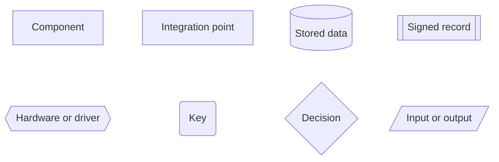
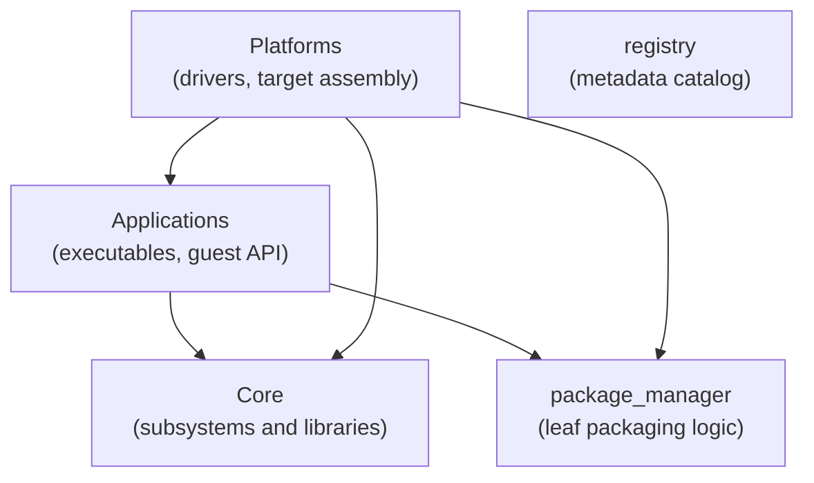
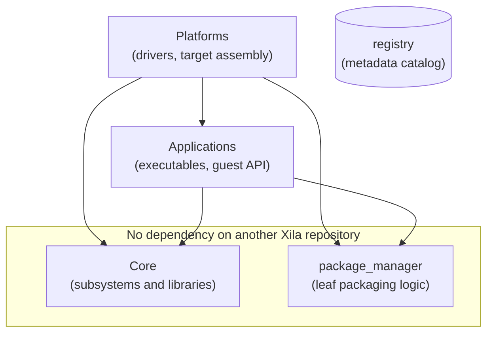
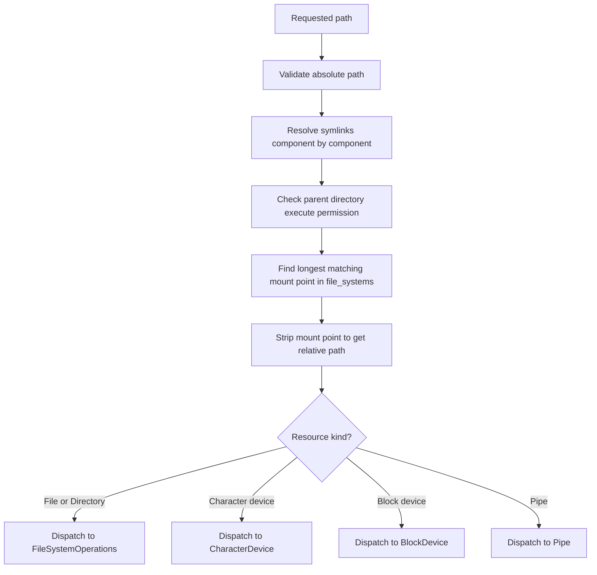
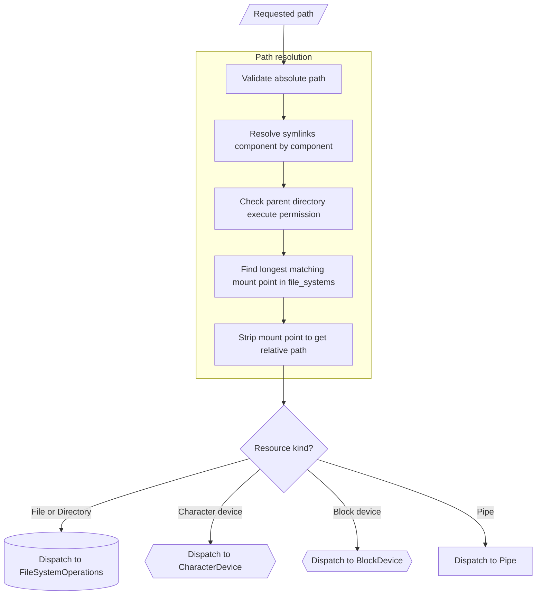
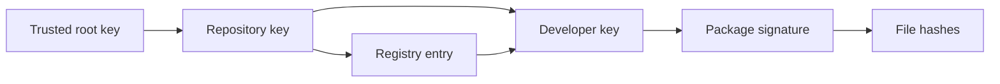
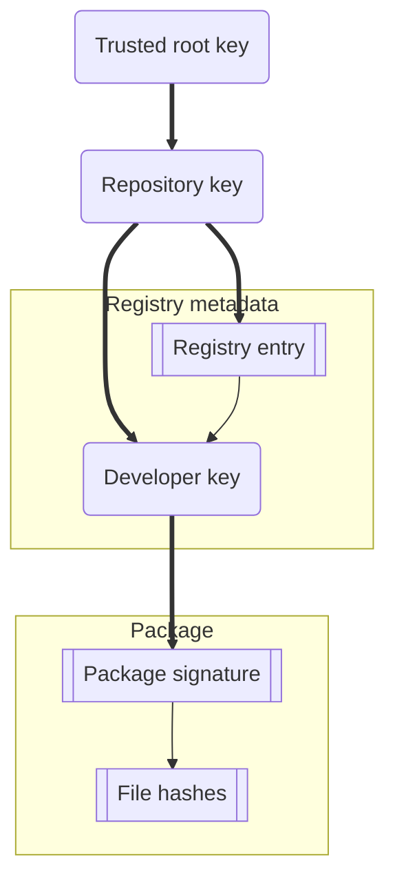
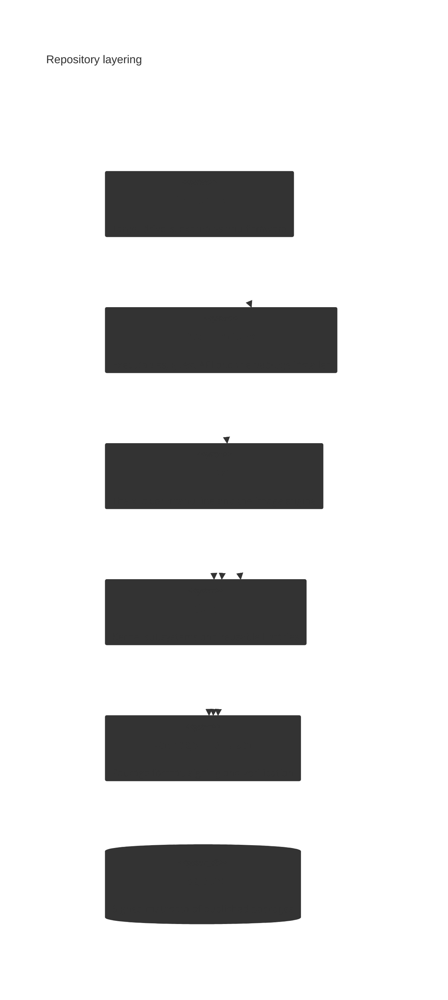
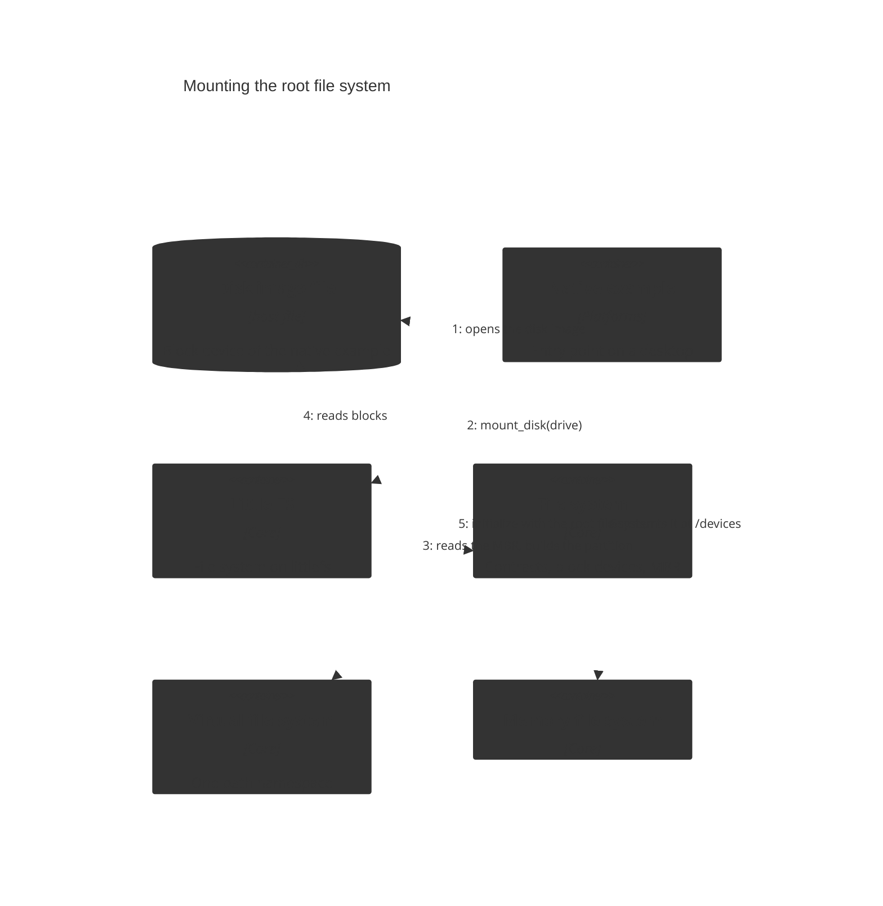
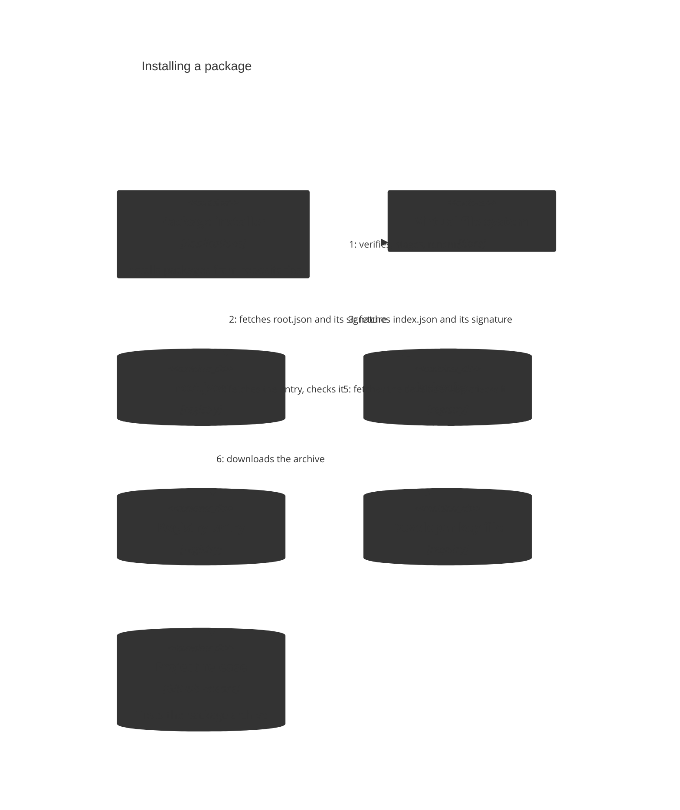

This page compares three renderings of three diagrams of the architecture documentation. It is not linked from the navigation and is excluded from the search index and from the sitemap. Issue [#132](https://github.com/xila-project/website/issues/132) holds the decision.

- **Current**: Mermaid rendered in the browser with the `neutral` or `dark` theme of Mermaid.
- **Option A**: Mermaid rendered at build time to inline SVG with a headless browser. The shapes follow the visual vocabulary below. The site stylesheet sets the colours.
- **Option B**: D2 rendered at build time to inline SVG. The same vocabulary, the same stylesheet.

Option A and option B use the same black and white style, the Montserrat font, thin strokes and square frames. Both follow the theme toggle of the site through CSS variables, so that the dark variant needs no second render.

## Visual vocabulary

One shape always means one kind of thing. This table is the proposed rule for every diagram of the site.

| Shape            | Meaning                                                                                                                                              |
| ---------------- | ---------------------------------------------------------------------------------------------------------------------------------------------------- |
| Rectangle        | Component, crate, repository or step                                                                                                                 |
| Filled rectangle | Integration point: the part that assembles the others                                                                                                |
| Cylinder         | Stored data, such as a catalogue or a file system                                                                                                    |
| Document         | Signed record or document. Option A draws it as a rectangle with side bars: the document shape of Mermaid adds about 60 KB of path data to each node |
| Hexagon          | Hardware or driver                                                                                                                                   |
| Oval             | Cryptographic key. Option A draws it as a pill shaped rectangle: the stadium shape of Mermaid adds about 40 KB of path data to each node             |
| Diamond          | Decision                                                                                                                                             |
| Parallelogram    | Input or output of the flow                                                                                                                          |
| Solid frame      | Layer or group of steps                                                                                                                              |
| Dashed frame     | Boundary: ownership, trust or an optional part                                                                                                       |
| Thin arrow       | Depends on, calls or leads to                                                                                                                        |
| Thick arrow      | Signs or authenticates                                                                                                                               |
| Dashed arrow     | Optional relation or returned value (used in sequence diagrams)                                                                                      |

<div className="diagram-trial-options">
<section>

Option A: Mermaid, build time

<div className="diagram">



</div>
</section>
<section>

Option B: D2, build time

<div className="diagram">

```d2 title="Legend of the visual vocabulary"
grid-columns: 4
grid-gap: 16
component: Component { class: component }
focus: Integration point { class: focus }
stored: Stored data { class: stored }
record: Signed record { class: record }
hardware: Hardware or driver { class: hardware }
key: Key { class: key }
decision: Decision { class: decision }
io: Input or output { class: io }
```

</div>
</section>
</div>

## Architecture: repository layering

Source: [Architecture overview](/explanation/architecture/). Each arrow points from a repository to a repository it depends on. Platforms is the integration point (filled). The registry is stored data (cylinder). Core and package_manager sit in a frame because they depend on no other Xila repository.

<div className="diagram-trial-options">
<section>

Current: Mermaid, browser



</section>
<section>

Option A: Mermaid, build time

<div className="diagram">



</div>
</section>
<section>

Option B: D2, build time

<div className="diagram">

```d2 title="Repository layering"
direction: down

platforms: "Platforms\n(drivers, target assembly)" { class: focus }
applications: "Applications\n(executables, guest API)" { class: component }
leaf: No dependency on another Xila repository { class: boundary
  core: "Core\n(subsystems and libraries)" { class: component }
  package_manager: "package_manager\n(leaf packaging logic)" { class: component }
}
registry: "registry\n(metadata catalog)" { class: stored }

platforms -> applications
platforms -> leaf.core
platforms -> leaf.package_manager
applications -> leaf.core
applications -> leaf.package_manager
```

</div>
</section>
</div>

## Subsystem: virtual file system path resolution

Source: [Virtual file system](/explanation/architecture/subsystems/virtual_file_system/). The five resolution steps sit in a solid frame. The decision is a diamond. A file system is stored data (cylinder). A device is a hexagon. A pipe is a component.

<div className="diagram-trial-options">
<section>

Current: Mermaid, browser



</section>
<section>

Option A: Mermaid, build time

<div className="diagram">



</div>
</section>
<section>

Option B: D2, build time

<div className="diagram">

```d2 title="Virtual file system path resolution"
direction: down

start: Requested path { class: io }
resolution: Path resolution { class: layer
  absolute: Validate absolute path { class: component }
  symlinks: Resolve symlinks component by component { class: component }
  permission: Check parent directory execute permission { class: component }
  mount: Find longest matching mount point in file_systems { class: component }
  strip: Strip mount point to get relative path { class: component }
  absolute -> symlinks -> permission -> mount -> strip
}
kind: Resource kind? { class: decision }
file_system: Dispatch to FileSystemOperations { class: stored }
character: Dispatch to CharacterDevice { class: hardware }
block: Dispatch to BlockDevice { class: hardware }
pipe: Dispatch to Pipe { class: component }

start -> resolution.absolute
resolution.strip -> kind
kind -> file_system: File or Directory
kind -> character: Character device
kind -> block: Block device
kind -> pipe: Pipe
```

</div>
</section>
</div>

## Flow: trust chain of a repository installation

Source: [Package management architecture](/explanation/package-management/). Keys are ovals (pills in option A). Records and the signature are documents (rectangles with side bars in option A). The two dashed frames are trust boundaries: the registry metadata and the package. A thick arrow means that one object signs or authenticates the next. The layout runs top to bottom in options A and B, so that the diagram fits a narrow screen. The current version runs left to right.

<div className="diagram-trial-options">
<section>

Current: Mermaid, browser



</section>
<section>

Option A: Mermaid, build time

<div className="diagram">



</div>
</section>
<section>

Option B: D2, build time

<div className="diagram">

```d2 title="Trust chain of a repository installation"
direction: down

root: Trusted root key { class: key }
repository: Repository key { class: key }
registry: Registry metadata { class: boundary
  entry: Registry entry { class: record }
  developer: Developer key { class: key }
}
package: Package { class: boundary
  signature: Package signature { class: record }
  hashes: File hashes { class: record }
}

root -> repository: { class: trust }
repository -> registry.entry: { class: trust }
repository -> registry.developer: { class: trust }
registry.entry -> registry.developer
registry.developer -> package.signature: { class: trust }
package.signature -> package.hashes
```

</div>
</section>
</div>

## Round 2: C4 views from one model

The views below come from one LikeC4 model, `src/diagrams/model/xila.c4`. Names and relationships come from the code of the workspace submodules (revisions in the header of the model file). Each view sits in a mock documentation section, the way it would appear in a real page.

LikeC4 reads the model and computes the layout at build time. LikeC4 draws a view only in the browser, with React. This trial draws the computed layout as static SVG with `scripts/likec4-svg.mjs`, so a reader needs no JavaScript. The same style sheet themes it. Mermaid has its own C4 diagram types (`C4Context`, `C4Container`, `C4Dynamic`). The first section compares both, and the D2 version of round 1.

What the style sheet can theme, by renderer:

|                                                              | LikeC4 (static SVG of this trial) | Mermaid C4                                                                                                          | D2                      |
| ------------------------------------------------------------ | --------------------------------- | ------------------------------------------------------------------------------------------------------------------- | ----------------------- |
| Colours, strokes, fonts from the theme variables             | Yes                               | Only with `UpdateElementStyle` and `UpdateRelStyle` on every element and relationship, with CSS variables as values | Yes                     |
| Light and dark from one render                               | Yes                               | Yes, with those calls                                                                                               | Yes                     |
| Square corners                                               | Yes                               | No: the radius is an inline `!important` style                                                                      | Yes                     |
| Own shape for each kind of element (hexagon, document, oval) | Yes, in the drawing script        | No: person, system, container, component, database, queue                                                           | Yes, 20 built-in shapes |
| Orthogonal or curved routes                                  | Both, from the layout             | Straight lines                                                                                                      | Orthogonal with ELK     |
| Layout quality                                               | Good (Graphviz)                   | Poor: fixed grid, labels overlap                                                                                    | Good (ELK)              |

### Repository layering

Xila is split across six repositories. Each arrow points from a repository to a repository it depends on, as the Cargo manifests declare. Core and package_manager depend on no other Xila repository. The registry holds signed metadata and no code. Platforms is the integration point.

<div className="diagram-trial-options">
<section>

LikeC4, static SVG

<div className="diagram">

```likec4 view="repositories"

```

</div>
</section>
<section>

Mermaid C4, build time

<div className="diagram">



</div>
</section>
<section>

D2, build time

<div className="diagram">

```d2 title="Repository layering"
direction: down

platforms: "Platforms\n(drivers, target assembly)" { class: focus }
applications: "Applications\n(executables, guest API)" { class: component }
tools: "tools\n(command line, image engine)" { class: component }
leaf: No dependency on another Xila repository { class: boundary
  core: "Core\n(subsystems and libraries)" { class: component }
  package_manager: "package_manager\n(leaf packaging logic)" { class: component }
}
registry: "registry\n(signed metadata)" { class: stored }

platforms -> applications
platforms -> tools
platforms -> leaf.core
platforms -> leaf.package_manager
applications -> leaf.core
applications -> leaf.package_manager
tools -> leaf.core
tools -> leaf.package_manager
```

</div>
</section>
</div>

### Core subsystems

Core subsystems own runtime state. The virtual file system sits in the middle: graphics, network and lifecycle build on it, and it builds on the file system library, the task, time, users and log subsystems. The diagram shows the dependencies that the Cargo manifests of the Core crates declare. It leaves out the other dependencies between these crates, to stay legible.

<div className="diagram">

```likec4 view="subsystems"

```

</div>

### Mounting the root file system

On a desktop, the native example opens a disk image file as a block device. The Little FS library reads the partition table and mounts the Xila partition. The virtual file system takes the result as its root file system. Steps 1 and 5 are calls of the entry point, steps 3 and 4 happen inside `mount_disk`. The numbers give the order in `platforms/examples/native/src/main.rs`. The Nano 33 BLE firmware does the same with its internal flash instead of a disk image. The repository has no SD card driver, so this section shows the two block devices that exist.

<div className="diagram-trial-options">
<section>

LikeC4, static SVG

<div className="diagram">

```likec4 view="mounting"

```

</div>
</section>
<section>

Mermaid C4, build time

<div className="diagram">



</div>
</section>
</div>

### Installing a package

The `package` executable installs a package from a repository. The device pins the root key of the repository. The HTTPS client does not authenticate the server, so nothing that the installer fetches is trusted on its own. The installer verifies each file from the root key, then checks the archive size and SHA-256 digest, stages the files and renames them into `/applications`. The numbers give the order of the steps in `applications/executables/package/src/repository.rs`.

<div className="diagram-trial-options">
<section>

LikeC4, static SVG

<div className="diagram">

```likec4 view="installing"

```

</div>
</section>
<section>

Mermaid C4, build time

<div className="diagram">



</div>
</section>
</div>

### Package trust chain

Three roles, each with its own Ed25519 key. The root key stays offline and signs `root.json`, which names the repository keys. The repository key signs the index, every registry entry and every developer key file. The developer key signs the package manifest. The device pins the root key and verifies the chain down to the file hashes. A thick arrow means that one object signs another.

<div className="diagram">

```likec4 view="trust"

```

</div>
