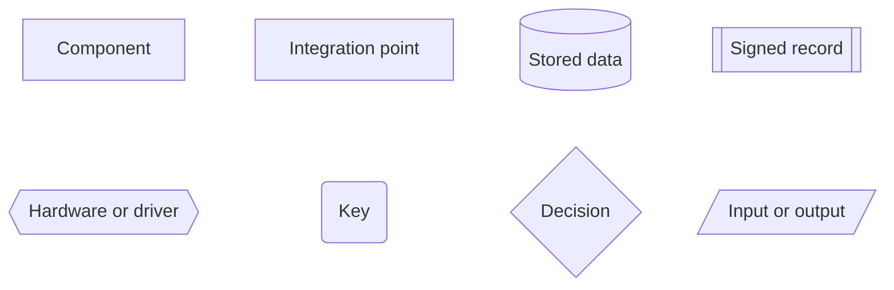
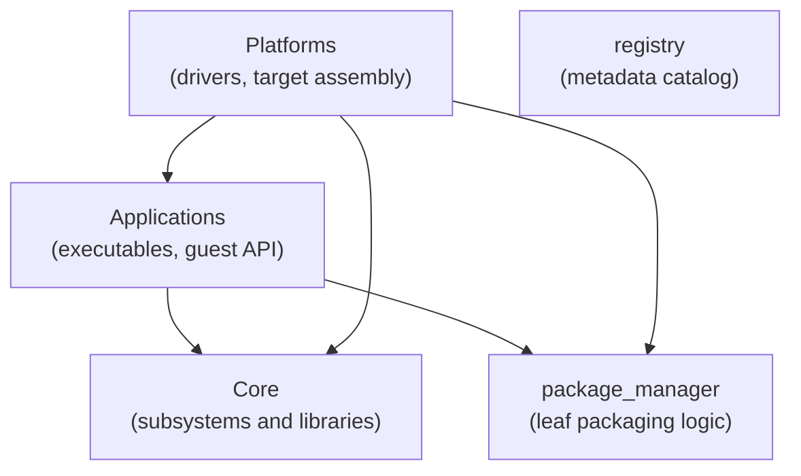
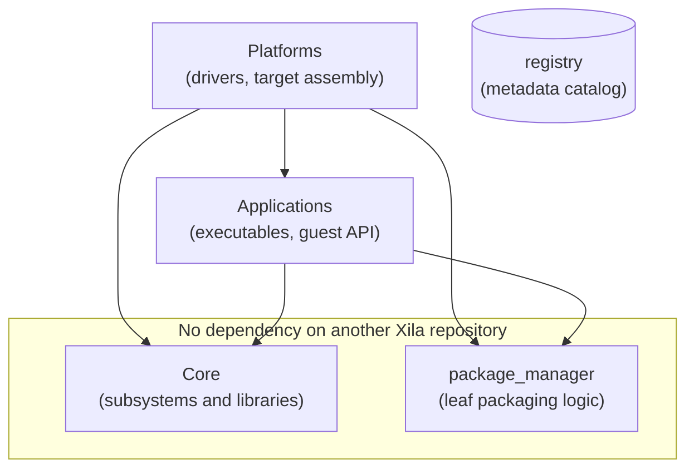
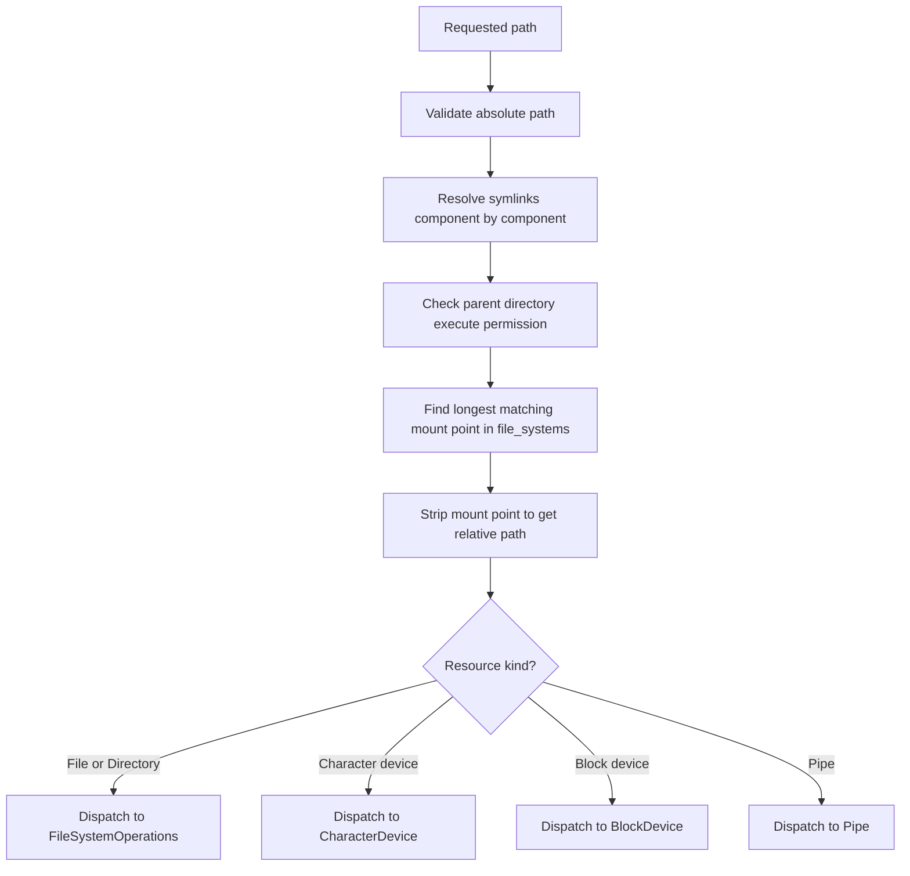
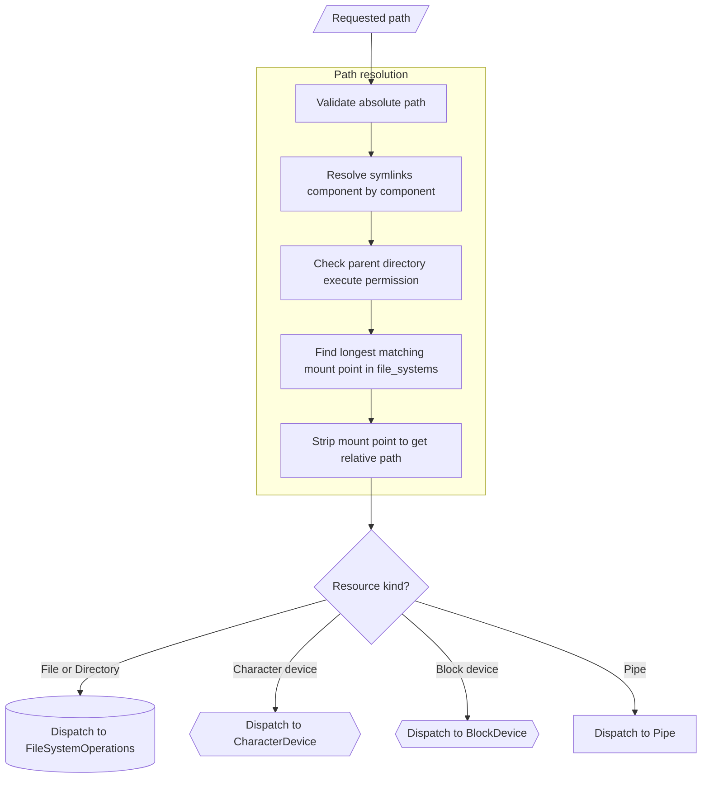
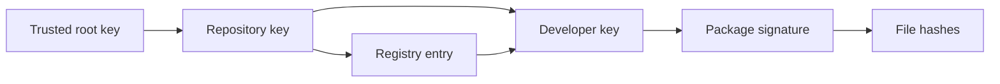
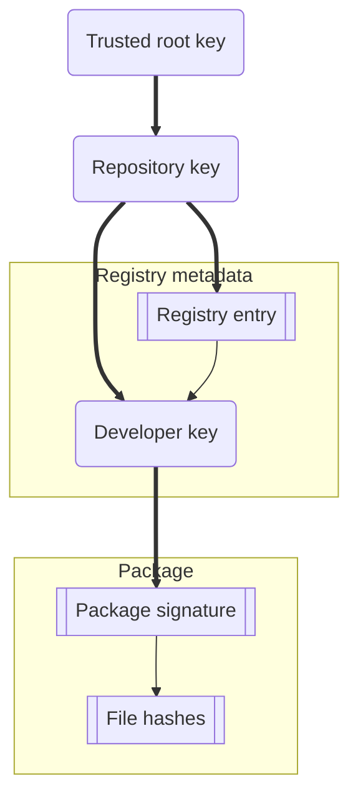

This page compares three renderings of three diagrams of the architecture documentation. It is not linked from the navigation and is excluded from the search index and from the sitemap. Issue [#132](https://github.com/xila-project/website/issues/132) holds the decision.

- **Current**: Mermaid rendered in the browser with the `neutral` or `dark` theme of Mermaid.
- **Option A**: Mermaid rendered at build time to inline SVG with a headless browser. The shapes follow the visual vocabulary below. The site stylesheet sets the colours.
- **Option B**: D2 rendered at build time to inline SVG. The same vocabulary, the same stylesheet.

Option A and option B use the same black and white style, the Montserrat font, thin strokes and square frames. Both follow the theme toggle of the site through CSS variables, so that the dark variant needs no second render.

## Visual vocabulary

One shape always means one kind of thing. This table is the proposed rule for every diagram of the site.

| Shape            | Meaning                                                                                                                                              |
| ---------------- | ---------------------------------------------------------------------------------------------------------------------------------------------------- |
| Rectangle        | Component, crate, repository or step                                                                                                                 |
| Filled rectangle | Integration point: the part that assembles the others                                                                                                |
| Cylinder         | Stored data, such as a catalogue or a file system                                                                                                    |
| Document         | Signed record or document. Option A draws it as a rectangle with side bars: the document shape of Mermaid adds about 60 KB of path data to each node |
| Hexagon          | Hardware or driver                                                                                                                                   |
| Oval             | Cryptographic key. Option A draws it as a pill shaped rectangle: the stadium shape of Mermaid adds about 40 KB of path data to each node             |
| Diamond          | Decision                                                                                                                                             |
| Parallelogram    | Input or output of the flow                                                                                                                          |
| Solid frame      | Layer or group of steps                                                                                                                              |
| Dashed frame     | Boundary: ownership, trust or an optional part                                                                                                       |
| Thin arrow       | Depends on, calls or leads to                                                                                                                        |
| Thick arrow      | Signs or authenticates                                                                                                                               |
| Dashed arrow     | Optional relation or returned value (used in sequence diagrams)                                                                                      |

<div className="diagram-trial-options">
<section>

Option A: Mermaid, build time

<div className="diagram">



</div>
</section>
<section>

Option B: D2, build time

<div className="diagram">

```d2 title="Legend of the visual vocabulary"
grid-columns: 4
grid-gap: 16
component: Component { class: component }
focus: Integration point { class: focus }
stored: Stored data { class: stored }
record: Signed record { class: record }
hardware: Hardware or driver { class: hardware }
key: Key { class: key }
decision: Decision { class: decision }
io: Input or output { class: io }
```

</div>
</section>
</div>

## Architecture: repository layering

Source: [Architecture overview](/explanation/architecture/). Each arrow points from a repository to a repository it depends on. Platforms is the integration point (filled). The registry is stored data (cylinder). Core and package_manager sit in a frame because they depend on no other Xila repository.

<div className="diagram-trial-options">
<section>

Current: Mermaid, browser



</section>
<section>

Option A: Mermaid, build time

<div className="diagram">



</div>
</section>
<section>

Option B: D2, build time

<div className="diagram">

```d2 title="Repository layering"
direction: down

platforms: "Platforms\n(drivers, target assembly)" { class: focus }
applications: "Applications\n(executables, guest API)" { class: component }
leaf: No dependency on another Xila repository { class: boundary
  core: "Core\n(subsystems and libraries)" { class: component }
  package_manager: "package_manager\n(leaf packaging logic)" { class: component }
}
registry: "registry\n(metadata catalog)" { class: stored }

platforms -> applications
platforms -> leaf.core
platforms -> leaf.package_manager
applications -> leaf.core
applications -> leaf.package_manager
```

</div>
</section>
</div>

## Subsystem: virtual file system path resolution

Source: [Virtual file system](/explanation/architecture/subsystems/virtual_file_system/). The five resolution steps sit in a solid frame. The decision is a diamond. A file system is stored data (cylinder). A device is a hexagon. A pipe is a component.

<div className="diagram-trial-options">
<section>

Current: Mermaid, browser



</section>
<section>

Option A: Mermaid, build time

<div className="diagram">



</div>
</section>
<section>

Option B: D2, build time

<div className="diagram">

```d2 title="Virtual file system path resolution"
direction: down

start: Requested path { class: io }
resolution: Path resolution { class: layer
  absolute: Validate absolute path { class: component }
  symlinks: Resolve symlinks component by component { class: component }
  permission: Check parent directory execute permission { class: component }
  mount: Find longest matching mount point in file_systems { class: component }
  strip: Strip mount point to get relative path { class: component }
  absolute -> symlinks -> permission -> mount -> strip
}
kind: Resource kind? { class: decision }
file_system: Dispatch to FileSystemOperations { class: stored }
character: Dispatch to CharacterDevice { class: hardware }
block: Dispatch to BlockDevice { class: hardware }
pipe: Dispatch to Pipe { class: component }

start -> resolution.absolute
resolution.strip -> kind
kind -> file_system: File or Directory
kind -> character: Character device
kind -> block: Block device
kind -> pipe: Pipe
```

</div>
</section>
</div>

## Flow: trust chain of a repository installation

Source: [Package management architecture](/explanation/package-management/). Keys are ovals (pills in option A). Records and the signature are documents (rectangles with side bars in option A). The two dashed frames are trust boundaries: the registry metadata and the package. A thick arrow means that one object signs or authenticates the next. The layout runs top to bottom in options A and B, so that the diagram fits a narrow screen. The current version runs left to right.

<div className="diagram-trial-options">
<section>

Current: Mermaid, browser



</section>
<section>

Option A: Mermaid, build time

<div className="diagram">



</div>
</section>
<section>

Option B: D2, build time

<div className="diagram">

```d2 title="Trust chain of a repository installation"
direction: down

root: Trusted root key { class: key }
repository: Repository key { class: key }
registry: Registry metadata { class: boundary
  entry: Registry entry { class: record }
  developer: Developer key { class: key }
}
package: Package { class: boundary
  signature: Package signature { class: record }
  hashes: File hashes { class: record }
}

root -> repository: { class: trust }
repository -> registry.entry: { class: trust }
repository -> registry.developer: { class: trust }
registry.entry -> registry.developer
registry.developer -> package.signature: { class: trust }
package.signature -> package.hashes
```

</div>
</section>
</div>
