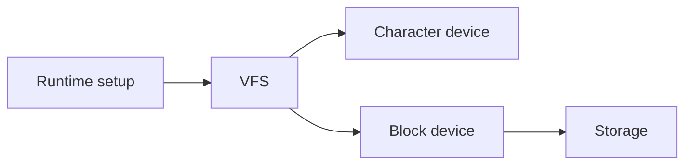

import HostReference from "@/components/HostReference.astro";
import CodeReference from "@/components/CodeReference.astro";

Drivers connect Xila services to devices. Core and Platforms provide driver crates for different runtimes.

The following diagram shows the relationship between a runtime, the virtual file system (VFS), and devices.

Runtime setup mounts devices in the VFS. Character devices provide byte-oriented access. Block devices support storage. The native and browser examples mount LittleFS on block storage and register character devices at boot. Both examples mount the Wasm, graphical shell, command-line shell, settings, file manager, terminal, and activity executables under `/applications/executables/`. The native example also mounts the package and, on Unix, debug executables. See [Virtual file system](/explanation/architecture/subsystems/virtual_file_system/).

| Crate                                                        | Package                       | Description                                                                                    |
| ------------------------------------------------------------ | ----------------------------- | ---------------------------------------------------------------------------------------------- |
| <HostReference crate="drivers_core" />                       | `xila-drivers-core`           | [Core](/explanation/architecture/drivers/core/): minimal devices and Wi-Fi mock.               |
| <HostReference crate="drivers_neural_network" />             | `xila-drivers-neural-network` | [Neural network](/explanation/architecture/libraries/neural_network/): neural network drivers. |
| <HostReference crate="drivers_peripherals" />                | `xila-drivers-peripherals`    | [Device](/explanation/architecture/libraries/device/): peripheral drivers.                     |
| <HostReference repo="platforms" crate="drivers_espressif" /> | `xila-drivers-espressif`      | [Espressif](/explanation/architecture/drivers/espressif/): Espressif drivers.                  |
| <HostReference repo="platforms" crate="drivers_headless" />  | `xila-drivers-headless`       | [Headless](/explanation/architecture/drivers/headless/): headless runtime drivers.             |
| <HostReference repo="platforms" crate="drivers_native" />    | `xila-drivers-native`         | [Native](/explanation/architecture/drivers/native/): host integrations.                        |
| <CodeReference repo="platforms" path="drivers/nordic" />     | `xila-drivers-nordic`         | [Nordic](/explanation/architecture/drivers/nordic/): Nordic hardware drivers.                  |
| <HostReference repo="platforms" crate="drivers_shared" />    | `xila-drivers-shared`         | [Shared](/explanation/architecture/drivers/shared/): reusable devices.                         |
| <HostReference repo="platforms" crate="drivers_std" />       | `xila-drivers-std`            | [Std](/explanation/architecture/drivers/std/): standard-library services.                      |
| <HostReference repo="platforms" crate="drivers_wasm" />      | `xila-drivers-wasm`           | [Wasm](/explanation/architecture/drivers/wasm/): browser runtime drivers.                      |
