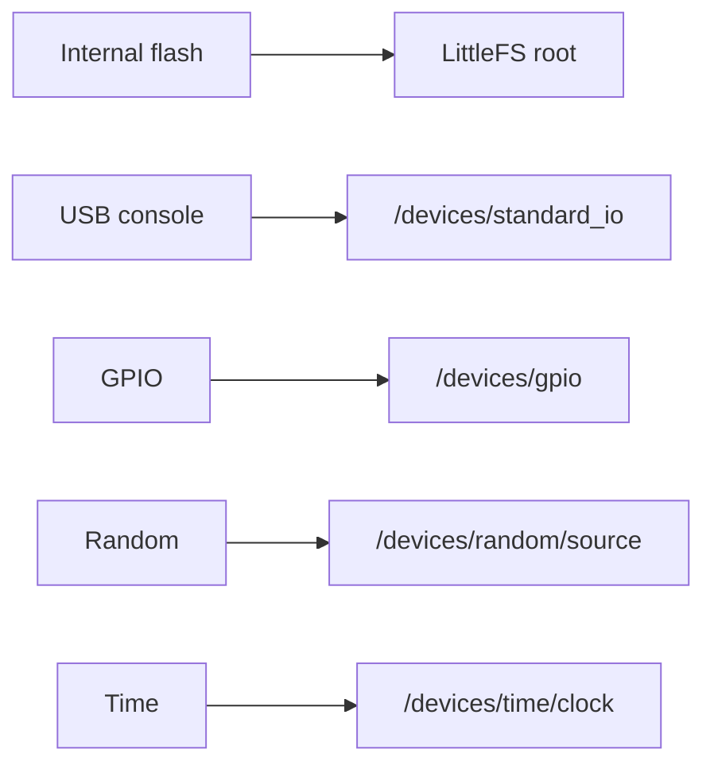

import CodeReference from "@/components/CodeReference.astro";

The Platforms `drivers_nordic` crate supplies drivers for the nRF52840 used by the Arduino Nano 33 BLE. The board example assembles these drivers into a Xila runtime.

## Context

The board runs without a host operating system. Its example combines the Nordic executor, memory and time implementations with internal flash, random number generation, GPIO and a USB console.

## How it works

The following diagram shows how the example connects drivers to its virtual file system (VFS).

The flash block device backs LittleFS at the root. USB standard input passes through the shared terminal input device; output and error use USB output. GPIO, random and time devices are mounted separately.

The example mounts GPIO character devices `/devices/gpio/d0` through `/devices/gpio/d13`, `/devices/gpio/a0` through `/devices/gpio/a7`, and `led_red`, `led_green` and `led_blue` under `/devices/gpio/`. D13 starts low, which turns its LED off. The RGB LEDs are active low and start high, also off.

The USB CDC serial console receives bytes and sends output. The shared line editor echoes input, accepts backspace or delete, and uses Ctrl-U to erase a line. Ctrl-C discards the line and supplies an empty line; Ctrl-D on an empty line reports end of input. Tab becomes a space. CR or LF commits a line with a newline; an LF immediately following CR is consumed. Escape sequences are consumed. A full input line rings the terminal bell.

## Design choices and trade-offs

The terminal editor uses fixed-capacity buffers. Its completed-line queue must have room for the line and newline before it commits the line. The example formats the flash file system when mounting it fails.

## API reference

- <CodeReference repo="platforms" path="drivers/nordic" />: Nordic driver
  source.
- <CodeReference repo="platforms" path="examples/nano_33_ble/src/firmware.rs" />
  : Runtime assembly.
- <CodeReference repo="platforms" path="examples/nano_33_ble/src/pins.rs" />:
  Board pin mappings.
- <CodeReference
    repo="platforms"
    path="drivers/shared/src/devices/terminal/logic.rs"
  />
  : Terminal line editor.

## Related

- [Drivers](/explanation/architecture/drivers/)
- [Run Xila on the Nano 33 BLE](/how-to/run-nano-33-ble/)
