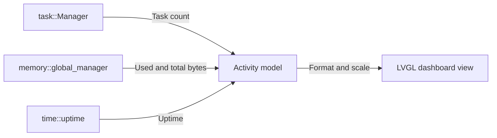

import HostReference from "@/components/HostReference.astro";
import CodeReference from "@/components/CodeReference.astro";

The Activity executable (<HostReference repo="applications" crate="activity" />) provides a real-time system monitoring dashboard for Xila. It reports uptime, active task counts, and global allocator usage, and includes an optional bounded workload to demonstrate resource consumption under load.

## Context

Resource monitoring on embedded systems must balance observability against CPU and heap overhead. A monitoring tool that continuously polls kernel locks or creates unboundedly growing history buffers risks perturbing the exact system performance it attempts to observe.

Activity addresses this challenge as a standalone graphical executable:

- It runs within both the native runtime (<CodeReference repo="platforms" path="examples/native/src/main.rs" />) and the browser runtime (<CodeReference repo="platforms" path="examples/wasm/src/main.rs" />), mounted at `/applications/executables/activity`.
- It samples metrics asynchronously from core subsystems outside the graphics lock.
- It operates with bounded allocations, retaining a fixed number of samples for chart rendering.
- It provides a safe, transient test workload that expires automatically without spawning detached threads or tasks.

## How it works

### Sampling and event loop

The following diagram shows the sampling loop and data flow between kernel subsystems and the Activity user interface.



The application runs a continuous asynchronous event loop. Each iteration checks for pending user interface events, evaluates the status of any active test workload, and collects fresh metrics whenever the configured sample interval expires:

1. **Task count**: Queries <HostReference crate="task" kind="struct" symbol="Manager" /> via `get_task_count()` to determine the number of currently scheduled tasks.
2. **Memory allocation**: Reads heap utilization from <HostReference crate="memory" /> via `global_manager().get_used()` and `get_total_size()`. If capacity is zero or smaller than used bytes, capacity is marked unavailable.
3. **Uptime**: Retrieves monotonic elapsed time from <HostReference crate="time" /> to format the running session duration.

Metric retrieval occurs outside the graphics lock, ensuring that slow system queries never block user interface interactivity.

### Dashboard layout and visualization

Activity renders its dashboard using LVGL through an <HostReference crate="graphics" kind="struct" symbol="OwnedWindow" />:

- **Metrics summary**: Displays formatted uptime (`D d HH:MM:SS`), total task count, and numerical heap usage (scaled to bytes, KiB, or MiB).
- **Memory share bar**: A visual progress bar displaying used heap memory as a permille value (0 to 1000) of total heap capacity.
- **Historical memory chart**: A 60-point line series charting heap usage over time. Points are scaled in 16-byte steps (`bytes / 16`) to fit signed 32-bit chart values, with dynamic axis bounds padded by at least 2,048 bytes to keep flat or subtly varying traces readable.
- **Adaptive layout**: When window dimensions fall below 560 pixels in width or 360 pixels in height, the dashboard switches to a compact layout with reduced padding and tighter widget spacing.

### Refresh interval selection

Users can toggle the sampling rate using a segmented button control offering three standard periods: 250 milliseconds, 1 second, and 2 seconds. When launched from the command line, the executable accepts an `--interval-ms` argument between 100 and 10,000 milliseconds:

```text
/applications/executables/activity --interval-ms 500
```

### Bounded demo workload

Activity includes a built-in demo workload to observe memory and CPU activity. When toggled on:

- It allocates an exact 4,096-byte scratch buffer.
- The async loop ticks the workload, processing at most one 512-byte slice every 25 milliseconds.
- Missed ticks are discarded rather than queued, avoiding CPU saturation.
- The workload automatically expires after 10 seconds, freeing its scratch buffer without leaving background tasks or persistent executor allocations.

## Design choices and trade-offs

- **Asynchronous polling over push telemetry**: Polling at user-controlled intervals avoids intrusive event subscriptions or notification buffers inside the kernel task and memory managers.
- **Scaled integer chart points**: Dividing sample byte counts by 16 allows large memory sizes to fit standard integer coordinates without floating-point math on platforms lacking hardware floating-point units.
- **Inline workload execution**: The test workload executes directly within the application's cooperative tick loop rather than launching separate kernel tasks. This guarantees that stopping the workload immediately halts its execution.

## Limits

- **Global metrics only**: The dashboard displays total task counts and aggregate heap metrics; it does not provide per-task CPU utilization or per-task memory breakdowns.
- **Fixed historical depth**: The history chart retains exactly 60 samples. Older samples are dropped as new ones arrive.
- **Unvarying memory capacity**: Platforms that do not expose a fixed allocator capacity report used bytes only and omit capacity percentage calculations.

## API reference

- <HostReference repo="applications" crate="activity" />: Activity executable
  crate.
- <HostReference crate="executable" kind="trait" symbol="ExecutableTrait" />:
  Core host executable interface.
- <HostReference crate="task" kind="struct" symbol="Manager" />: Kernel task
  management service.
- <HostReference crate="graphics" kind="struct" symbol="OwnedWindow" />: Managed
  graphical window surface.
- <HostReference crate="memory" />: Global heap allocator manager.
- <HostReference crate="time" />: Monotonic time and uptime service.

## Related

- [Command-line shell](/explanation/architecture/executables/command_line_shell/)
- [Settings](/explanation/architecture/executables/settings/)
- [Debug](/explanation/architecture/executables/debug/)
- [Executables](/explanation/architecture/executables/)
