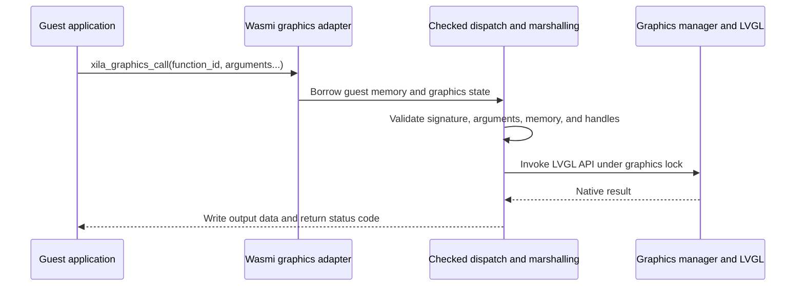

import CodeReference from "@/components/CodeReference.astro";
import HostReference from "@/components/HostReference.astro";
import GuestReference from "@/components/GuestReference.astro";

Xila's graphics bindings connect sandboxed WebAssembly (Wasm) guest applications to the LVGL graphics subsystem. The bindings generator in the Core repository (<CodeReference path="subsystems/graphics/bindings_generator" />) generates the API catalog. The host runtime in Applications (<CodeReference repo="applications" path="executables/wasm/src/host/graphics/mod.rs" />) performs checked dispatch and memory validation.

## Context

Guest applications compile to `wasm32-wasip1` and run in an isolated linear memory space. They cannot dereference host pointers or call native C libraries directly. User interface operations must therefore cross an explicit foreign function interface boundary.

The graphics bindings solve this problem without exposing raw pointers or compromising kernel safety:

- The generator scans LVGL C headers and builds a typed catalog of functions, types, and constants.
- A build-time registry filters cataloged calls to implemented host dispatchers.
- The build generates safe Rust wrappers for guest applications. These wrappers provide idiomatic method calls that translate into a single host multiplexer import.
- At runtime, host dispatchers validate arguments and memory bounds before invoking native LVGL routines.

## How it works

### Foreign function interface dispatch

The following diagram shows the sequence of a graphics call from guest code through host dispatch to the graphics manager.

When a guest application calls a graphics function such as <GuestReference repo="applications" crate="wasm" kind="fn" symbol="button_create" />, the safe wrapper places up to seven machine-word arguments into registers. It then calls the host import `xila_graphics_call`. The Wasmi adapter (<CodeReference repo="applications" path="executables/wasm/src/host/graphics/wasmi.rs" />) checks that the calling task has graphics capabilities. It also borrows the guest linear memory.

The dispatch layer validates the function identifier and the parameter count. It resolves handle identifiers in the object table of the virtual machine. The call then acquires the graphics manager lock (<HostReference crate="graphics" kind="struct" symbol="Manager" />) and runs the native LVGL operation. If the function produces output data, the dispatcher copies the results into guest memory and returns a status code.

### Handle-based object virtualization

Guest code never receives or manipulates native LVGL pointers (`lv_obj_t*`). The host assigns 32-bit generational integer handles instead:

- The object table of each virtual machine has no fixed entry cap. Retained resources are bounded by the limits below.
- Each handle identifies a specific widget type and native pointer.
- Calling <GuestReference repo="applications" crate="wasm" kind="fn" symbol="object_delete" /> deletes the LVGL widget and invalidates the handle.
- A handle packs a 16-bit slot and a 16-bit generation. Deleting an object frees its slot for reuse with a higher generation. A stale handle is therefore rejected until the same slot has been reused 65,536 times. Handles are not cryptographic capabilities.
- When an application terminates or traps, the host tears down the window hierarchy and releases all graphics resources.

### Bounded string and array marshalling

All data transfers across the boundary are strictly bounded. This keeps memory usage deterministic:

- Strings: NUL-terminated strings are limited to 1,024 bytes, or 4,097 bytes for text areas. The text is validated as UTF-8 and copied synchronously into host-owned buffers.
- Button maps: Pointer arrays for button matrices are copied into allocations owned by the virtual machine. The cap is 64 entries and 8,192 bytes in total.
- Grid layouts: Track arrays are checked for sentinel termination and copied into host memory. The limit is 32 tracks per axis and 512 descriptors per virtual machine.

## Design choices and trade-offs

- Single multiplexer import: One host function (`xila_graphics_call`) replaces hundreds of individual imports. This simplifies linker configuration and reduces the module binary size.
- Host-owned allocations: Copying complex structures such as button-map string arrays and canvas pixels into host memory prevents guest memory growth or reallocation from corrupting native LVGL data structures.
- Static catalog filtering: The build generates wrappers only for verified host dispatchers. Uncallable APIs do not compile, so guest code fails at compile time instead of at runtime.

## Limits

- Object capacity: Each guest instance has no fixed object cap. Retained resources are bounded by the per-virtual-machine limits.
- Canvas memory: Host-owned indexed canvas pixel buffers are capped at 65,536 pixels per virtual machine.
- Unsupported widgets: Tables, Menus, and Messageboxes are not exposed in the guest API.

## API reference

- <HostReference crate="graphics" kind="struct" symbol="Manager" />: Core
  graphics subsystem manager.
- <GuestReference
    repo="applications"
    crate="wasm"
    kind="fn"
    symbol="window_create"
  />
  : Guest window constructor.
- <GuestReference
    repo="applications"
    crate="wasm"
    kind="fn"
    symbol="object_delete"
  />
  : Guest object destructor.
- <CodeReference path="subsystems/graphics/src/call/handlers.rs" />: Graphics
  call handlers (in Core).

## Related

- [Graphics bindings reference](/reference/graphics-bindings/)
- [Wasm runtime](/reference/wasm-runtime/)
- [Wasm](/explanation/architecture/executables/wasm/)
