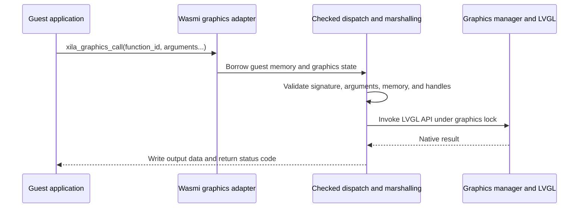

import CodeReference from "@/components/CodeReference.astro";
import HostReference from "@/components/HostReference.astro";
import GuestReference from "@/components/GuestReference.astro";

Xila's graphics bindings bridge sandboxed WebAssembly (Wasm) guest applications to the LVGL graphics subsystem. The bindings generator in the Core repository (<CodeReference path="subsystems/graphics/bindings_generator" />) generates the API catalog, while the host runtime in Applications (<CodeReference repo="applications" path="executables/wasm/src/host/graphics/mod.rs" />) handles checked dispatch and memory validation.

## Context

Guest applications compile to `wasm32-wasip1` and execute inside an isolated linear memory space. Because they cannot directly dereference host pointers or call native C libraries, user interface operations must cross an explicit foreign function interface boundary.

The graphics bindings system solves this problem without exposing raw pointers or compromising kernel safety:

- The generator scans LVGL C headers and builds a typed catalog of functions, types, and constants.
- A build-time registry filters cataloged calls to implemented host dispatchers.
- Safe Rust wrappers are generated for guest applications, providing idiomatic method calls that translate into a single host multiplexer import.
- At runtime, host dispatchers validate arguments and memory bounds before invoking native LVGL routines.

## How it works

### Foreign function interface dispatch

The following diagram shows the sequence of a graphics call from guest code through host dispatch to the graphics manager.

When a guest application calls a graphics function such as <GuestReference repo="applications" crate="wasm" kind="fn" symbol="button_create" />, the safe wrapper places up to seven machine-word arguments into registers and calls the host import `xila_graphics_call`. The Wasmi adapter (<CodeReference repo="applications" path="executables/wasm/src/host/graphics/wasmi.rs" />) confirms that the calling task owns graphics capabilities and borrows the guest linear memory.

The dispatch layer validates the function identifier, verifies parameter counts, and resolves handle identifiers in the virtual machine's object table. The call then acquires the graphics manager lock (<HostReference crate="graphics" kind="struct" symbol="Manager" />) and executes the native LVGL operation. If the function produces output data, the dispatcher copies results into guest memory and returns a status code.

### Handle-based object virtualization

Guest code never receives or manipulates native LVGL pointers (`lv_obj_t*`). Instead, the host assigns monotonically increasing integer handles:

- The per-VM object table maintains up to 256 active object entries.
- Each handle identifies a specific widget type and native pointer.
- Calling <GuestReference repo="applications" crate="wasm" kind="fn" symbol="object_delete" /> deletes the LVGL widget and invalidates the handle.
- Handles are not reused within a single execution lifetime, preventing stale handle references from interacting with newly created widgets.
- When an application terminates or traps, the host tears down the window hierarchy and releases all allocated graphics resources.

### Bounded string and array marshalling

To maintain deterministic memory usage, all data transfers across the boundary are strictly bounded:

- Strings: NUL-terminated strings are limited to 1,024 bytes (or 4,097 bytes for text areas). Text is validated as UTF-8 and copied synchronously into host-owned buffers.
- Button maps: Pointer arrays for button matrices are copied into VM-owned allocations, capping items at 64 entries and 8,192 bytes total.
- Grid layouts: Track arrays are validated for sentinel termination and copied into host memory, with a limit of 32 tracks per axis and 512 descriptors per VM.

## Design choices and trade-offs

- Single multiplexer import: Using one host function (`xila_graphics_call`) instead of hundreds of individual imports simplifies linker configuration and reduces module binary size.
- Host-owned allocations: Copying complex structures (such as button-map string arrays and canvas pixels) into host memory ensures that guest memory growth or reallocation cannot corrupt native LVGL data structures.
- Static catalog filtering: Generating wrappers only for verified host dispatchers prevents compilation of uncallable APIs, ensuring that guest code fails at compile time rather than encountering runtime errors.

## Limits

- Object capacity: Each guest instance can allocate at most 256 objects concurrently.
- Canvas memory: Host-owned indexed canvas pixel buffers are capped at 65,536 pixels per VM.
- Unsupported widgets: Tables, Menus, and Messageboxes are not exposed in the guest API.

## API reference

- <HostReference crate="graphics" kind="struct" symbol="Manager" />: Core
  graphics subsystem manager.
- <GuestReference
    repo="applications"
    crate="wasm"
    kind="fn"
    symbol="window_create"
  />
  : Guest window constructor.
- <GuestReference
    repo="applications"
    crate="wasm"
    kind="fn"
    symbol="object_delete"
  />
  : Guest object destructor.
- <CodeReference
    repo="applications"
    path="executables/wasm/src/host/graphics/dispatch.rs"
  />
  : Host dispatch implementation.

## Related

- [Graphics bindings reference](/reference/graphics-bindings/)
- [Wasm runtime](/reference/wasm-runtime/)
- [Wasm](/explanation/architecture/executables/wasm/)
