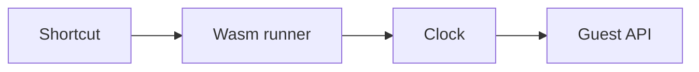

import HostReference from "@/components/HostReference.astro";
import GuestReference from "@/components/GuestReference.astro";
import CodeReference from "@/components/CodeReference.astro";

Clock shows time and provides an alarm, stopwatch and countdown timer. The Applications repository provides it as a WebAssembly (Wasm) guest application (`wasm32-wasip1`).

## Context

The guest uses Xila graphics through the guest API. Its package metadata identifies the Wasm entrypoint, and its shortcut launches it through `/applications/executables/wasm`. The native and browser image profiles include this bundle.

## How it works

The interface reads system time and tracks elapsed time. Settings are stored in alternating files.

The following diagram shows the launch path.

The shortcut starts the Wasm runner with the bundle entrypoint. The guest uses the guest API for its interface.

## Design choices and trade-offs

Alarm and timer tones use `/devices/audio/playback` when audio is available.

## Limits

The stopwatch retains at most 32 laps; the timer is limited to 23 hours, 59 minutes and 59 seconds.

## API reference

- <HostReference repo="applications" crate="clock" />: application source.
- <GuestReference repo="applications" crate="wasm" />: guest API Rustdoc.
- <CodeReference repo="applications" path="packaging/clock.json" />: package
  metadata.

## Related

- [Wasm runtime](/explanation/architecture/executables/wasm/)
- [Guest API reference](/reference/guest/)
