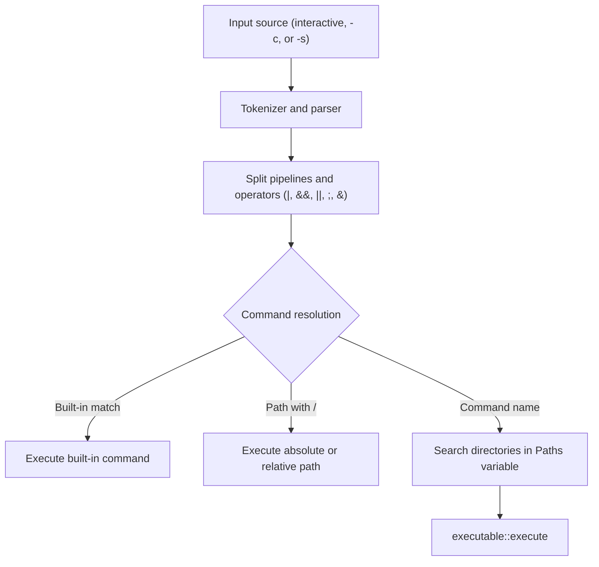

import HostReference from "@/components/HostReference.astro";
import CodeReference from "@/components/CodeReference.astro";

The command-line shell executable (<HostReference repo="applications" crate="command_line_shell" />) is an interactive text shell and scripting environment for Xila. It parses command lines with bounded buffers, runs streaming pipelines, provides built-in commands, and resolves external native and WebAssembly (Wasm) executables.

## Context

Embedded systems and microcontrollers need a diagnostic and scripting shell that cannot exhaust heap memory through runaway tokenization or unbounded pipeline buffers. Operators also need familiar shell mechanics such as pipes, redirections, conditional execution, and path searching.

The command-line shell meets these requirements:

- It provides an interactive prompt over standard input and output streams.
- It parses command lines using strictly bounded static and heap buffers.
- It connects pipeline stages concurrently through in-memory virtual file system (VFS) pipes.
- It resolves commands against built-in handlers and the directories listed in environment variables.
- It limits the recursion depth of nested shell scripts. This protects the stack and the task table from exhaustion.

## How it works

### Invocation and execution modes

The following diagram shows how the shell processes input through parsing, resolution, and execution.

The shell has four entry paths:

1. **Interactive line loop**: With no arguments, the shell authenticates the user if needed. It prints a prompt (`user@host:directory$ `) and processes lines from standard input until end-of-file.
2. **Command string (`-c`)**: Runs a command line passed as an argument. The line can contain pipelines, conditionals, and redirections.
3. **Script file (`-s PATH`)**: Reads a file in the virtual file system and runs its lines in order. A syntax error, a read failure, or a non-zero exit code stops the script.
4. **Literal arguments**: When invoked programmatically, the shell runs the command with pre-separated argument strings. It does not re-tokenize the input and does not perform shell expansion.

Nested shell invocations track their depth in the `XILA_SHELL_DEPTH` environment variable. The shell rejects execution when the depth exceeds four levels. This prevents infinite script loops and unbounded task trees.

### Tokenization and operator composition

The tokenizer converts input strings up to 4,096 bytes into at most 256 tokens:

- **Pipelines (`|`)**: Splits commands into stages. Each stage runs as a spawned task. Adjacent stages communicate through an unnamed VFS pipe (<HostReference crate="virtual_file_system" kind="struct" symbol="File" />) with a 512-byte ring buffer.
- **Conditional chaining (`&&` and `||`)**: Runs the right-hand command only when the left-hand command succeeds (status 0) or fails (non-zero status), respectively.
- **Sequential separation (`;`)**: Runs commands in sequence regardless of the preceding exit status.
- **Background jobs (`&`)**: Runs the pipeline in a detached task. Standard input is redirected to `/devices/standard_io/null`. The shell tracks up to eight background tasks and joins them when it exits.
- **Redirection**: Redirects standard input (`<`), standard output (`>` truncates, `>>` appends), and standard error (`2>` truncates, `2>>` appends) to VFS files.

### Expansion rules

Before executing a command, the shell expands variables in unquoted text and double-quoted strings (`"..."`):

- `$VARIABLE` and `${VARIABLE}`: Replaced by the value of the task environment variable with the same name.
- `$?`: Replaced by the exit status of the previous foreground command.
- Single quotes (`'...'`): Keep all enclosed characters literal. No variable expansion or escape processing happens inside single quotes.

Expanded command strings cannot exceed 8,192 bytes. The shell does not support command substitution (`$(...)` or backticks).

### Command resolution

The shell resolves each command as follows:

1. **Built-in commands**: The shell checks its built-in lookup table first. Built-ins include file system commands (`ls`, `cat`, `mkdir`, `rm`, `cp`, `mv`, `stat`), environment commands (`export`, `unset`, `printenv`), network commands (`ping`, `ip`, `dns_resolve`, `web_request`), and navigation commands (`cd`, `pwd`). For the complete list, see [Shell commands](/reference/shell/).
2. **Explicit paths**: A command that contains a forward slash (`/`) is a path. Absolute paths such as `/applications/executables/...` run directly. The shell joins relative paths against the task's `Current_directory` environment variable.
3. **Path variable search**: A command without a slash is looked up in the colon-separated directory list of the `Paths` environment variable, for example `/applications/executables`. The shell searches the directories in order and runs the first match via <HostReference crate="executable" kind="fn" symbol="execute" />.

## Design choices and trade-offs

- **Strict allocation bounds**: Hard caps on line length (4,096 bytes), token count (256), and expanded text (8,192 bytes) prevent denial-of-service and memory exhaustion on microcontrollers with limited RAM.
- **Unnamed in-memory pipes**: Pipeline stages stream data across VFS pipe ring buffers instead of writing intermediate data to disk files. This reduces flash write wear and latency.
- **No command substitution**: Omitting subshell spawning and command substitution reduces parser complexity, stack usage, and execution indeterminism.
- **Preserved literal arguments**: Passing pre-separated argument arrays bypasses parsing. This prevents argument injection when native applications invoke secondary commands.

## Limits

- **Input buffer capacity**: Input lines cannot exceed 4,096 bytes.
- **Token limit**: A single command line can contain at most 256 tokens.
- **Background tasks**: At most 8 background jobs run at the same time.
- **Nesting depth**: Shell scripts and subshells cannot exceed a nesting depth of 4.
- **No job control**: Interactive job suspension (Ctrl+Z) and the job commands `fg`, `bg`, and `jobs` are not implemented.

## API reference

- <HostReference repo="applications" crate="command_line_shell" />: Command-line
  shell crate.
- <HostReference crate="executable" kind="trait" symbol="ExecutableTrait" />:
  Host executable contract implemented by the shell.
- <HostReference crate="executable" kind="fn" symbol="execute" />: Executable
  launch function.
- <HostReference crate="virtual_file_system" kind="struct" symbol="File" />:
  Virtual file system file and pipe abstraction.
- <HostReference crate="task" kind="struct" symbol="Manager" />: Task management
  service for environment variables and task spawning.

## Related

- [Shell commands](/reference/shell/)
- [Terminal](/explanation/architecture/executables/terminal/)
- [Executables](/explanation/architecture/executables/)
- [Virtual file system](/explanation/architecture/subsystems/virtual_file_system/)
