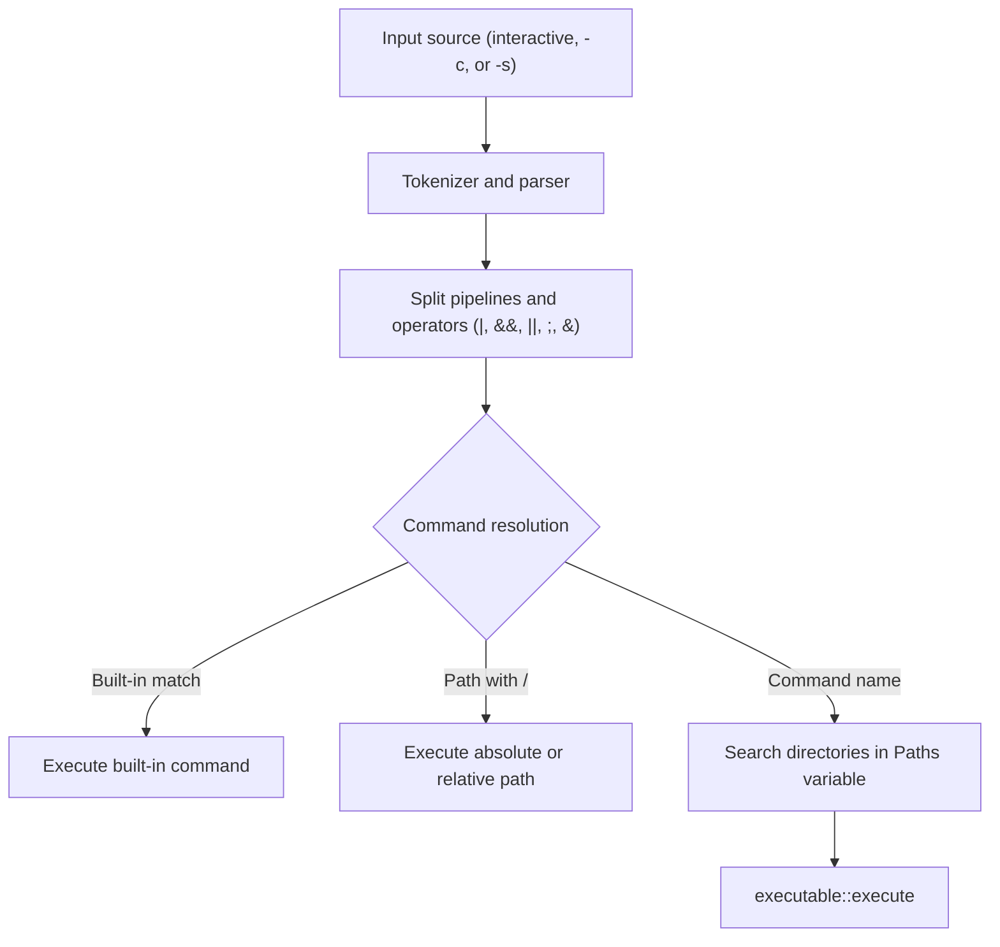

import HostReference from "@/components/HostReference.astro";
import CodeReference from "@/components/CodeReference.astro";

The command-line shell executable (<HostReference repo="applications" crate="command_line_shell" />) provides an interactive text-based shell and scripting environment for Xila. It implements bounded token parsing, streaming command pipelines, a collection of essential built-in commands, and resolution for external native and WebAssembly (Wasm) executables.

## Context

Resource-constrained embedded systems and microcontrollers need a diagnostic and scripting shell that cannot exhaust heap memory through runaway tokenization or unbounded pipeline buffers. At the same time, operators require familiar shell mechanics such as pipes, redirections, conditional execution, and path searching.

The command-line shell satisfies these requirements:

- It provides an interactive prompt over standard input and output streams.
- It parses command lines using strictly bounded static and heap buffers.
- It connects pipeline stages concurrently through in-memory virtual file system (VFS) pipes.
- It resolves commands against built-in handlers and mounted directories specified by environment variables.
- It enforces a recursion limit on nested shell scripts to protect against stack and task exhaustion.

## How it works

### Invocation and execution modes

The following diagram illustrates how the shell processes user input through parsing, resolution, and execution.

The shell evaluates commands through four distinct entry paths:

1. **Interactive line loop**: When invoked with no arguments, the shell authenticates the user if needed, prints an interactive prompt (`user@host:directory$ `), and processes lines read from standard input until end-of-file.
2. **Command string (`-c`)**: Evaluates a command line passed directly as an argument, executing pipelines, conditionals, and redirections.
3. **Script file (`-s PATH`)**: Reads and evaluates lines sequentially from a file in the virtual file system. Syntax errors, read failures, or non-zero exit codes from commands halt script execution.
4. **Literal arguments**: When invoked programmatically with pre-separated argument strings, the shell executes the command directly without re-tokenizing or performing shell expansion.

To prevent infinite script loops or unbounded task trees, nested invocations of the shell track their depth using the `XILA_SHELL_DEPTH` environment variable, rejecting execution if the nesting exceeds four levels.

### Tokenization and operator composition

The tokenizer converts input strings up to 4,096 bytes into at most 256 tokens:

- **Pipelines (`|`)**: Divides commands into pipeline stages. Each stage runs as a spawned task. Adjacent stages communicate through an unnamed VFS pipe (<HostReference crate="virtual_file_system" kind="struct" symbol="File" />) backed by a 512-byte ring buffer.
- **Conditional chaining (`&&` and `||`)**: Evaluates the right-hand command only if the left-hand command succeeded (status 0) or failed (non-zero status), respectively.
- **Sequential separation (`;`)**: Runs commands in sequence regardless of the preceding exit status.
- **Background jobs (`&`)**: Spawns the command pipeline in a detached task with standard input redirected to `/devices/standard_io/null`. The shell tracks up to eight concurrent background tasks and joins them when the shell exits.
- **Redirection**: Redirects standard input (`<`), standard output (`>` for truncate, `>>` for append), and standard error (`2>` for truncate, `2>>` for append) to VFS files.

### Expansion rules

Before executing a command, the shell expands variables in unquoted text and double-quoted strings (`"..."`):

- `$VARIABLE` and `${VARIABLE}`: Substituted with the value of the corresponding task environment variable.
- `$?`: Substituted with the exit status of the previous foreground command.
- Single quotes (`'...'`): Preserve all enclosed characters literally without variable expansion or escape sequence processing.

Total expanded command strings cannot exceed 8,192 bytes. Command substitutions (`$(...)` and backticks) are deliberately unsupported.

### Command resolution

When a command is executed, the shell resolves its target:

1. **Built-in commands**: The shell checks its internal lookup table. Built-ins include filesystem utilities (`ls`, `cat`, `mkdir`, `rm`, `cp`, `mv`, `stat`), environment controls (`export`, `unset`, `printenv`), networking tools (`ping`, `ip`, `dns_resolve`, `web_request`), and navigation commands (`cd`, `pwd`). For the complete list, see [Shell commands](/reference/shell/).
2. **Explicit paths**: If the command contains a forward slash (`/`), the shell treats it as a path. Absolute paths (`/applications/executables/...`) run directly. Relative paths are joined against the task's `Current_directory` environment variable.
3. **Path variable search**: If the command contains no slashes, the shell reads the colon-separated directory list from the `Paths` environment variable (for example, `/applications/executables`). It searches each directory in order and executes the first matching entry via <HostReference crate="executable" kind="fn" symbol="execute" />.

## Design choices and trade-offs

- **Strict allocation bounds**: Hard caps on line length (4,096 bytes), token count (256), and expanded text (8,192 bytes) prevent denial-of-service and memory exhaustion on microcontrollers with limited RAM.
- **Unnamed in-memory pipes**: Pipeline stages stream data across VFS pipe ring buffers rather than spooling intermediate data to disk files, reducing flash write wear and latency.
- **No command substitution**: Omitting subshell spawning and command substitution significantly reduces parser complexity, stack usage, and execution indeterminism.
- **Preserved literal arguments**: Passing pre-separated argument arrays directly bypasses parsing, preventing argument injection when native applications invoke secondary commands.

## Limits

- **Input buffer capacity**: Input lines cannot exceed 4,096 bytes.
- **Token limit**: A single command line can contain at most 256 tokens.
- **Background tasks**: At most 8 concurrent background jobs can run simultaneously.
- **Nesting depth**: Shell scripts and subshells cannot exceed a nesting depth of 4.
- **No job control**: Interactive job suspension (Ctrl+Z) and job manipulation commands (`fg`, `bg`, `jobs`) are not implemented.

## API reference

- <HostReference repo="applications" crate="command_line_shell" />: Command-line
  shell crate.
- <HostReference crate="executable" kind="trait" symbol="ExecutableTrait" />:
  Host executable contract implemented by the shell.
- <HostReference crate="executable" kind="fn" symbol="execute" />: Executable
  launch function.
- <HostReference crate="virtual_file_system" kind="struct" symbol="File" />:
  Virtual file system file and pipe abstraction.
- <HostReference crate="task" kind="struct" symbol="Manager" />: Task management
  service for environment variables and task spawning.

## Related

- [Shell commands](/reference/shell/)
- [Terminal](/explanation/architecture/executables/terminal/)
- [Executables](/explanation/architecture/executables/)
- [Virtual file system](/explanation/architecture/subsystems/virtual_file_system/)
