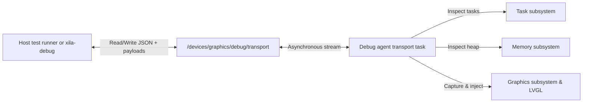

import HostReference from "@/components/HostReference.astro";
import CodeReference from "@/components/CodeReference.astro";

The Debug executable (<HostReference repo="applications" crate="debug_application">Debug executable</HostReference>) provides a host-side diagnostics and automation service for Xila. It exposes task inspection, allocator heap metrics, screen capture, user interface tree introspection, and synthetic pointer and keyboard input injection over a character-device transport.

## Context

Automated testing, continuous integration, and remote diagnosis on embedded devices require inspecting internal operating system state without attaching hardware debug probes. Furthermore, end-to-end integration tests must simulate realistic user interactions—such as clicking buttons, entering text, and verifying rendered screens—without perturbing production code.

Debug addresses these needs:

- It provides an extensible JSON command protocol defined by <HostReference crate="debug_protocol" />.
- It operates over a mounted character device at `/devices/graphics/debug/transport`.
- It supports both interactive graphical operation and headless execution via the `--background` flag.
- It enforces strict memory bounds on request payloads, response buffers, and task collection trees.

## How it works

### Service architecture and transport

The following diagram illustrates how the Debug executable interacts with the transport character device and core kernel subsystems.

When Debug launches:

1. **Window initialization**: In foreground mode, it creates an <HostReference crate="graphics" kind="struct" symbol="OwnedWindow" /> displaying the status message `"Debug agent is ready. Use xila-debug from the host."`. Passing the `--background` flag omits window creation, running purely as a headless service.
2. **Transport task**: Spawns an independent child task named `Debug agent transport` using <HostReference crate="task" kind="struct" symbol="Manager" />.
3. **Endpoint connection**: The transport task opens the character device endpoint `/devices/graphics/debug/transport` using <HostReference crate="virtual_file_system" kind="struct" symbol="File" /> with read/write access. The host platform or test harness is responsible for mounting this device node prior to invocation.
4. **Lifecycle management**: Closing the foreground window signals the transport task to shut down, joins the task handle, and cleanly terminates the executable.

### Request and response framing

Communication over the transport device uses newline-delimited JSON messages governed by strict size constraints:

- **Request size**: The transport task reads at most 16,385 bytes (`MAX_REQUEST_BYTES + 1`), rejecting overlong requests.
- **Response size**: Responses are serialized into JSON and capped at 65,536 bytes (`MAX_RESPONSE_BYTES`). If an introspection response exceeds this limit, the service returns an explicit `response_too_large` error rather than exhausting heap memory.
- **Binary payloads**: For screenshot requests, the JSON metadata response is followed immediately by the raw uncompressed pixel byte stream.

### Supported diagnostic operations

The transport dispatches requests across several functional areas:

- **Diagnostics (`diagnostics`)**: Collects a snapshot of active tasks (up to 64 unique tasks, capped to avoid cycles or unbounded recursion) and reports global allocator memory metrics: total bytes, used bytes, free bytes, and allocation page size.
- **Capabilities (`capabilities`)**: Returns protocol version 2 and lists supported operations, scene layers, input acknowledgment modes, and resource limits.
- **Display resolution (`resolution`)**: Queries the graphics manager for the current screen width and height in pixels.
- **Screen capture (`screenshot`)**: Captures a full composited RGBA8888 snapshot of the current display framebuffer via the graphics subsystem.
- **UI tree inspection (`ui_tree`)**: Generates a bounded hierarchical snapshot of the active LVGL widget tree, constrained by `max_elements` and `max_depth` parameters.
- **Pointer injection (`pointer_move`, `pointer_button`, `pointer_click`, `click`)**: Injects synthetic pointer movement, button press/release states, or high-level clicks directed at specific widget roles, identifiers, or button labels.
- **Keyboard injection (`key`, `press_key`, `text`)**: Injects raw key events (such as arrows, Enter, backspace, and escape) or queues UTF-8 text strings into the graphics input queue.

## Design choices and trade-offs

- **Strict size caps**: Enforcing hard limits on requests (16 KiB), responses (64 KiB), and diagnostic task enumeration (64 tasks) guarantees deterministic memory consumption on memory-constrained microcontrollers.
- **Transport decoupling**: Communicating through a generic VFS character device (`/devices/graphics/debug/transport`) allows the underlying transport to be backed by USB serial, TCP sockets, or shared-memory pipes without modifying the application logic.
- **Headless background mode**: Providing the `--background` option allows CI runners and automation testbeds to execute test suites without dedicating display resources to an informational status window.

## Limits

- **Transport dependency**: The executable does not create the `/devices/graphics/debug/transport` device node itself; a supporting platform driver or harness must mount it.
- **Graphics manager required**: Introspection and injection operations depend on a functioning graphics subsystem; requesting screenshots or UI trees on headless systems without a graphics manager fails.
- **No ASCII control characters in text injection**: The `text` injection operation rejects non-printable ASCII control characters.

## API reference

- <HostReference repo="applications" crate="debug_application">
    Debug executable
  </HostReference>
  : Debug application crate.
- <HostReference crate="executable" kind="trait" symbol="ExecutableTrait" />:
  Core host executable contract.
- <HostReference crate="debug_protocol" />: Reusable debug protocol schema and
  request definitions.
- <HostReference crate="task" kind="struct" symbol="Manager" />: Task subsystem
  management service.
- <HostReference crate="graphics" kind="struct" symbol="Manager" />: Graphics
  subsystem manager.
- <HostReference crate="virtual_file_system" kind="struct" symbol="File" />: VFS
  file and device handle.

## Related

- [Activity](/explanation/architecture/executables/activity/)
- [Command-line shell](/explanation/architecture/executables/command_line_shell/)
- [Executables](/explanation/architecture/executables/)
