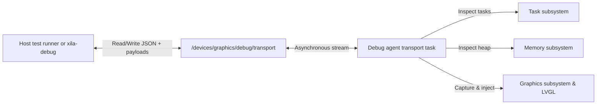

import HostReference from "@/components/HostReference.astro";
import CodeReference from "@/components/CodeReference.astro";

The Debug executable (<HostReference repo="applications" crate="debug_application">Debug executable</HostReference>) is a diagnostics and automation service on the host side of Xila. It provides task inspection, heap metrics, screen capture, user interface tree introspection, and synthetic pointer and keyboard input. It communicates over a character device.

## Context

Automated tests, continuous integration, and remote diagnosis on embedded devices need access to internal operating system state without hardware debug probes. End-to-end tests must also simulate realistic user interactions, such as clicking buttons, entering text, and verifying rendered screens, without changing production code.

Debug provides:

- An extensible JSON command protocol defined by <HostReference crate="debug_protocol" />.
- Operation over a mounted character device at `/devices/graphics/debug/transport`.
- An interactive graphical mode and a headless mode with the `--background` flag.
- Strict memory bounds on request payloads, response buffers, and task collection trees.

## How it works

### Service architecture and transport

The following diagram shows how the Debug executable interacts with the transport character device and the core subsystems.

When Debug launches:

1. **Window initialization**: In foreground mode, Debug creates an <HostReference crate="graphics" kind="struct" symbol="OwnedWindow" /> that displays the status message `\"Debug agent is ready. Use xila-debug from the host.\"`. The `--background` flag skips window creation. Debug then runs as a headless service.
2. **Transport task**: Spawns a child task named `Debug agent transport` with <HostReference crate="task" kind="struct" symbol="Manager" />.
3. **Endpoint connection**: The transport task opens `/devices/graphics/debug/transport` with <HostReference crate="virtual_file_system" kind="struct" symbol="File" /> for reading and writing. The host platform or test harness must mount this device node before Debug starts.
4. **Lifecycle management**: Closing the foreground window tells the transport task to shut down. Debug joins the task handle and exits.

### Request and response framing

The transport device carries newline-delimited JSON messages with strict size limits:

- **Request size**: The transport task reads at most 16,385 bytes (`MAX_REQUEST_BYTES + 1`). Longer requests are rejected.
- **Response size**: Responses are JSON and capped at 65,536 bytes (`MAX_RESPONSE_BYTES`). If an introspection response exceeds this limit, the service returns a `response_too_large` error instead of exhausting heap memory.
- **Binary payloads**: For screenshot requests, the JSON metadata is followed immediately by the raw uncompressed pixel bytes.

### Supported diagnostic operations

The transport dispatches requests across several functional areas:

- **Diagnostics (`diagnostics`)**: Collects a snapshot of the active tasks. The snapshot contains at most 64 unique tasks, which avoids cycles and unbounded recursion. It also reports global allocator metrics: total bytes, used bytes, free bytes, and allocation page size.
- **Capabilities (`capabilities`)**: Returns protocol version 2 and lists supported operations, scene layers, input acknowledgment modes, and resource limits.
- **Display resolution (`resolution`)**: Queries the graphics manager for the screen width and height in pixels.
- **Screen capture (`screenshot`)**: Captures the current display framebuffer as a full composited RGBA8888 image through the graphics subsystem.
- **UI tree inspection (`ui_tree`)**: Generates a bounded hierarchical snapshot of the active LVGL widget tree. The `max_elements` and `max_depth` parameters constrain the snapshot.
- **Pointer injection (`pointer_move`, `pointer_button`, `pointer_click`, `click`)**: Injects synthetic pointer movement, button presses and releases, or clicks. The target is a widget role, identifier, or button label.
- **Keyboard injection (`key`, `press_key`, `text`)**: Injects raw key events, such as arrows, Enter, backspace, and escape. It also queues UTF-8 text strings into the graphics input queue.

## Design choices and trade-offs

- **Strict size caps**: Hard limits on requests (16 KiB), responses (64 KiB), and task enumeration (64 tasks) keep memory consumption deterministic on memory-constrained microcontrollers.
- **Transport decoupling**: The generic VFS character device (`/devices/graphics/debug/transport`) can be backed by USB serial, TCP sockets, or shared-memory pipes. The application logic does not change.
- **Headless background mode**: With `--background`, continuous integration runners and automation systems run test suites without a status window. No display resources are needed.

## Limits

- **Transport dependency**: The executable does not create the `/devices/graphics/debug/transport` device node itself. A platform driver or test harness must mount it.
- **Graphics manager required**: Introspection and injection need a working graphics subsystem. Screenshots and UI trees fail on headless systems without a graphics manager.
- **No ASCII control characters in text injection**: The `text` operation rejects non-printable ASCII control characters.

## API reference

- <HostReference repo="applications" crate="debug_application">
    Debug executable
  </HostReference>
  : Debug application crate.
- <HostReference crate="executable" kind="trait" symbol="ExecutableTrait" />:
  Core host executable contract.
- <HostReference crate="debug_protocol" />: Reusable debug protocol schema and
  request definitions.
- <HostReference crate="task" kind="struct" symbol="Manager" />: Task subsystem
  management service.
- <HostReference crate="graphics" kind="struct" symbol="Manager" />: Graphics
  subsystem manager.
- <HostReference crate="virtual_file_system" kind="struct" symbol="File" />: VFS
  file and device handle.

## Related

- [Activity](/explanation/architecture/executables/activity/)
- [Command-line shell](/explanation/architecture/executables/command_line_shell/)
- [Executables](/explanation/architecture/executables/)
