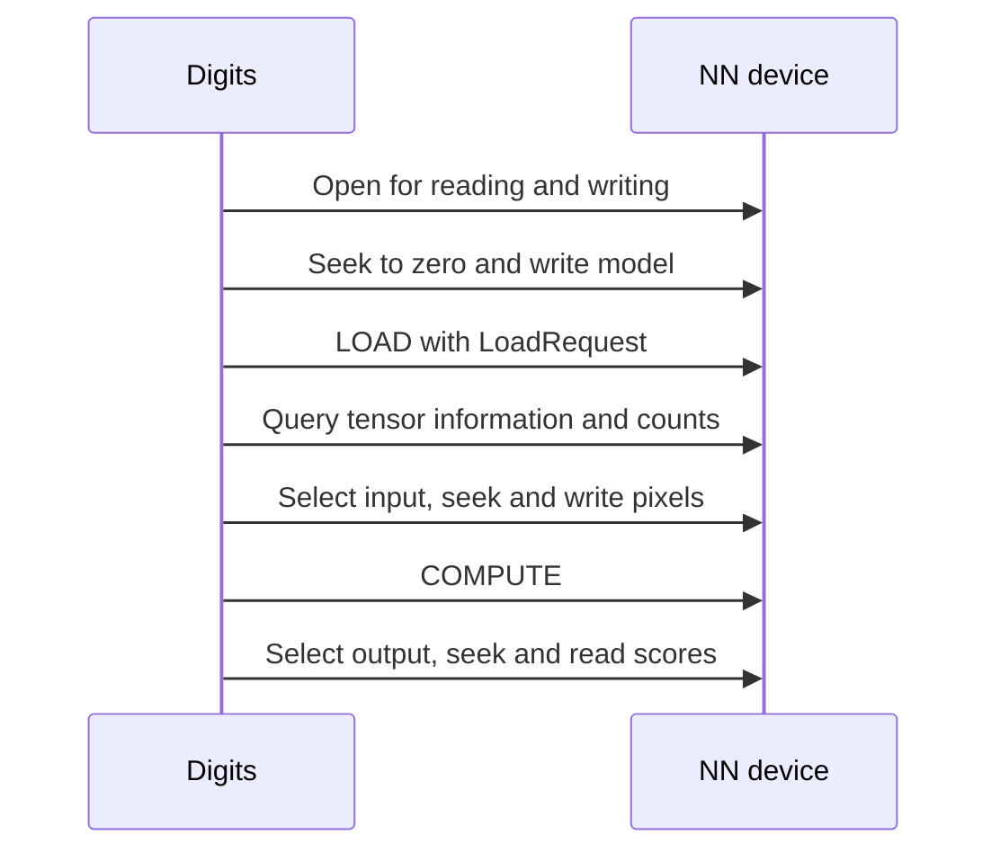

import HostReference from "@/components/HostReference.astro";
import GuestReference from "@/components/GuestReference.astro";
import CodeReference from "@/components/CodeReference.astro";

Digits recognizes handwritten digits. The Applications repository provides `xila-digits` as a WebAssembly (Wasm) guest application (`wasm32-wasip1`).

## Context

Digits depends on Pixel Painter's drawing representation and a neural-network device. Its package specifies a Wasm entrypoint; its shortcut launches `/applications/executables/wasm`. The native and browser image profiles include the bundle.

## How it works

Digits crops the drawn ink and fits it into a 28 by 28 input. It embeds a TensorFlow Lite model and opens `/devices/nn/cpu` for reading and writing. The native runtime registers a loader at that path.

The following sequence shows model loading and prediction.

Digits writes the model before sending <HostReference crate="device/neural_network" kind="struct" symbol="LOAD"><code>device::neural_network::LOAD</code></HostReference> with a TensorFlow Lite `LoadRequest`. It checks the input and output tensors, writes the input, sends <HostReference crate="device/neural_network" kind="struct" symbol="COMPUTE"><code>device::neural_network::COMPUTE</code></HostReference>, and reads ten scores. It ranks the three highest scores.

## Design choices and trade-offs

The embedded model travels with the guest. The device performs inference; the guest prepares the drawing and validates the returned probabilities.

## Limits

Digits requires one float32 input shaped `[1, 784]` and one float32 output shaped `[1, 10]`. Empty drawings do not produce an input.

## API reference

- <CodeReference repo="applications" path="executables/digits" />: application
  source.
- <HostReference crate="device/neural_network" />: neural-network device
  interface.
- <GuestReference repo="applications" crate="wasm" />: guest API Rustdoc.
- <CodeReference repo="applications" path="packaging/digits.json" />: package
  metadata.

## Related

- [Neural network](/explanation/architecture/libraries/neural_network/)
- [Pixel Painter](/explanation/architecture/executables/pixel_painter/)
- [Wasm runtime](/explanation/architecture/executables/wasm/)
- [Guest API reference](/reference/guest/)
