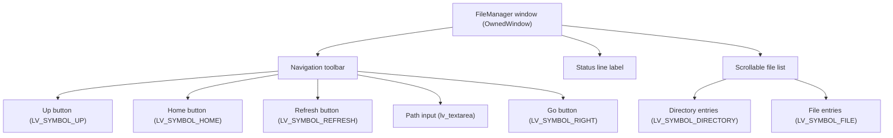

import HostReference from "@/components/HostReference.astro";
import CodeReference from "@/components/CodeReference.astro";

The File manager executable (<HostReference repo="applications" crate="file_manager" />) provides a graphical directory browser for Xila. It allows users to inspect the hierarchy of the virtual file system (VFS), traverse directories, and navigate to arbitrary paths using a dedicated toolbar and interactive file list.

## Context

While developers and administrators frequently navigate the file system using the command-line shell, users in graphical desktop environments benefit from visual exploration of storage volumes, user directories, and system paths.

File manager satisfies this role:

- It provides an interactive graphical interface backed directly by the VFS.
- It displays files, directories, character devices, and block devices with visual type distinctions.
- It supports standard navigation actions including parent directory traversal, home directory shortcuts, and direct path entry.
- It integrates seamlessly with the graphical desktop through a launcher shortcut seeded by Platforms.

## How it works

### Interface layout and components

The following diagram illustrates the component hierarchy of the File manager window.

When started, File manager creates an <HostReference crate="graphics" kind="struct" symbol="OwnedWindow" /> with the icon "Fm" (Cyan hue) and arranges its contents using a vertical flex layout:

1. **Toolbar**: A horizontal bar containing navigation controls:
   - **Up button** (`LV_SYMBOL_UP`): Navigates to the parent directory of the current path. Disabled at the file system root (`/`).
   - **Home button** (`LV_SYMBOL_HOME`): Navigates directly to the user's home directory, resolved from the `HOME` environment variable or constructed as `/home/<username>`.
   - **Refresh button** (`LV_SYMBOL_REFRESH`): Re-reads and re-renders the current directory contents from the VFS.
   - **Path field** (`lv_textarea`): Displays the current path as text and accepts manual keyboard input. Pressing Enter navigates to the entered path.
   - **Go button** (`LV_SYMBOL_RIGHT`): Confirms and navigates to the path entered in the path field.
2. **Status line**: A dedicated label positioned beneath the toolbar that surfaces error diagnostics, such as failed directory reads or invalid target paths.
3. **File list**: A scrollable vertical container listing all entries contained in the active directory.

### Directory reading and traversal

When navigating to a new path:

1. File manager checks that the path is absolute or joins it against the current path using <HostReference crate="file_system" kind="struct" symbol="PathOwned" />.
2. It opens the directory through the VFS using <HostReference crate="virtual_file_system" kind="struct" symbol="Directory" />.
3. It iterates over directory entries, collecting file names, entry kinds (file, directory, device, pipe, or link), and file sizes.
4. It sorts the entries deterministically: directories appear first, followed by other entries, sorted alphabetically in a case-insensitive order.
5. It clears existing widget buttons and creates new list buttons styled according to entry kind:
   - Directories display the `LV_SYMBOL_DIRECTORY` prefix. Clicking a directory button navigates into that directory.
   - Regular files and other nodes display the `LV_SYMBOL_FILE` prefix.

### Desktop integration

File manager does not register its own shortcut file at runtime. Instead, Platforms seeds its launcher shortcut at `/configuration/shared/applications/shortcuts/file_manager.json` (<CodeReference repo="platforms" path="tools/fs_image/shortcuts/file_manager.json" />), allowing the graphical shell to discover and present it in the launcher drawer.

## Design choices and trade-offs

- **Directories-first sorting**: Presenting subdirectories ahead of regular files ensures consistent, predictable navigation across both small and large storage trees.
- **Edge-to-edge layout**: Removing outer padding from the window, toolbar, and list maximizes visible entries on constrained embedded displays.
- **Direct VFS queries**: The manager reads directory entries directly without maintaining a persistent file cache, ensuring that modifications made concurrently by background tasks are immediately visible upon refresh.

## Limits

- **Read-only navigation**: File manager browses and inspects directories; it does not currently create, rename, move, or delete files or directories from the user interface.
- **No file opening or execution**: Clicking regular files does not launch associated viewer applications or execute binaries; file launching is handled through the shell or launcher drawer.

## API reference

- <HostReference repo="applications" crate="file_manager" />: File manager
  crate.
- <HostReference crate="executable" kind="trait" symbol="ExecutableTrait" />:
  Core host executable contract.
- <HostReference crate="virtual_file_system" kind="struct" symbol="Directory" />
  : VFS directory reading interface.
- <HostReference crate="file_system" kind="struct" symbol="PathOwned" />:
  Managed heap-allocated path.
- <HostReference crate="graphics" kind="struct" symbol="OwnedWindow" />: Managed
  window surface.

## Related

- [Command-line shell](/explanation/architecture/executables/command_line_shell/)
- [Virtual file system](/explanation/architecture/subsystems/virtual_file_system/)
- [Executables](/explanation/architecture/executables/)
