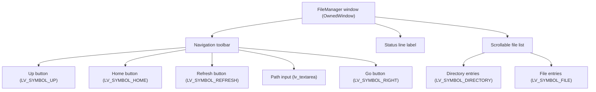

import HostReference from "@/components/HostReference.astro";
import CodeReference from "@/components/CodeReference.astro";

The File manager executable (<HostReference repo="applications" crate="file_manager" />) is a graphical directory browser for Xila. It shows the hierarchy of the virtual file system (VFS). Users can traverse directories and open arbitrary paths with a toolbar and an interactive file list.

## Context

Developers and administrators often navigate the file system with the command-line shell. In graphical desktop environments, users explore storage volumes, user directories, and system paths visually.

File manager fills this role:

- It provides an interactive graphical interface backed directly by the VFS.
- It displays files, directories, character devices, and block devices and marks each type visually.
- It supports parent directory traversal, a home directory shortcut, and direct path entry.
- Platforms seeds a launcher shortcut for it, so the graphical desktop shows it in the application drawer.

## How it works

### Interface layout and components

The following diagram shows the components of the File manager window.

When started, File manager creates an <HostReference crate="graphics" kind="struct" symbol="OwnedWindow" /> with the icon "Fm" (Cyan hue). It arranges the contents in a vertical flex layout:

1. **Toolbar**: A horizontal bar containing navigation controls:
   - **Up button** (`LV_SYMBOL_UP`): Opens the parent directory of the current path. Disabled at the root (`/`).
   - **Home button** (`LV_SYMBOL_HOME`): Opens the user's home directory. The path comes from the `HOME` environment variable or is built as `/home/<username>`.
   - **Refresh button** (`LV_SYMBOL_REFRESH`): Re-reads the current directory from the VFS and updates the list.
   - **Path field** (`lv_textarea`): Shows the current path and accepts keyboard input. Pressing Enter opens the entered path.
   - **Go button** (`LV_SYMBOL_RIGHT`): Opens the path entered in the path field.
2. **Status line**: A label below the toolbar that shows errors such as failed directory reads or invalid paths.
3. **File list**: A scrollable vertical list of the entries in the active directory.

### Directory reading and traversal

When navigating to a new path:

1. File manager checks that the path is absolute. Otherwise it joins the path against the current path using <HostReference crate="file_system" kind="struct" symbol="PathOwned" />.
2. It opens the directory through the VFS using <HostReference crate="virtual_file_system" kind="struct" symbol="Directory" />.
3. It iterates over directory entries, collecting file names, entry kinds (file, directory, device, pipe, or link), and file sizes.
4. It sorts the entries: directories first, then the other entries, alphabetically and case-insensitive.
5. It clears the old list buttons and creates new buttons for each entry, styled by entry kind:
   - Directories show the `LV_SYMBOL_DIRECTORY` prefix. Clicking a directory opens it.
   - Regular files and other nodes show the `LV_SYMBOL_FILE` prefix.

### Desktop integration

File manager does not create its own shortcut file at runtime. Platforms seeds the launcher shortcut at `/configuration/shared/applications/shortcuts/file_manager.json` (<CodeReference repo="platforms" path="tools/fs_image/shortcuts/file_manager.json" />). The graphical shell then shows it in the application drawer.

## Design choices and trade-offs

- **Directories-first sorting**: Showing subdirectories before files makes navigation consistent across storage trees of any size.
- **Edge-to-edge layout**: Removing the outer padding of the window, toolbar, and list shows more entries on small embedded displays.
- **Direct VFS queries**: The manager reads directory entries without a persistent file cache. Changes made by background tasks are visible after a refresh.

## Limits

- **Read-only navigation**: File manager only browses and inspects directories. The user interface cannot create, rename, move, or delete files or directories.
- **No file opening or execution**: Clicking a regular file does not open it or run it. Files are opened through the shell or the launcher drawer.

## API reference

- <HostReference repo="applications" crate="file_manager" />: File manager
  crate.
- <HostReference crate="executable" kind="trait" symbol="ExecutableTrait" />:
  Core host executable contract.
- <HostReference crate="virtual_file_system" kind="struct" symbol="Directory" />
  : VFS directory reading interface.
- <HostReference crate="file_system" kind="struct" symbol="PathOwned" />:
  Managed heap-allocated path.
- <HostReference crate="graphics" kind="struct" symbol="OwnedWindow" />: Managed
  window surface.

## Related

- [Command-line shell](/explanation/architecture/executables/command_line_shell/)
- [Virtual file system](/explanation/architecture/subsystems/virtual_file_system/)
- [Executables](/explanation/architecture/executables/)
