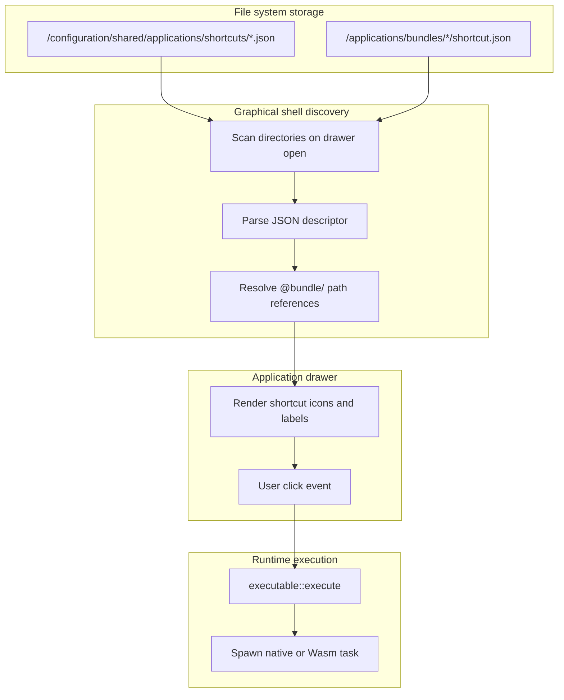

import HostReference from "@/components/HostReference.astro";
import CodeReference from "@/components/CodeReference.astro";

The graphical shell executable (<HostReference repo="applications" crate="graphical_shell" />) manages the interactive desktop session in Xila. It oversees user authentication, global screen layout and status indicators, dynamic shortcut discovery from application bundles, and graphical application launching.

## Context

Interactive embedded systems and graphical workstations need a cohesive session supervisor to transition from a secure login screen to a multitasking desktop. This environment must integrate system-level status indicators with application launchers without requiring applications to hardcode desktop dependencies.

The graphical shell fulfills this role:

- It provides a centralized login interface backed by the Core authentication subsystem.
- It displays a persistent top status bar reporting system time and network connectivity.
- It organizes running windows within a bottom application dock and window menu.
- It scans both system-wide shortcut directories and installed application bundles to populate an on-screen application drawer.
- It executes selected applications through the Core executable runtime.

## How it works

### Session lifecycle and login transition

When Xila boots into a graphical environment, the runtime launches the graphical shell executable. Startup follows a clear sequence:

1. **Argument parsing**: The shell checks for optional CLI flags, such as `--show-keyboard`, which mounts an on-screen virtual keyboard for touch-only devices.
2. **Layout creation**: Initializes the root display layout, allocating the top status bar and reserving space for active windows.
3. **Login view**: Displays a centered login card with username and password input fields. When the user submits credentials, the shell calls into <HostReference crate="authentication" /> to verify the password.
4. **Session initialization**: Upon successful authentication:
   - Sets the active user on the shell task via <HostReference crate="task" kind="struct" symbol="Manager" /> and updates the `User` environment variable.
   - Restores user-specific theme and palette preferences from `/users/<username>/configuration/graphics/appearance.json`.
   - Destroys the login view and activates the desktop (`Desk`) and home (`Home`) views.

### Desktop layout and status bar

The shell layout maintains persistent interface elements around the primary window workspace:

- **Top status bar**: Displays a digital clock formatted via `DateTimeFormatter` (`%H:%M`), an active network interface indicator, and an optional battery level icon.
- **Application dock**: Sits along the bottom edge of the screen, featuring a main launcher button and icons representing each currently open window.
- **Window management menu**: Clicking a window's dock icon brings that window to the foreground, while secondary actions permit minimizing, maximizing, or closing the window.

### Shortcut discovery and launcher integration

The following diagram illustrates how the graphical shell discovers shortcuts and launches applications.

When the user opens the application drawer by clicking the main dock button, the desktop scans the filesystem to populate the launcher:

1. **Static shortcuts**: Reads pre-seeded native shortcuts in `/configuration/shared/applications/shortcuts/`, such as Terminal, Settings, and File Manager.
2. **Bundle shortcuts**: Scans the `/applications/bundles` directory. For every subdirectory that does not begin with a period (skipping staging directories such as `.incoming-1`), it reads `shortcut.json`.
3. **Bundle path resolution**: When reading bundle shortcuts, the parser resolves any argument or command starting with the `@bundle/` prefix. It replaces the prefix with the canonical path of the containing bundle (for example, `@bundle/executables/app.wasm` becomes `/applications/bundles/com.example.app/executables/app.wasm`).
4. **Drawer rendering**: Populates the drawer grid with the application's icon string and configured color palette.
5. **Launch dispatch**: When an icon is clicked, the shell calls <HostReference crate="executable" kind="fn" symbol="execute" />, which starts the target executable with its configured arguments.

For instructions on formatting shortcut descriptors and adding new applications, see [Add a launcher shortcut](/how-to/add-shortcut/).

## Design choices and trade-offs

- **Fresh directory scan on drawer opening**: Scanning bundles when the drawer opens ensures newly installed packages appear immediately without requiring a shell reload or background filesystem watcher.
- **Lightweight shortcut descriptors**: Reading lightweight `shortcut.json` files decoupled from package archive manifests avoids parsing cryptographic package metadata during UI layout.
- **Per-user appearance restoration**: Applying appearance preferences immediately after login allows each user to retain custom themes and color palettes across sessions.

## Limits

- **Single active desktop session**: The graphical shell supports one active logged-in graphical user session at a time; concurrent multi-seat desktop sessions are not supported.
- **No shortcut customization in UI**: Users cannot reorder or group application drawer icons directly in the graphical interface.

## API reference

- <HostReference repo="applications" crate="graphical_shell" />: Graphical shell
  crate.
- <HostReference crate="executable" kind="trait" symbol="ExecutableTrait" />:
  Core host executable contract.
- <HostReference crate="executable" kind="fn" symbol="execute" />: Executable
  launch function.
- <HostReference crate="graphics" kind="struct" symbol="OwnedWindow" />: Managed
  graphics window container.
- <HostReference crate="authentication" />: Authentication subsystem interface.
- <HostReference crate="task" kind="struct" symbol="Manager" />: Task management
  service for environment variables and task user identity.

## Related

- [Add a launcher shortcut](/how-to/add-shortcut/)
- [Settings](/explanation/architecture/executables/settings/)
- [Terminal](/explanation/architecture/executables/terminal/)
- [Executables](/explanation/architecture/executables/)
