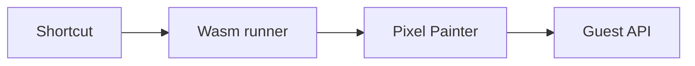

import CodeReference from "@/components/CodeReference.astro";
import Api from "@/components/Api.astro";

Pixel Painter lets the user draw and save indexed-color images. It is a WebAssembly (Wasm) guest application (`wasm32-wasip1`) in the Applications repository.

## Context

The guest application uses Xila graphics through the guest API. Its package metadata identifies the Wasm entrypoint. Its shortcut launches the guest through `/applications/executables/wasm`. The native and browser image profiles include this bundle.

## How it works

The canvas is 160 by 100 pixels with an eight-color palette. The interface opens and saves drawings with file operations.

The following diagram shows the launch path.

The shortcut starts the Wasm runner with the bundle entrypoint. The runner starts the guest, which uses the guest API for its interface.

## Design choices and trade-offs

The fixed canvas and palette bound the image size.

## Limits

The encoded drawing contains an eight-byte header followed by 16,000 pixel indices.

## API reference

- <CodeReference repo="applications" path="executables/pixel_painter">
    <code>pixel_painter</code> crate
  </CodeReference>
  : application source.
- <Api api="guest" path="wasm" />: guest API Rustdoc.
- <CodeReference repo="applications" path="packaging/pixel_painter.json" />:
  package metadata.

## Related

- [Wasm executable](/explanation/architecture/executables/wasm/)
- [Guest API reference](/reference/guest/)
