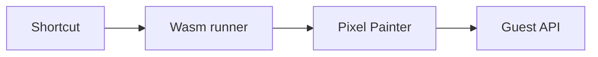

import HostReference from "@/components/HostReference.astro";
import GuestReference from "@/components/GuestReference.astro";
import CodeReference from "@/components/CodeReference.astro";

Pixel Painter lets you draw and save indexed-color images. The Applications repository provides it as a WebAssembly (Wasm) guest application (`wasm32-wasip1`).

## Context

The guest uses Xila graphics through the guest API. Its package metadata identifies the Wasm entrypoint, and its shortcut launches it through `/applications/executables/wasm`. The native and browser image profiles include this bundle.

## How it works

The drawing uses a 160 by 100 pixel canvas and an eight-color palette. The interface opens and saves drawings through file operations.

The following diagram shows the launch path.

The shortcut starts the Wasm runner with the bundle entrypoint. The guest uses the guest API for its interface.

## Design choices and trade-offs

The fixed canvas and palette bound the image size.

## Limits

The encoded drawing contains an eight-byte header followed by 16,000 pixel indices.

## API reference

- <HostReference repo="applications" crate="pixel_painter" />: application
  source.
- <GuestReference repo="applications" crate="wasm" />: guest API Rustdoc.
- <CodeReference repo="applications" path="packaging/pixel_painter.json" />:
  package metadata.

## Related

- [Wasm runtime](/explanation/architecture/executables/wasm/)
- [Guest API reference](/reference/guest/)
