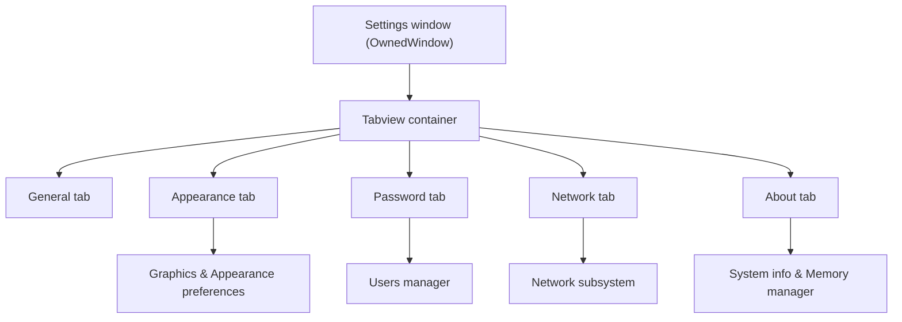

import HostReference from "@/components/HostReference.astro";
import CodeReference from "@/components/CodeReference.astro";

The Settings executable (<HostReference repo="applications" crate="settings" />) provides a tab-based graphical configuration utility for Xila. It manages core system options, visual appearance themes, user authentication credentials, network interface settings, and platform diagnostics.

## Context

System configuration on multitasking embedded platforms requires a structured interface that exposes administrative settings without requiring command-line execution for routine tasks. Settings must manage distinct subsystems—such as graphics theming, user identity, and network stacks—while isolating sensitive credentials in memory.

Settings fulfills this purpose:

- It provides an integrated tabview interface spanning five dedicated configuration panels.
- It dynamically loads and persists user-level appearance preferences to the virtual file system (VFS).
- It interacts directly with the Core users manager to update authentication credentials.
- It provides live network status monitoring and interface configuration.
- It securely releases ephemeral password data and interface panels when closed.

## How it works

### Window architecture and tabs

The following diagram shows how the Settings window coordinates its five configuration panels with Xila's core subsystems.

Settings initializes by creating an <HostReference crate="graphics" kind="struct" symbol="OwnedWindow" /> with the icon "Se" (Grey palette). It flattens the window chrome to host a full-size LVGL tabview containing five panels:

1. **General**: Displays the active system language compiled into the system image (<CodeReference repo="applications" path="executables/settings/src/tabs/general.rs" />).
2. **Appearance**: Configures interface styling. It provides a switch to toggle dark mode and dropdown selectors for the primary and secondary color palette hues (Blue, Green, Red, Orange, and Purple). Changes are applied immediately to all active windows and saved to `/users/<username>/configuration/graphics/appearance.json`.
3. **Password**: Manages user authentication credentials. It contains fields for the current password, a new password, and password confirmation. Submitting the form validates the existing password and updates the hash through the Users subsystem (<HostReference crate="users" />).
4. **Network**: Inspects and manages network connectivity. It enumerates active network interfaces (<HostReference crate="network" />), reporting link state, IP address, and subnet masks. It allows configuring static addresses or Wi-Fi credentials. When this tab is active, Settings refreshes interface statistics every 250 milliseconds.
5. **About**: Reports system metadata, including the host machine name, operating system release, kernel version, total and used allocator heap bytes, and mounted storage statistics.

### Event handling and lifecycle

Settings runs a responsive event loop that dispatches user actions to the active tab:

- **Window close**: When the window receives a close or delete event, event dispatch halts and the application exits cleanly.
- **Resource cleanup**: Settings implements `Drop` to ensure that ephemeral password text and interface panels are deallocated under the graphics lock before the parent window widget tree is deleted.

### Desktop discovery

Settings does not write its own shortcut at runtime. Platforms seeds its shortcut descriptor in `/configuration/shared/applications/shortcuts/settings.json`, making it visible within the launcher drawer of the graphical shell.

## Design choices and trade-offs

- **Instant appearance persistence**: Appearance updates are written directly to per-user VFS configuration files and propagated across existing windows, providing immediate visual feedback without requiring a system restart.
- **Periodic network polling**: When the network panel is open, the event loop polls network link state every 250 milliseconds. This ensures link up/down transitions appear promptly without registering complex kernel socket callbacks.
- **Explicit cleanup on drop**: Clearing panel widgets and temporary password strings under the graphics lock during `Drop` prevents sensitive plaintext passwords from lingering in uncollected memory.

## Limits

- **Fixed system language**: The system locale is determined at build time by the internationalization system; the General tab currently displays this language as read-only.
- **Theme scope**: Theme and palette changes apply to standard LVGL controls and window frames, but do not alter raw pixel buffers drawn by custom canvas applications like Pixel Painter.

## API reference

- <HostReference repo="applications" crate="settings" />: Settings application
  crate.
- <HostReference crate="executable" kind="trait" symbol="ExecutableTrait" />:
  Core host executable contract.
- <HostReference crate="graphics" />: Core graphics subsystem and theme engine.
- <HostReference crate="graphics" kind="struct" symbol="OwnedWindow" />: Managed
  graphics window surface.
- <HostReference crate="users" />: User identity and credential management
  service.
- <HostReference crate="network" />: Network stack and interface management.

## Related

- [Graphical shell](/explanation/architecture/executables/graphical_shell/)
- [Activity](/explanation/architecture/executables/activity/)
- [Executables](/explanation/architecture/executables/)
