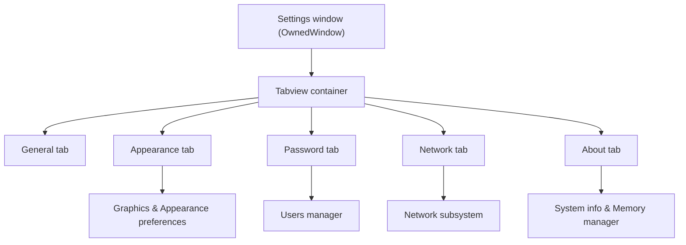

import HostReference from "@/components/HostReference.astro";
import CodeReference from "@/components/CodeReference.astro";

The Settings executable (<HostReference repo="applications" crate="settings" />) is a tab-based graphical configuration utility for Xila. It manages system options, appearance themes, user passwords, network interfaces, and system information.

## Context

System configuration on multitasking embedded platforms needs a structured interface for administrative settings, so routine tasks do not require the command line. Settings manages distinct subsystems, such as graphics theming, user identity, and network stacks.

Settings provides:

- An integrated tab view with five configuration panels.
- Loading and saving of user-level appearance preferences in the virtual file system (VFS).
- Direct access to the Core users manager to update authentication credentials.
- Live network status monitoring and interface configuration.
- Cleanup of interface panels and of the Wi-Fi password input field when it closes, and of password input fields after a successful password change.

## How it works

### Window architecture and tabs

The following diagram shows how the Settings window coordinates its five configuration panels with Xila's core subsystems.

Settings creates an <HostReference crate="graphics" kind="struct" symbol="OwnedWindow" /> with the icon "Se" (Grey palette). It flattens the window chrome and hosts a full-size LVGL tab view with five panels:

1. **General**: Displays the active system language compiled into the system image (<CodeReference repo="applications" path="executables/settings/src/tabs/general.rs" />).
2. **Appearance**: Configures interface styling. A switch toggles dark mode. Dropdowns select the primary and secondary palette hues (Blue, Green, Red, Orange, and Purple). Changes apply immediately to all open windows and are saved to `/users/<username>/configuration/graphics/appearance.json`.
3. **Password**: Manages the user's login credentials. It has fields for the current password, the new password, and the confirmation. Submitting the form checks the current password and updates the hash through <HostReference crate="users" />.
4. **Network**: Shows and configures network connectivity. It lists the active interfaces (<HostReference crate="network" />) with link state, IP address, and subnet mask. It can configure static addresses or Wi-Fi credentials. While this tab is open, Settings refreshes the statistics every 250 milliseconds.
5. **About**: Reports system metadata, including the host machine name, operating system release, kernel version, total and used allocator heap bytes, and mounted storage statistics.

### Event handling and lifecycle

Settings runs a responsive event loop that dispatches user actions to the active tab:

- **Window close**: On a close or delete event, the event loop stops and the application exits.
- **Resource cleanup**: Settings implements `Drop`. It releases the open network interface panel under the graphics lock before the window widget tree is deleted. Releasing the panel empties its Wi-Fi password input field. The password tab empties its input fields after a successful password change.

### Desktop discovery

Settings does not write its own shortcut at runtime. Platforms seeds the shortcut descriptor in `/configuration/shared/applications/shortcuts/settings.json`. The graphical shell shows it in the launcher drawer.

## Design choices and trade-offs

- **Instant appearance persistence**: Appearance updates are written to the per-user VFS configuration file and applied to all open windows. The user sees the change immediately, without a restart.
- **Periodic network polling**: While the network panel is open, the event loop polls the link state every 250 milliseconds. Link changes appear promptly, without kernel socket callbacks.
- **No password zeroization**: Emptying a password input field replaces the widget text with an empty string. Settings does not overwrite the memory that held the password.

## Limits

- **Fixed system language**: The system language is fixed at build time by the internationalization system. The General tab shows it as read-only.
- **Theme scope**: Themes apply to standard LVGL controls and window frames. They do not alter raw pixel buffers drawn by custom canvas applications such as Pixel Painter.

## API reference

- <HostReference repo="applications" crate="settings" />: Settings application
  crate.
- <HostReference crate="executable" kind="trait" symbol="ExecutableTrait" />:
  Core host executable contract.
- <HostReference crate="graphics" />: Core graphics subsystem and theme engine.
- <HostReference crate="graphics" kind="struct" symbol="OwnedWindow" />: Managed
  graphics window surface.
- <HostReference crate="users" />: User identity and credential management
  service.
- <HostReference crate="network" />: Network stack and interface management.

## Related

- [Graphical shell](/explanation/architecture/executables/graphical_shell/)
- [Activity](/explanation/architecture/executables/activity/)
- [Executables](/explanation/architecture/executables/)
