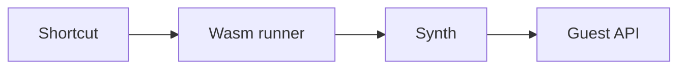

import HostReference from "@/components/HostReference.astro";
import GuestReference from "@/components/GuestReference.astro";
import CodeReference from "@/components/CodeReference.astro";

Synth plays synthesized notes. It is a WebAssembly (Wasm) guest application (`wasm32-wasip1`) in the Applications repository.

## Context

The guest application uses Xila graphics through the guest API. Its package metadata identifies the Wasm entrypoint. Its shortcut launches the guest through `/applications/executables/wasm`. The native and browser image profiles include this bundle.

## How it works

The interface offers a keyboard and sine, square, and triangle waveforms. It writes the generated audio to `/devices/audio/playback`.

The following diagram shows the launch path.

The shortcut starts the Wasm runner with the bundle entrypoint. The runner starts the guest, which uses the guest API for its interface.

## Design choices and trade-offs

Audio is rendered in blocks of 128 frames at 48 kHz with two channels.

## Limits

The synthesizer supports up to eight voices.

## API reference

- <HostReference repo="applications" crate="synth" />: application source.
- <GuestReference repo="applications" crate="wasm" />: guest API Rustdoc.
- <CodeReference repo="applications" path="packaging/synth.json" />: package
  metadata.

## Related

- [Wasm runtime](/explanation/architecture/executables/wasm/)
- [Guest API reference](/reference/guest/)
