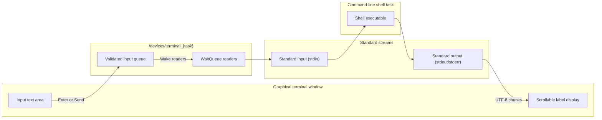

import HostReference from "@/components/HostReference.astro";
import CodeReference from "@/components/CodeReference.astro";

The Terminal executable (<HostReference repo="applications" crate="terminal" />) provides a graphical window console for Xila. It implements a virtual character device, mounts it dynamically into the virtual file system (VFS), connects standard I/O streams to that device, and executes the [Command-line shell](/explanation/architecture/executables/command_line_shell/).

## Context

On graphical platforms, text-mode applications and interactive command shells cannot write directly to a display framebuffer. Instead, they interact with standard input, standard output, and standard error streams through file descriptors.

Terminal bridges this gap by acting as a user-facing terminal emulator and virtual device:

- It creates a dedicated graphical window with a scrollable text display and single-line command input field.
- It exposes itself to the VFS as a character device mounted at `/devices/terminal_{task}`.
- It instantiates standard streams backed by this character device and spawns `/applications/executables/command_line_shell`.
- It processes GUI input events and streams them as UTF-8 bytes to the shell while rendering output text using a monospaced font.

## How it works

### Data flow and stream wiring

The following diagram shows the data flow between the graphical user interface, the mounted terminal character device, standard streams, and the child command-line shell task.

When Terminal starts:

1. It allocates a `Terminal` instance through the graphics manager (<HostReference crate="graphics" />), constructing an <HostReference crate="graphics" kind="struct" symbol="OwnedWindow" /> containing a scrollable output display and a bottom toolbar.
2. It generates a task-specific device path `/devices/terminal_{task}` based on its current <HostReference crate="task" kind="struct" symbol="TaskIdentifier" />.
3. It mounts the terminal instance into the VFS as a static character device via <HostReference crate="virtual_file_system" kind="enum" symbol="ItemStatic" />.
4. It creates a <HostReference crate="executable" kind="struct" symbol="Standard" /> descriptor whose standard input, standard output, and standard error paths all point to `/devices/terminal_{task}`.
5. It executes `/applications/executables/command_line_shell` with those standard streams via <HostReference crate="executable" kind="fn" symbol="execute" />.
6. It runs an event loop every 20 milliseconds to process LVGL events and forward I/O until the window is closed.

### Character device interface

Terminal implements <HostReference crate="file_system" kind="trait" symbol="CharacterDevice" /> and <HostReference crate="file_system" kind="trait" symbol="BaseOperations" /> directly on the `Terminal` struct:

- **Open**: Allocates a per-handle <HostReference crate="file_system" kind="struct" symbol="Waiter" /> and stores it in the file context private data.
- **Read**: Pulls pending bytes from the internal validated input queue. If the queue is empty, the calling task registers its waker in `input_waiters` and yields `Poll::Pending`.
- **Write**: Receives UTF-8 byte chunks written by the shell, appends them to the window's text buffer, updates the display label, and scrolls the view to keep the latest output visible.
- **Close & cancel**: Deregisters any registered waker from the wait queue and cleans up context private data.

### Graphical line discipline and input handling

Line editing and input dispatch in the graphical terminal are split between the widget toolkit and an internal byte queue:

1. **Typing and editing**: The LVGL `lv_textarea` widget handles in-field cursor movement, text insertion, selection, and backspacing.
2. **Submission**: Pressing the Enter key or clicking the Send button invokes `submit()`. This echoes the current text line to the scrollable display buffer, pushes the UTF-8 bytes followed by a newline (`\n`) into a `VecDeque<u8>` queue, and clears the input field.
3. **Reader notification**: The event loop wakes all waiting readers registered in `input_waiters`, allowing the shell's `read` call to return the queued line.
4. **ANSI escape sequence support**: When writing output, Terminal checks for specific ANSI control sequences:
   - `\x1b[2J`: Clears the scrollback display buffer.
   - `\x1b[H`: Resets the display cursor to home position.
5. **Clear button**: Clicking the trash icon button drops the current scrollback history while preserving the prompt line currently being typed.

In contrast to the graphical terminal, raw serial interfaces on hardware without displays utilize a dedicated serial line discipline. For example, the Arduino Nano 33 BLE uses the USB console driver in the Platforms repository (<CodeReference repo="platforms" path="drivers/nordic/src/usb_console" />) to handle local echo, backspace erasure, and carriage return normalization over UART. For driver-level serial console details, see [Nordic drivers](/explanation/architecture/drivers/nordic/).

## Design choices and trade-offs

- **Per-task device node paths**: Mounting at `/devices/terminal_{task}` instead of a single static path ensures multiple terminal windows operate concurrently without stream crosstalk or permission conflicts on multi-user systems.
- **Asynchronous wait queue notifications**: Decoupling LVGL GUI input events from asynchronous VFS readers via <HostReference crate="file_system" kind="struct" symbol="WaitQueue" /> prevents GUI thread blocking while waiting for shell processing.
- **Monospaced font rendering**: Output text is formatted using a dedicated medium monospaced font, ensuring columnar alignment for command outputs such as tables and directory listings.
- **Selective escape code parsing**: Supporting only ANSI clear and home sequences avoids the significant memory and code complexity of a complete VT100/xterm terminal emulator state machine.

## Limits

- **No full terminal emulation**: Terminal does not implement arbitrary cursor positioning, color codes, or interactive full-screen curses applications.
- **Single-line input field**: Command input is limited to one line at a time in the bottom text area before submission.
- **Device lifetime tied to window**: Closing the terminal window deletes the `/devices/terminal_{task}` character device node, terminating the active child shell task.

## API reference

- <HostReference repo="applications" crate="terminal" />: Terminal executable
  crate.
- <HostReference crate="file_system" kind="trait" symbol="CharacterDevice" />:
  VFS character device trait.
- <HostReference crate="file_system" kind="trait" symbol="BaseOperations" />:
  Core file system I/O operation trait.
- <HostReference crate="executable" kind="struct" symbol="Standard" />: Standard
  streams container.
- <HostReference crate="graphics" kind="struct" symbol="OwnedWindow" />:
  Graphics subsystem window wrapper.

## Related

- [Command-line shell](/explanation/architecture/executables/command_line_shell/)
- [Shell commands](/reference/shell/)
- [Nordic drivers](/explanation/architecture/drivers/nordic/)
- [Executables](/explanation/architecture/executables/)
