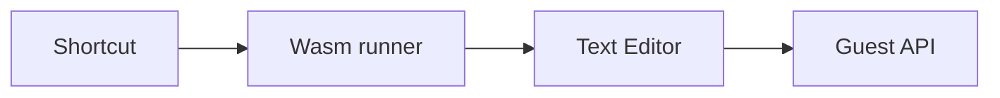

import CodeReference from "@/components/CodeReference.astro";
import Api from "@/components/Api.astro";

Text Editor edits UTF-8 text files. It is a WebAssembly (Wasm) guest application (`wasm32-wasip1`) in the Applications repository.

## Context

The guest application uses Xila graphics through the guest API. Its package metadata identifies the Wasm entrypoint. Its shortcut launches the guest through `/applications/executables/wasm`. The native and browser image profiles include this bundle.

## How it works

The editor opens a file as a temporary working copy and edits it in pages. Saving writes the working copy back to the file.

The following diagram shows the launch path.

The shortcut starts the Wasm runner with the bundle entrypoint. The runner starts the guest, which uses the guest API for its interface.

## Design choices and trade-offs

A file-backed working copy avoids keeping the entire document in a single editing buffer.

## Limits

The editing page size is 4096 bytes.

## API reference

- <CodeReference repo="applications" path="executables/text_editor">
    <code>text_editor</code> crate
  </CodeReference>
  : application source.
- <Api api="guest" path="wasm" />: guest API Rustdoc.
- <CodeReference repo="applications" path="packaging/text_editor.json" />:
  package metadata.

## Related

- [Wasm executable](/explanation/architecture/executables/wasm/)
- [Guest API reference](/reference/guest/)
