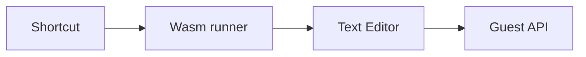

import HostReference from "@/components/HostReference.astro";
import GuestReference from "@/components/GuestReference.astro";
import CodeReference from "@/components/CodeReference.astro";

Text Editor edits UTF-8 text files. The Applications repository provides it as a WebAssembly (Wasm) guest application (`wasm32-wasip1`).

## Context

The guest uses Xila graphics through the guest API. Its package metadata identifies the Wasm entrypoint, and its shortcut launches it through `/applications/executables/wasm`. The native and browser image profiles include this bundle.

## How it works

The editor opens a file into a temporary working copy and edits it in pages. Saving writes the working copy to a file.

The following diagram shows the launch path.

The shortcut starts the Wasm runner with the bundle entrypoint. The guest uses the guest API for its interface.

## Design choices and trade-offs

A file-backed working copy avoids keeping the entire document in a single editing buffer.

## Limits

The editing page size is 4096 bytes.

## API reference

- <HostReference repo="applications" crate="text_editor" />: application source.
- <GuestReference repo="applications" crate="wasm" />: guest API Rustdoc.
- <CodeReference repo="applications" path="packaging/text_editor.json" />:
  package metadata.

## Related

- [Wasm runtime](/explanation/architecture/executables/wasm/)
- [Guest API reference](/reference/guest/)
