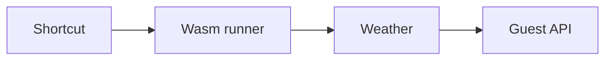

import HostReference from "@/components/HostReference.astro";
import GuestReference from "@/components/GuestReference.astro";
import CodeReference from "@/components/CodeReference.astro";

Weather shows forecasts for a selected location. The Applications repository provides it as a WebAssembly (Wasm) guest application (`wasm32-wasip1`).

## Context

The guest uses Xila graphics through the guest API. Its package metadata identifies the Wasm entrypoint, and its shortcut launches it through `/applications/executables/wasm`. The native image profile includes this bundle.

## How it works

The guest requests geocoding and forecast data from Open-Meteo through `/devices/network/https_client`. It parses HTTP responses and JSON for display.

The following diagram shows the launch path.

The shortcut starts the Wasm runner with the bundle entrypoint. The guest uses the guest API for its interface.

## Design choices and trade-offs

The application depends on a working HTTPS device and network access.

## Limits

The interface displays up to 24 hours and 10 days of forecast data.

## API reference

- <HostReference repo="applications" crate="weather" />: application source.
- <GuestReference repo="applications" crate="wasm" />: guest API Rustdoc.
- <CodeReference repo="applications" path="packaging/weather.json" />: package
  metadata.

## Related

- [Wasm runtime](/explanation/architecture/executables/wasm/)
- [Guest API reference](/reference/guest/)
