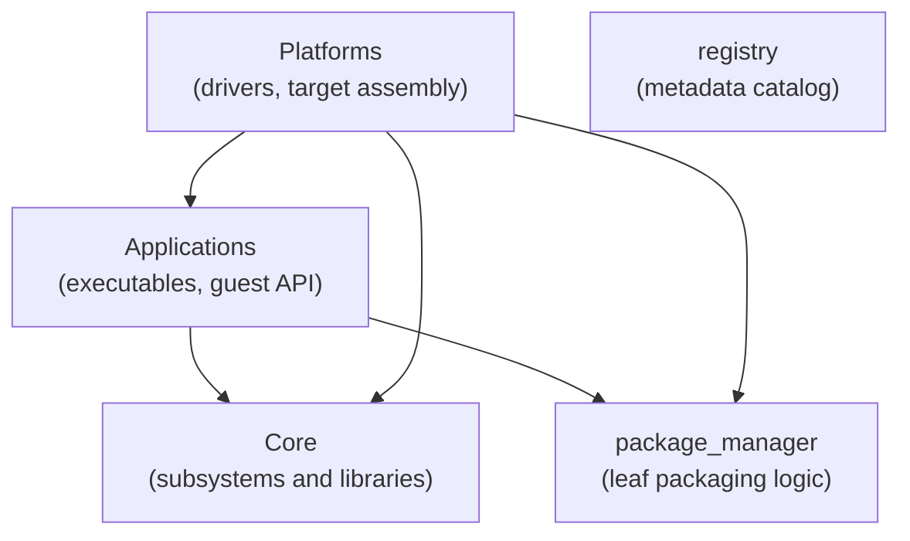
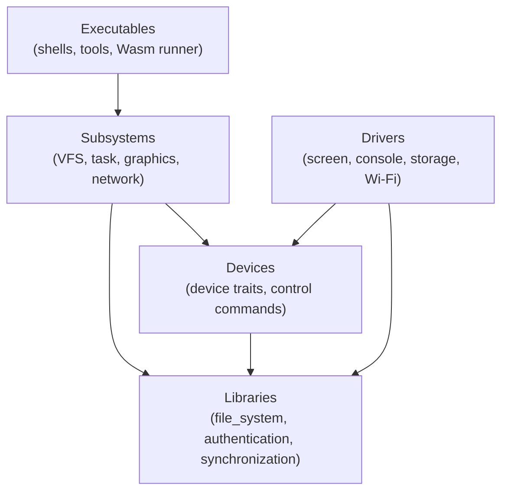

import CodeReference from "@/components/CodeReference.astro";
import HostReference from "@/components/HostReference.astro";

Xila is structured across independent repositories that separate portable kernel services, user-space applications, platform drivers, and packaging tools. This separation enforces clear dependency directions and keeps core operating system logic independent of hardware targets.

## Context

Embedded operating systems often tangle driver implementations, kernel primitives, and user applications together. This tight coupling makes testing difficult and prevents running system services across different hardware targets.

Xila addresses this challenge by isolating portable abstractions from platform runtimes. The same operating system services compile and run on bare-metal microcontrollers, native desktop environments, and web browsers without modifying kernel logic.

Dependencies follow a strict unidirectional hierarchy:

- `core` is consumed by `applications` and `platforms`.
- `package_manager` is a leaf repository consumed by `applications` and `platforms`.
- `applications` is consumed by `platforms`.
- `platforms` integrates all repositories to produce bootable target binaries.
- `registry` contains signed package release metadata and holds no code dependencies.

## How it works

### Repository layering

The following diagram shows the dependency relationships among Xila repositories. Each arrow points from a repository to a repository it depends on; `registry` holds no code and has no arrow.

Each repository owns a distinct responsibility in the ecosystem:

- **[Core](https://github.com/xila-project/core)** provides portable operating system subsystems, reusable data structures, and the top-level `xila` façade crate. The crates of the Core workspace depend on no other Xila repository.
- **[package_manager](https://github.com/xila-project/package_manager)** is a leaf repository providing package creation, manifest validation, cryptographic signing, and verification. It has no dependencies on any other Xila repository.
- **[Applications](https://github.com/xila-project/applications)** contains official system executables, shells, user-space utilities, and the WebAssembly (Wasm) host interpreter. Applications depends on Core and package manager.
- **[Platforms](https://github.com/xila-project/platforms)** contains target drivers, filesystem seed generation tools, and target entry points that assemble full system images. Platforms depends on Core, package manager, and Applications.
- **[registry](https://github.com/xila-project/registry)** is a standalone metadata repository that records signed package versions and developer keys.

### Crate layering

The following diagram illustrates how crates are layered from hardware drivers up to user-facing executables.

Crates belong to one of five architectural roles:

1. **Subsystems**: own runtime state and background lifecycles for core services such as task scheduling, graphics rendering, and path resolution.
2. **Libraries**: provide stateless contracts, data formats, cryptographic utilities, and synchronization primitives.
3. **Devices**: define unified interface traits and typed control commands for hardware and virtual devices.
4. **Drivers**: implement concrete hardware or host adapters fulfilling device trait contracts.
5. **Executables**: programs launched by the system that interact with services through runtime contexts.

### Runtime assembly

Platforms integrates Core subsystems with concrete drivers and Applications executables to create runnable binaries. During boot, the target entry point executes the following initialization steps:

1. Initializes the target memory allocator and installs the global logger.
2. Instantiates the task manager and registers the Embassy executor spawner.
3. Constructs the users manager and initializes the time manager with a hardware time source.
4. Mounts the root file system and initializes the virtual file system (VFS).
5. Populates the default directory hierarchy and mounts device nodes under `/devices/`.
6. Mounts static executables into `/applications/executables/`.
7. Seeds initial user accounts through the authentication library.
8. Launches the initial user interface shell.

## Design choices and trade-offs

- **Strict dependency directions**: circular dependencies between repositories or crate layers are forbidden, ensuring predictable builds and modular components.
- **Portable kernel core**: Core does not link against platform SDKs or standard operating system libraries, enabling unit testing on native hosts without hardware dependencies.
- **Explicit manager lifecycle**: subsystem managers are constructed explicitly and passed to execution contexts, avoiding hidden global state except where required by C libraries or runtime allocators.

## API reference

- <HostReference crate="xila" /> - the root façade crate re-exporting Core
  subsystems and libraries.
- <CodeReference path="core/src/lib.rs" /> - façade module definitions and
  feature re-exports.
- <CodeReference repo="platforms" path="examples/native/src/main.rs" /> - native
  desktop target initialization and assembly.

## Related

- [Component map](/explanation/architecture/components/) - complete inventory of crates and packages.
- [Subsystems](/explanation/architecture/subsystems/) - kernel-managed runtime services.
- [Libraries](/explanation/architecture/libraries/) - reusable system libraries and contracts.
- [Drivers](/explanation/architecture/drivers/) - platform hardware and simulation drivers.
- [Executables](/explanation/architecture/executables/) - built-in system applications and launchers.
