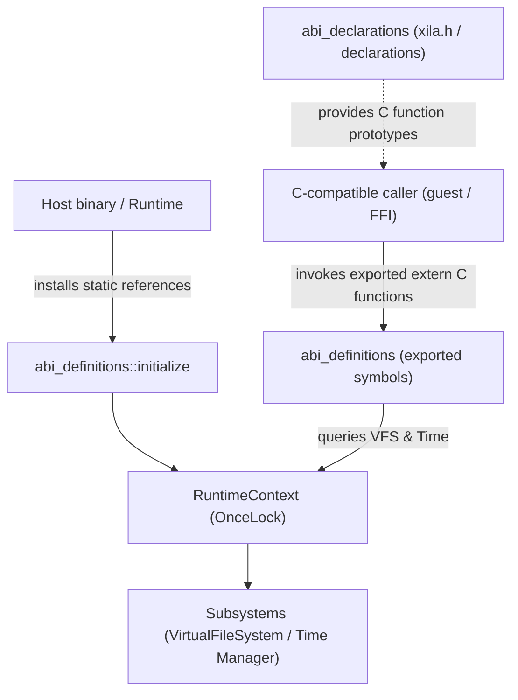

import CodeReference from "@/components/CodeReference.astro";
import HostReference from "@/components/HostReference.astro";

The Xila C Application Binary Interface (ABI) provides a standard FFI boundary between native host services and C-compatible callers. The ABI surface is divided into interface declarations and runtime symbol definitions.

## Context

While Xila core services and drivers communicate internally through Rust trait objects and static managers, foreign callers and compiled guest components require stable C calling conventions, fixed memory layouts, and integer error conventions.

The ABI subsystem bridges foreign calls to native subsystems:

- <HostReference crate="abi_declarations" />: defines C headers, type
  signatures, and generated bindings used by callers.
- <HostReference crate="abi_definitions" />: implements the exported
  `#[unsafe(no_mangle)] extern "C"` symbols that adapt raw C arguments to Xila's
  internal services.

## How it works

### Split architecture and header generation

The ABI architecture maintains a strict separation between headers and implementation symbols:



1. **Definitions** (<CodeReference path="libraries/abi/definitions" />): implements C-exported symbols across file system, memory, string, task, time, and user categories.
2. **Header generation**: the build script of `abi_declarations` uses `cbindgen` to parse `abi_definitions` and emit the standard C header `xila.generated.h`.
3. **Declarations** (<CodeReference path="libraries/abi/declarations" />): uses `bindgen` to generate type-checked Rust foreign function declarations (`declarations.generated.rs`) from the C header, exporting constants such as <HostReference crate="abi_declarations" kind="constant" symbol="APPLICATION_ABI_VERSION" />.

### Process-wide runtime context

Internal Rust services receive manager instances through explicit constructor injection. C ABI entry points cannot pass manager pointers on every call; instead, the host runtime initializes a process-wide <HostReference crate="abi_definitions" kind="struct" symbol="RuntimeContext" />:

```rust
use xila::abi_definitions::{RuntimeContext, initialize};

initialize(RuntimeContext {
    virtual_file_system,
    time_manager,
});
```

The runtime context is stored in a `OnceLock` during host startup:

- Calling context-dependent ABI symbols before initialization causes a panic.
- Once registered, the runtime context cannot be replaced or cleared.
- C functions that require task identity (such as file permissions and ownership checks) take the task identifier as a parameter in their C argument list.

### ABI categories and conventions

The exported symbols in `abi_definitions` follow consistent conventions:

- **Return values**: integer return values follow POSIX-like semantics where zero indicates success (`XILA_RESULT_OK`) and negative or non-zero integers correspond to mapped system errors.
- **Memory allocations**: memory management functions (`xila_memory_allocate`, `xila_memory_deallocate`) route requests through Xila's allocator contracts with capability flags.
- **Synchronization primitives**: mutexes, read-write locks, semaphores, and condition variables are backed by Xila's synchronization library.

## Design choices and trade-offs

- **Static OnceLock boundary**: using a global context for C entry points isolates FFI mechanics from internal Rust libraries, which continue to use explicit dependency injection.
- **Pre-generated header bindings**: running `cbindgen` and `bindgen` during the build ensures C headers and Rust foreign declarations remain synchronized.
- **Explicit task parameters**: entry points pass task identifiers explicitly, decoupling ABI dispatch from thread-local storage models.

## Limits

- Calling any context-dependent ABI symbol before invoking <HostReference crate="abi_definitions" kind="fn" symbol="initialize" /> causes a runtime panic.
- The C ABI is distinct from the WebAssembly Wasmi execution sandbox, which maintains per-instance descriptor tables and WASI contexts.

## API reference

- <HostReference crate="abi_declarations" /> — C declarations and generated
  headers.
- <HostReference
    crate="abi_declarations"
    kind="constant"
    symbol="APPLICATION_ABI_VERSION"
  />
  — ABI contract version identifier.
- <HostReference crate="abi_definitions" /> — exported C symbols and adapters.
- <HostReference
    crate="abi_definitions"
    kind="struct"
    symbol="RuntimeContext"
  />
  — process-wide runtime context for C entry points.
- <HostReference crate="abi_definitions" kind="fn" symbol="initialize" /> —
  installs the runtime context.

## Related

- [Virtual file system](/explanation/architecture/subsystems/virtual_file_system/)
- [Task](/explanation/architecture/subsystems/task/)
- [Time](/explanation/architecture/subsystems/time/)
- [Wasm runtime](/explanation/architecture/executables/wasm/)
