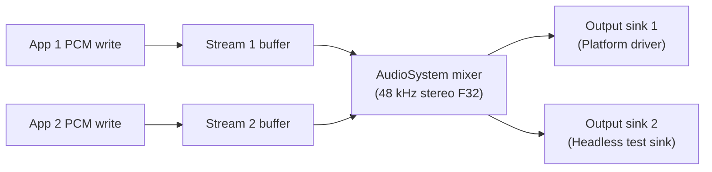

import CodeReference from "@/components/CodeReference.astro";
import HostReference from "@/components/HostReference.astro";

The `audio` crate supplies reusable PCM playback primitives, character device control contracts, and a fixed-capacity software mixer. It lives in the Core repository under `libraries/audio/` and is exposed by the `xila` facade crate when the `audio` feature is enabled.

## Context

Embedded operating systems require sound synthesis and PCM playback without the memory overhead of a persistent audio server daemon. The `audio` library provides caller-owned playback buffers, format conversion, and a compile-time dimensioned multi-stream mixer that routes audio streams into platform output sinks.

## How it works

### PCM formats and configuration

The library handles interleaved little-endian PCM audio with 1 to 8 channels. The <HostReference crate="audio" kind="enum" symbol="SampleFormat" /> enum defines supported formats:

- `U8` (code 0, silence at 128)
- `I16` (code 1, signed 16-bit)
- `I24` (code 2, packed signed 24-bit)
- `I32` (code 3, signed 32-bit)
- `F32` (code 4, nominal full scale -1.0 to 1.0)

The <HostReference crate="audio" kind="struct" symbol="Configuration" /> struct is an 8-byte `repr(C)` descriptor containing `sample_rate: u32`, `channels: u8`, `format: u8`, and two reserved bytes.

### PCM control commands

Character devices in the audio subsystem respond to typed control commands prefixed with `b'A'`:

- `SET_CONFIGURATION` (1): Sets the active `Configuration`.
- `GET_CONFIGURATION` (2): Reads the current `Configuration`.
- `GET_WRITABLE` (3): Queries the number of bytes currently free in the input ring buffer.
- `SET_VOLUME` (4): Sets playback volume as a percentage from 0 to 100.
- `GET_VOLUME` (5): Queries current volume percentage.
- `START` (6): Starts or resumes audio playback.
- `STOP` (7): Pauses playback, preserving queued frames.

Payloads must match the exact size and alignment expected by each command; otherwise the driver returns `Error::InvalidParameter`.

### Single-device playback buffer

The <HostReference crate="audio" kind="struct" symbol="PlaybackBuffer" /> struct provides caller-owned storage for `N` PCM bytes plus cursor and state metadata:

```rust
let mut buffer = PlaybackBuffer::<4096>::new();
let (device, mut renderer) = buffer.split(configuration);
```

- `PlaybackDevice`: Implements character device operations. Non-blocking writes append PCM frames to the buffer, while control commands manage playback state.
- `Renderer`: Borrowed by the platform audio callback to consume mixed PCM frames.

### Multi-stream software mixer

The <HostReference crate="audio" kind="struct" symbol="AudioSystem" /> struct implements a multi-stream mixer:

```rust
AudioSystem<const STREAMS: usize = 4, const STREAM_BYTES: usize = 2048, const MIX_FRAMES: usize = 128, const OUTPUTS: usize = 2, const SINK_BYTES: usize = 3072>
```

The system mixes active streams to **48 kHz stereo interleaved F32**. It must be pinned before creating outputs:

1. `open_stream()`: Reserves an input slot and returns a `StreamHandle`.
2. `open_output()`: Reserves an output sink and returns an `OutputReservation`.
3. `mix_next_block()`: Consumes frames from all active streams, mixes them into a `MIX_FRAMES` buffer using `nanoaudio::Mixer`, and copies the result to each registered output sink. Paused or empty streams contribute silence.
4. If an output sink is full, it drops the block and increments `dropped_blocks()` without delaying other sinks.

### Virtual file system integration

The <HostReference crate="audio" kind="struct" symbol="AudioStreamDevice" /> character device mounts the mixer at `/devices/audio/playback`. When a task opens the device file, the driver reserves an independent stream from the pinned `AudioSystem` and attaches it to the open file context. File writes stream PCM directly into that reservation, and closing the file releases the stream.

The following diagram shows the audio data flow from applications through stream buffers and mixer blocks to platform output sinks:



Applications write PCM frames into their respective stream buffers. The `AudioSystem` mixer periodically pulls frames from active streams, mixes them into 48 kHz stereo F32 blocks, and pushes the result to registered output sinks, such as the platform sound backend or headless test sinks.

## Design choices and trade-offs

- Bounded static memory: Capacities are defined via const generics (`STREAMS`, `STREAM_BYTES`, `MIX_FRAMES`, `OUTPUTS`, `SINK_BYTES`), preventing runtime allocations during playback.
- Non-blocking writes: Writes only accept complete frames that fit in available ring buffer capacity, returning the accepted byte count immediately without blocking task execution.
- Decoupled from codecs: The library handles PCM buffering, volume, and mixing, leaving audio file decoding (WAV, MP3, etc.) to application layers.

## Limits

- Supported channel counts are restricted to 1 through 8.
- The software mixer operates at a fixed internal format of 48 kHz stereo interleaved F32.
- Cloning an open file context for `/devices/audio/playback` is unsupported (`Error::UnsupportedOperation`).

## API reference

- <HostReference crate="audio" />: package documentation and root exports.
- <HostReference crate="audio" kind="struct" symbol="AudioSystem" />: pinned
  multi-stream software mixer.
- <HostReference crate="audio" kind="struct" symbol="AudioStreamDevice" />: VFS
  character device mounting the mixer.
- <HostReference crate="audio" kind="struct" symbol="PlaybackBuffer" />:
  single-device ring buffer storage.
- <HostReference crate="audio" kind="struct" symbol="Configuration" />: PCM
  audio configuration descriptor.
- <HostReference crate="audio" kind="enum" symbol="SampleFormat" />: supported
  PCM sample formats.

## Related

- [Virtual file system](/explanation/architecture/subsystems/virtual_file_system/): Character device mounting and file contexts.
- [Testing](/explanation/architecture/libraries/testing/): Headless audio output for deterministic tests.
