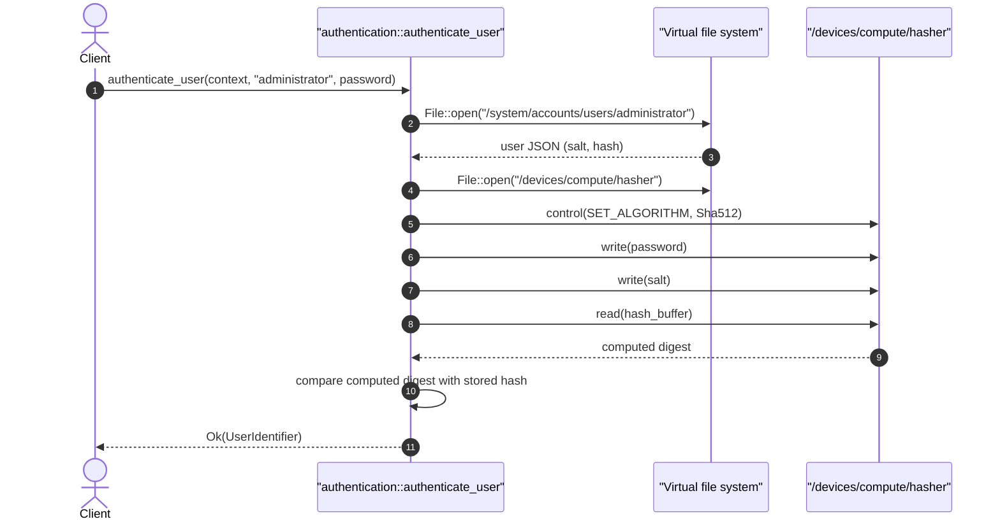

import CodeReference from "@/components/CodeReference.astro";
import HostReference from "@/components/HostReference.astro";

The `authentication` crate provides persistent account management, user and group record operations, and salted password hashing for the Xila host runtime. It lives in the Core repository under `libraries/authentication/` and is exposed by the `xila` facade crate.

## Context

The runtime `users` subsystem manages in-memory user identities and permissions for active tasks, but does not handle persistent storage on disk or cryptographic verification. The `authentication` library bridges the `users` subsystem with the virtual file system (VFS) and device drivers for hardware hashing and entropy, persisting accounts across system reboots.

## How it works

### Password hashing and entropy

The authentication library avoids storing passwords in plain text:

1. Salt generation: Generates a 16-byte random salt by reading `/devices/random/source`. It converts each byte to a lowercase ASCII character (`*byte % 26 + 97`).
2. Hash device interaction: Opens the character device `/devices/compute/hasher` with read/write access.
3. Algorithm selection: Sends the `SET_ALGORITHM` control command specifying `HashAlgorithm::Sha512`.
4. Hashing: Writes the plain text password bytes, writes the salt bytes, reads the 64-byte (512-bit) digest, and encodes it as a lowercase hexadecimal string.

### File layout and storage format

Account records persist as JSON files inside the virtual file system:

- User records: `/system/accounts/users/<user_name>`
- Group records: `/system/accounts/groups/<group_name>`

Records are serialized and deserialized with `miniserde`. The <HostReference crate="authentication" kind="struct" symbol="User" /> struct stores:

- `identifier`: unique 16-bit numerical user identifier (`u16`).
- `name`: human-readable username string.
- `primary_group`: primary group identifier (`u16`).
- `hash`: SHA-512 hexadecimal digest string.
- `salt`: 16-character random salt string.

The <HostReference crate="authentication" kind="struct" symbol="Group" /> struct stores:

- `identifier`: unique 16-bit numerical group identifier (`u16`).
- `name`: human-readable group name string.
- `users`: vector of member user identifiers (`Vec<u16>`).

### Seeded accounts

First-install provisioning uses the <HostReference crate="authentication" kind="fn" symbol="initialize_seeded" /> helper to initialize reference images:

1. Checks for the seed marker file at `SEED_PENDING_PATH` (`/system/accounts/.seed-pending`).
2. Verifies the file contents match `SEED_PENDING_CONTENT` (`b"xila-seed-v1\n"`).
3. Loads existing users and groups via `load_all_users_and_groups`.
4. If the marker is present, seeds the `administrator` group (identifier 1000) and user (identifier 1000) with an empty password.
5. Writes records atomically to temporary files (`.seed-group.tmp` and `.seed-user.tmp`) before renaming them to their final paths.
6. Deletes `/system/accounts/.seed-pending`.

An unmarked disk never authorizes account creation or password replacement during startup.

### Account helpers and runtime operations

The <HostReference crate="authentication" kind="struct" symbol="Context" /> struct packages references to the virtual file system, task manager, users manager, and caller task identifier. Core functions include:

- <HostReference
    crate="authentication"
    kind="fn"
    symbol="load_all_users_and_groups"
  />
  : Scans `/system/accounts/groups` and `/system/accounts/users`, registering
  every record into the users manager.
- <HostReference crate="authentication" kind="fn" symbol="authenticate_user" />:
  Reads the user record, computes the SHA-512 hash using the stored salt,
  compares the result, and returns the verified user identifier.
- <HostReference crate="authentication" kind="fn" symbol="create_user" />:
  Allocates a new user identifier, adds the account to the users manager,
  generates a salt, hashes the password, and writes the user JSON file.
- `change_user_password`: Generates a new random salt, computes the new password hash, and updates the stored record.
- `change_user_name`: Updates the username field and renames the file in `/system/accounts/users/`.
- <HostReference crate="authentication" kind="fn" symbol="create_group" />:
  Allocates a group identifier, registers it in the users manager, and writes
  the group JSON file.

The following diagram shows the sequence of operations during user authentication:

The authentication process begins when a client requests verification with a username and password. The library retrieves the user file from the virtual file system to extract the stored salt and password hash. It opens `/devices/compute/hasher`, configures SHA-512, writes the password and salt bytes, and reads the resulting digest. If the digest matches the stored hash, the library returns the user identifier.

## Design choices and trade-offs

- Device-backed hashing: Offloads cryptographic computation to `/devices/compute/hasher`, allowing hardware-accelerated crypto engines on microcontrollers while keeping the authentication library portable.
- Per-user salt: Every password uses a unique 16-character salt read from `/devices/random/source`, mitigating dictionary and rainbow table attacks.
- JSON storage format: Keeps account records human-readable and inspectable on LittleFS, using `miniserde` for low memory footprint in `no_std` environments.

## Limits

- User and group files are read in fixed 32-byte chunks (`READ_CHUNK_SIZE`).
- User and group identifiers are 16-bit integers (`u16`).
- Hashing is fixed to SHA-512 through the device interface; alternative digest algorithms are not configurable per account.

## API reference

- <HostReference crate="authentication" />: package documentation and root
  exports.
- <HostReference crate="authentication" kind="struct" symbol="Context" />:
  context bundling virtual file system, task, and user managers.
- <HostReference crate="authentication" kind="struct" symbol="User" />: user
  account data model.
- <HostReference crate="authentication" kind="struct" symbol="Group" />: user
  group data model.
- <HostReference crate="authentication" kind="fn" symbol="authenticate_user" />:
  verifies credentials against stored records.
- <HostReference crate="authentication" kind="fn" symbol="create_user" />:
  creates and persists a new user account.
- <HostReference crate="authentication" kind="fn" symbol="initialize_seeded" />:
  provisions default accounts when a seed marker exists.
- <HostReference
    crate="authentication"
    kind="fn"
    symbol="load_all_users_and_groups"
  />
  : loads persisted accounts into the users manager.

## Related

- [Users](/explanation/architecture/subsystems/users/): In-memory user management and permissions.
- [Virtual file system](/explanation/architecture/subsystems/virtual_file_system/): Persistent storage and device access.
- [Testing](/explanation/architecture/libraries/testing/): Test harness devices including mock hasher and entropy sources.
