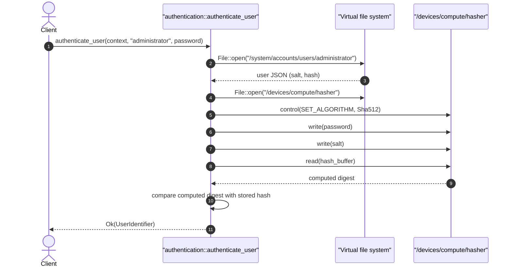

import CodeReference from "@/components/CodeReference.astro";
import HostReference from "@/components/HostReference.astro";

The `authentication` crate provides persistent account management, user and group record operations, and salted password hashing for the Xila host runtime. It lives in the Core repository under `libraries/authentication/`. The `xila` facade crate exposes it.

## Context

The runtime `users` subsystem manages in-memory user identities and permissions for active tasks. It does not handle persistent storage on disk or cryptographic verification. The `authentication` library bridges the `users` subsystem with the virtual file system (VFS) and with device drivers for hardware hashing and entropy. It persists accounts across system reboots.

## How it works

### Password hashing and entropy

The library never stores passwords in plain text:

1. Salt generation: Read a 16-byte random salt from `/devices/random/source`. Convert each byte to a lowercase ASCII character (`*byte % 26 + 97`).
2. Hash device interaction: Open the character device `/devices/compute/hasher` with read and write access.
3. Algorithm selection: Send the `SET_ALGORITHM` control command with `HashAlgorithm::Sha512`.
4. Hashing: Write the password bytes and the salt bytes to the device. Read the 64-byte (512-bit) digest and encode it as a lowercase hexadecimal string.

### File layout and storage format

Account records persist as JSON files inside the virtual file system:

- User records: `/system/accounts/users/<user_name>`
- Group records: `/system/accounts/groups/<group_name>`

The library serializes and deserializes records with `miniserde`. The <HostReference crate="authentication" kind="struct" symbol="User" /> struct stores:

- `identifier`: unique 16-bit user identifier (`u16`).
- `name`: human-readable username string.
- `primary_group`: primary group identifier (`u16`).
- `hash`: SHA-512 hexadecimal digest string.
- `salt`: 16-character random salt string.

The <HostReference crate="authentication" kind="struct" symbol="Group" /> struct stores:

- `identifier`: unique 16-bit group identifier (`u16`).
- `name`: human-readable group name string.
- `users`: vector of member user identifiers (`Vec<u16>`).

### Seeded accounts

First-install provisioning uses the <HostReference crate="authentication" kind="fn" symbol="initialize_seeded" /> helper to initialize reference images:

1. Check for the seed marker file at `SEED_PENDING_PATH` (`/system/accounts/.seed-pending`).
2. Verify that the file contents match `SEED_PENDING_CONTENT` (`b"xila-seed-v1\n"`).
3. Load existing users and groups via `load_all_users_and_groups`.
4. If the marker is present, seed the `administrator` group (identifier 1000) and user (identifier 1000) with an empty password.
5. Write records atomically to temporary files (`.seed-group.tmp` and `.seed-user.tmp`), then rename them to their final paths.
6. Delete `/system/accounts/.seed-pending`.

An unmarked disk never authorizes account creation or password replacement during startup.

### Account helpers and runtime operations

The <HostReference crate="authentication" kind="struct" symbol="Context" /> struct bundles references to the virtual file system, the task manager, the users manager, and the caller task identifier. The main functions include:

- <HostReference
    crate="authentication"
    kind="fn"
    symbol="load_all_users_and_groups"
  />
  : Scan `/system/accounts/groups` and `/system/accounts/users`. Register every
  record in the users manager.
- <HostReference crate="authentication" kind="fn" symbol="authenticate_user" />:
  Read the user record, compute the SHA-512 hash with the stored salt, compare
  the result, and return the verified user identifier.
- <HostReference crate="authentication" kind="fn" symbol="create_user" />:
  Allocate a new user identifier, add the account to the users manager, generate
  a salt, hash the password, and write the user JSON file.
- `change_user_password`: Generate a new random salt, compute the new password hash, and update the stored record.
- `change_user_name`: Update the username field and rename the file in `/system/accounts/users/`.
- <HostReference crate="authentication" kind="fn" symbol="create_group" />:
  Allocate a group identifier, register it in the users manager, and write the
  group JSON file.

The following diagram shows the sequence of operations during user authentication:

A client calls `authenticate_user` with a username and password. The library reads the user file from the virtual file system to get the stored salt and hash. It opens `/devices/compute/hasher`, selects SHA-512, writes the password and salt bytes, and reads the digest. If the digest matches the stored hash, the library returns the user identifier.

## Design choices and trade-offs

- Device-backed hashing: The library offloads hashing to `/devices/compute/hasher`. Microcontrollers can use hardware crypto engines. The library stays portable.
- Per-user salt: Every password uses a unique 16-character salt from `/devices/random/source`. This mitigates dictionary and rainbow table attacks.
- JSON storage format: `miniserde` serializes account records as human-readable JSON on LittleFS with a low memory footprint in `no_std` environments.

## Limits

- User and group files are read in fixed 32-byte chunks (`READ_CHUNK_SIZE`).
- User and group identifiers are 16-bit integers (`u16`).
- Hashing is fixed to SHA-512 through the device interface. Other digest algorithms are not configurable per account.

## API reference

- <HostReference crate="authentication" />: package documentation and root
  exports.
- <HostReference crate="authentication" kind="struct" symbol="Context" />:
  context bundling virtual file system, task, and user managers.
- <HostReference crate="authentication" kind="struct" symbol="User" />: user
  account data model.
- <HostReference crate="authentication" kind="struct" symbol="Group" />: user
  group data model.
- <HostReference crate="authentication" kind="fn" symbol="authenticate_user" />:
  verifies credentials against stored records.
- <HostReference crate="authentication" kind="fn" symbol="create_user" />:
  creates and persists a new user account.
- <HostReference crate="authentication" kind="fn" symbol="initialize_seeded" />:
  provisions default accounts when a seed marker exists.
- <HostReference
    crate="authentication"
    kind="fn"
    symbol="load_all_users_and_groups"
  />
  : loads persisted accounts into the users manager.

## Related

- [Users](/explanation/architecture/subsystems/users/): In-memory user management and permissions.
- [Virtual file system](/explanation/architecture/subsystems/virtual_file_system/): Persistent storage and device access.
- [Testing](/explanation/architecture/libraries/testing/): Test harness devices including mock hasher and entropy sources.
