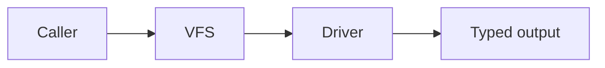

import CodeReference from "@/components/CodeReference.astro";
import Api from "@/components/Api.astro";

The Core `device` crate defines typed control commands for device callers and drivers. A command describes the data that crosses the virtual file system (VFS) device interface.

## Context

The crate groups commands by device kind. The kinds include ADC, audio, GPIO, hash, I2C, neural network, PWM, screen, SPI, and UART. The declarations define contracts. A particular driver determines which operations it implements.

## How it works

The following diagram shows a control command reaching a driver.

A caller sends a typed command through the VFS to a driver. The driver interprets its input and returns its output or an error. The command definitions and kind identifiers are in <CodeReference path="devices/src/lib.rs" />.

### GPIO controls

The GPIO contract uses versioned structures. Their version must equal `ABI_VERSION`, and reserved fields must be zero.

| Command                                                                        | Input          | Output            | Description                                      |
| ------------------------------------------------------------------------------ | -------------- | ----------------- | ------------------------------------------------ |
| <Api path="device::gpio::CONFIGURE"><code>CONFIGURE</code></Api>               | `ConfigureAbi` | `VersionAbi`      | Release and request the line as input or output. |
| <Api path="device::gpio::GET_CAPABILITIES"><code>GET_CAPABILITIES</code></Api> | `VersionAbi`   | `CapabilitiesAbi` | Report line capabilities.                        |
| <Api path="device::gpio::RELEASE"><code>RELEASE</code></Api>                   | `VersionAbi`   | `VersionAbi`      | Release the line.                                |

## Design choices and trade-offs

Typed commands give callers and drivers a shared representation. A driver does not have to support every device kind. The neural-network commands describe a device protocol. The backend trait belongs to the `neural_network` library.

## API reference

- <Api path="device" />: device contracts.
- <CodeReference path="devices/src/gpio.rs" />: GPIO command definitions.
- <CodeReference path="devices/src/neural_network.rs" />: inference device
  protocol.

## Related

- [Neural network](/explanation/architecture/libraries/neural_network/)
- [Peripherals](/explanation/architecture/libraries/peripherals/)
- [Virtual file system](/explanation/architecture/subsystems/virtual_file_system/)
