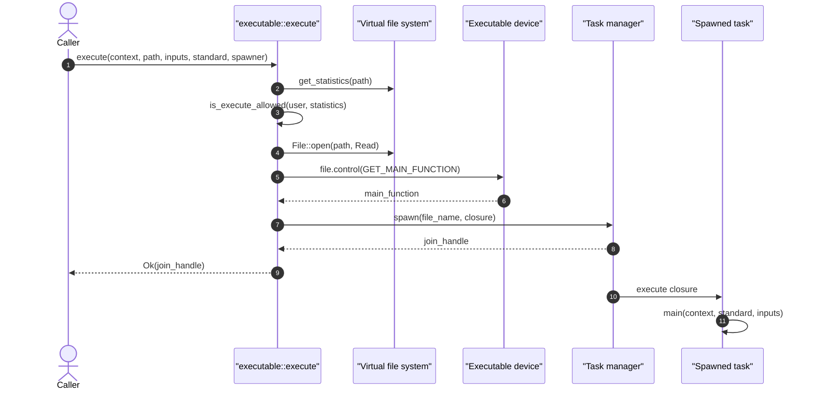

import CodeReference from "@/components/CodeReference.astro";
import HostReference from "@/components/HostReference.astro";

The `executable` crate defines Xila's execution contracts, execution context, standard streams, and task launching facilities. It lives in the Core repository under `libraries/executable/` and is exposed by the `xila` facade crate.

## Context

In Xila, applications and system utilities execute as cooperative asynchronous tasks. Rather than relying on preemptive kernel processes or dynamic ELF linkers, Xila represents executables as virtual file system nodes. The `executable` library provides the bridge between file system nodes, task execution, access control, and standard I/O streams. Subsystems such as the shell and test runners depend on `executable` to launch programs, while applications implement its trait contract.

## How it works

### Executable trait and character device wrapper

Every native program implements the <HostReference crate="executable" kind="trait" symbol="ExecutableTrait" /> trait:

```rust
pub trait ExecutableTrait: 'static + Send + Sync {
    fn main(standard: Standard<'static>, arguments: Vec<String>) -> MainFuture;
}
```

The future returns `Result<(), NonZeroUsize>` wrapped in a pinned box. To integrate with the virtual file system (VFS), an executable is wrapped in `ExecutableWrapper<T: ExecutableTrait>`. The wrapper implements `DirectCharacterDevice` and `DirectBaseOperations`. When the VFS sends the control command `GET_MAIN_FUNCTION`, the wrapper returns a closure that constructs `MainFuture` using the passed standard streams and argument vector.

### Mount executables in the file system

Executables are mounted into the VFS path hierarchy—typically under `/applications/executables/<name>`—using the <HostReference crate="executable" kind="macro" symbol="mount_executables" /> macro. The macro wraps each implementation in `ExecutableWrapper`, mounts it as a character device, and assigns `Permissions::EXECUTABLE`.

### Execution context and capabilities

The <HostReference crate="executable" kind="struct" symbol="ExecutableContext" /> carries shared system manager references required during task execution:

- `task_manager`: static reference to the task manager.
- `users_manager`: static reference to the users manager.
- `virtual_file_system`: static reference to the virtual file system.
- `time_manager`: static reference to the time manager.
- `graphics_manager`: optional reference to the graphics manager, gated by the `graphics` Cargo feature.
- `network_manager`: optional reference to the network manager, gated by the `network` Cargo feature.

### Standard streams

The <HostReference crate="executable" kind="struct" symbol="Standard" /> struct encapsulates three VFS file descriptors: `standard_in`, `standard_out`, and `standard_error`, alongside a static reference to the `ExecutableContext`. It provides helpers such as `read_line` for reading from standard input, `split` for extracting individual streams, and `duplicate` for cloning descriptors across tasks.

### Launching an executable

The <HostReference crate="executable" kind="fn" symbol="execute" /> function coordinates execution:

1. Checks execute permissions using `is_execute_allowed` against file statistics, the current task user, and group memberships.
2. Opens the target executable file in the virtual file system.
3. Checks for set-user-identifier overrides with `get_overridden_user`.
4. Sends the `GET_MAIN_FUNCTION` control command to retrieve the executable entrypoint.
5. Calls `task_manager.spawn` with the executable file name.
6. Inside the spawned task, switches the active user if overridden, then invokes the main entrypoint.
7. Maps success to exit code 0 and errors to negative non-zero values.
8. Returns a `JoinHandle<isize>` to the caller.

The following diagram shows the sequence of steps when launching an executable in Xila:



The sequence begins when the caller passes an execution context, target path, arguments, standard streams, and an optional spawner identifier. The launcher checks file execute permissions and opens the file in the virtual file system. It retrieves the entrypoint closure via the `GET_MAIN_FUNCTION` control command. The launcher spawns a new task on the task scheduler, and returns the join handle to the caller while the spawned task executes `main`.

## Design choices and trade-offs

- Executables as VFS character devices: Enables uniform permission checking, path discovery, and namespace routing without introducing a specialized binary loader in the kernel.
- Explicit capability passing: `ExecutableContext` passes system managers directly, avoiding ambient global state and making subsystem requirements transparent.
- Cooperative async futures: Executables run as futures scheduled on Xila's cooperative task executor. This minimizes stack and RAM overhead on microcontrollers, but requires tasks to yield cooperatively.

## Limits

- `Standard::read_line` operates on single-byte reads with a 10 ms sleep between polls when no input is available.
- `ExecutableWrapper` returns `file_system::Error::UnsupportedOperation` for raw data read and write calls; it only responds to `GET_MAIN_FUNCTION` control commands.
- The `building` feature (which compiles guest Wasm crates via Cargo) requires the host standard library and is intended for build tooling and host integration tests.

## API reference

- <HostReference crate="executable" />: package documentation and entry point.
- <HostReference crate="executable" kind="trait" symbol="ExecutableTrait" />:
  trait defining the executable entry point.
- <HostReference crate="executable" kind="struct" symbol="ExecutableContext" />:
  context carrying system manager references.
- <HostReference crate="executable" kind="struct" symbol="Standard" />: standard
  input, output, and error stream wrapper.
- <HostReference crate="executable" kind="fn" symbol="execute" />: launcher
  function checking permissions and spawning tasks.
- <HostReference crate="executable" kind="macro" symbol="mount_executables" />:
  macro mounting executables into the file system.

## Related

- [Task](/explanation/architecture/subsystems/task/): Cooperative multitasking and task lifecycle.
- [Virtual file system](/explanation/architecture/subsystems/virtual_file_system/): Path routing and device mounting.
- [Users](/explanation/architecture/subsystems/users/): User identifiers and group permissions.
