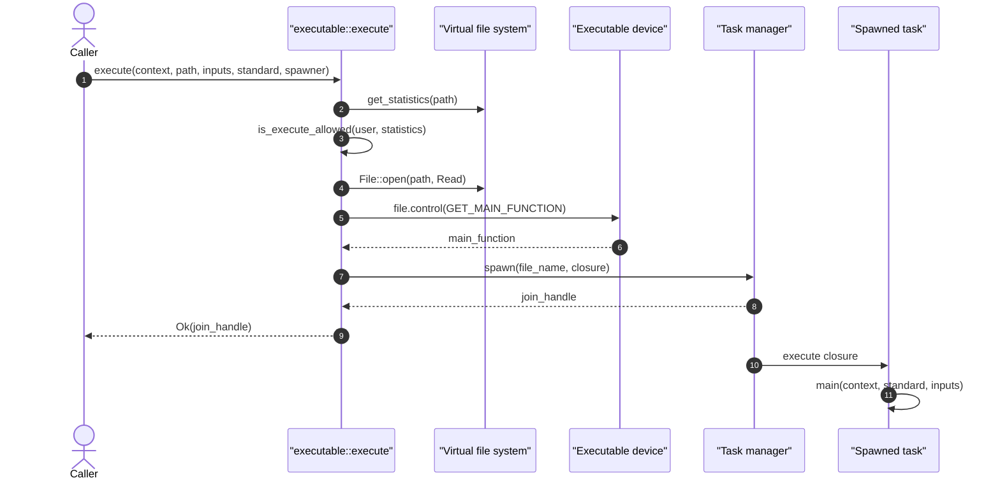

import CodeReference from "@/components/CodeReference.astro";
import Api from "@/components/Api.astro";

The `executable` crate defines Xila's execution contracts, execution context, standard streams, and task launching facilities. It lives in the Core repository under `libraries/executable/`. The `xila` facade crate exposes it.

## Context

In Xila, applications and system utilities run as cooperative asynchronous tasks. Xila does not use preemptive kernel processes or dynamic ELF linkers. It represents executables as virtual file system (VFS) nodes. The `executable` library bridges file system nodes, task execution, access control, and standard I/O streams. Subsystems such as the shell and test runners use `executable` to launch programs. Applications implement its trait contract.

## How it works

### Executable trait and character device wrapper

Every native program implements the <Api path="executable::ExecutableTrait" /> trait:

```rust
pub trait ExecutableTrait: 'static + Send + Sync {
    fn main(standard: Standard<'static>, arguments: Vec<String>) -> MainFuture;
}
```

The future returns `Result<(), NonZeroUsize>` in a pinned box. `ExecutableWrapper<T: ExecutableTrait>` integrates an executable with the virtual file system (VFS). The wrapper implements `DirectCharacterDevice` and `DirectBaseOperations`. When the VFS sends the `GET_MAIN_FUNCTION` control command, the wrapper returns a closure. The closure constructs `MainFuture` from the passed standard streams and argument vector.

### Mount executables in the file system

The <Api path="executable::mount_executables" /> macro mounts executables into the VFS path hierarchy, typically under `/applications/executables/<name>`. It wraps each implementation in `ExecutableWrapper`, mounts it as a character device, and assigns `Permissions::EXECUTABLE`.

### Execution context and capabilities

The <Api path="executable::ExecutableContext" /> struct carries the system manager references required during task execution:

- `task_manager`: static reference to the task manager.
- `users_manager`: static reference to the users manager.
- `virtual_file_system`: static reference to the virtual file system.
- `time_manager`: static reference to the time manager.
- `graphics_manager`: optional reference to the graphics manager, gated by the `graphics` Cargo feature.
- `network_manager`: optional reference to the network manager, gated by the `network` Cargo feature.

### Standard streams

The <Api path="executable::Standard" /> struct holds three VFS file descriptors, `standard_in`, `standard_out`, and `standard_error`, and a static reference to the `ExecutableContext`. Helpers include `read_line` for reading standard input, `split` for extracting individual streams, and `duplicate` for cloning descriptors across tasks.

### Launching an executable

The <Api path="executable::execute" /> function coordinates execution:

1. Check execute permissions with `is_execute_allowed` against file statistics, the current task user, and group memberships.
2. Open the target executable file in the virtual file system.
3. Check for set-user-identifier overrides with `get_overridden_user`.
4. Send the `GET_MAIN_FUNCTION` control command to retrieve the executable entrypoint.
5. Call `task_manager.spawn` with the executable file name.
6. Inside the spawned task, switch the active user if overridden, then invoke the main entrypoint.
7. Map success to exit code 0 and errors to negative non-zero values.
8. Return a `JoinHandle<isize>` to the caller.

The following diagram shows the sequence of steps when launching an executable in Xila:



The caller passes an execution context, target path, arguments, standard streams, and an optional spawner identifier. The launcher checks the file execute permissions and opens the file in the VFS. It retrieves the entrypoint closure with the `GET_MAIN_FUNCTION` control command. It spawns a new task on the task scheduler and returns the join handle. The spawned task then executes `main`.

## Design choices and trade-offs

- Executables as VFS character devices: Uniform permission checking, path discovery, and namespace routing work without a specialized binary loader in the kernel.
- Explicit capability passing: `ExecutableContext` passes system managers directly. This avoids ambient global state and makes subsystem requirements visible.
- Cooperative async futures: Executables run as futures on Xila's cooperative task executor. This minimizes stack and RAM use on microcontrollers. Tasks must yield cooperatively.

## Limits

- `Standard::read_line` operates on single-byte reads with a 10 ms sleep between polls when no input is available.
- `ExecutableWrapper` returns `file_system::Error::UnsupportedOperation` for raw data read and write calls; it only responds to `GET_MAIN_FUNCTION` control commands.
- The `building` feature (which compiles guest Wasm crates via Cargo) requires the host standard library and is intended for build tooling and host integration tests.

## API reference

- <Api path="executable" />: package documentation and entry point.
- <Api path="executable::ExecutableTrait" />: trait defining the executable
  entry point.
- <Api path="executable::ExecutableContext" />: context carrying system manager
  references.
- <Api path="executable::Standard" />: standard input, output, and error stream
  wrapper.
- <Api path="executable::execute" />: launcher function checking permissions and
  spawning tasks.
- <Api path="executable::mount_executables" />: macro mounting executables into
  the file system.

## Related

- [Task](/explanation/architecture/subsystems/task/): Cooperative multitasking and task lifecycle.
- [Virtual file system](/explanation/architecture/subsystems/virtual_file_system/): Path routing and device mounting.
- [Users](/explanation/architecture/subsystems/users/): User identifiers and group permissions.
