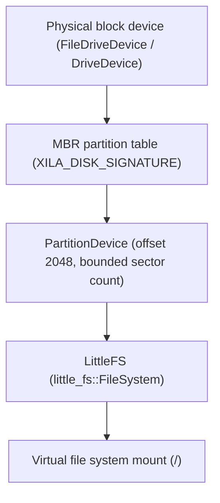

import CodeReference from "@/components/CodeReference.astro";
import DocsRsReference from "@/components/DocsRsReference.astro";
import HostReference from "@/components/HostReference.astro";

The <HostReference crate="file_system" /> crate provides the architectural contract layer for storage, files, directories, and hardware devices in Xila. It defines standardized operation traits. The virtual file system (VFS) consumes these traits. Concrete storage engines and device drivers implement them.

## Context

Storage hardware in embedded and desktop systems varies from raw NOR/NAND flash memory and SD cards to memory-backed virtual disks. The `file_system` crate abstracts these differences into uniform interfaces: character devices for stream-oriented data, block devices for fixed-size sector access, and file system operations for hierarchical directory trees.

Higher-level subsystems such as the [Virtual file system](/explanation/architecture/subsystems/virtual_file_system/) use `file_system` traits to resolve paths and dispatch control commands without depending on concrete hardware drivers. Concrete storage engines such as [Little FS](/explanation/architecture/libraries/little_fs/) implement these traits for persistent file storage.

## How it works

### Device abstractions and the polling model

The crate defines two categories of hardware devices:

- <HostReference crate="file_system" kind="trait" symbol="CharacterDevice" />:
  stream-oriented devices such as serial ports, sensors, and pipes. They
  implement
  <HostReference crate="file_system" kind="trait" symbol="BaseOperations" /> to
  support contextual, asynchronous byte transfers and typed control commands.
- <HostReference crate="file_system" kind="trait" symbol="BlockDevice" />:
  sector-oriented storage media such as flash chips, SD cards, and disk images.
  In addition to base operations, block devices implement
  <HostReference crate="file_system" kind="trait" symbol="MountOperations" />
  for mounting.

Synchronous and direct environments use <HostReference crate="file_system" kind="trait" symbol="DirectCharacterDevice" /> and <HostReference crate="file_system" kind="trait" symbol="DirectBlockDevice" />. These traits provide context-free synchronous wrappers (`read_sync`, `write_sync`, `flush_sync`, `control_sync`).

Block devices expose standardized geometry commands defined through the <HostReference crate="file_system" kind="macro" symbol="define_command" /> macro:

- <HostReference
    crate="file_system/block_device"
    kind="struct"
    symbol="GET_BLOCK_SIZE"
  >
    <code>file_system::block_device::GET_BLOCK_SIZE</code>
  </HostReference>
  : returns the device block size in bytes as a `u32` value.
- <HostReference
    crate="file_system/block_device"
    kind="struct"
    symbol="GET_BLOCK_COUNT"
  >
    <code>file_system::block_device::GET_BLOCK_COUNT</code>
  </HostReference>
  : returns the total block count as a `Size` (`u64`) value.
- <HostReference crate="file_system/block_device" kind="struct" symbol="ERASE">
    <code>file_system::block_device::ERASE</code>
  </HostReference>
  : prepares a byte range for writing using an
  <HostReference
    crate="file_system/block_device"
    kind="struct"
    symbol="EraseRange"
  >
    <code>EraseRange</code>
  </HostReference>
  structure.

:::caution[Block erasure causes irreversible data loss]
Sending the `ERASE` control command or formatting a block device resets the specified block range. On raw flash media, erased blocks read back unspecified data. Rewrite them before use.
:::

Device read and write operations return `core::task::Poll<file_system::Result<T>>`. When an operation cannot complete immediately, the driver registers a waker and returns `Poll::Pending`. The synchronous helpers attempt the operation once. They return `Error::RessourceBusy` instead of busy-spinning when the driver reports a pending status.

### Master Boot Record handling

The `mbr` module parses, validates, and writes Master Boot Record (MBR) partition tables using the <DocsRsReference crate="mbrman" /> crate.

Every Xila disk image carries the disk signature <HostReference crate="file_system" kind="constant" symbol="XILA_DISK_SIGNATURE" />, defined as `u32::from_le_bytes(*b"Xila")` (`0x616C6958`). The partition manager reserves the first 2,048 sectors (`Mbr::MINIMUM_START_BLOCK`) for the partition table and alignment.

<HostReference crate="file_system/mbr" kind="struct" symbol="Mbr">
  <code>file_system::mbr::Mbr</code>
</HostReference>
provides disk formatting and partition lookup:

- `Mbr::validate` checks boot signatures, verifies that no partitions overlap, and enforces that at most one partition is marked bootable.
- `Mbr::format_disk_with_signature_and_partition` writes an MBR header with the specified disk signature and a single <HostReference crate="file_system/mbr" kind="enum" symbol="PartitionKind"><code>PartitionKind::Xila</code></HostReference> partition starting at sector 2,048.
- <HostReference
    crate="file_system/mbr"
    kind="fn"
    symbol="create_partition_device"
  >
    <code>file_system::mbr::create_partition_device</code>
  </HostReference>
  wraps an MBR partition entry into a
  <HostReference crate="file_system" kind="struct" symbol="PartitionDevice" />.

### Block device stack

The following diagram shows how storage layers compose from physical media to the virtual file system mount point.



When a runtime boots:

1. The platform driver opens the underlying physical block storage, such as `FileDriveDevice` on Linux or `DriveDevice` in the browser.
2. The runtime reads the MBR partition table and validates `XILA_DISK_SIGNATURE` and partition boundaries.
3. A `PartitionDevice` wraps the physical block device. It translates partition-relative offsets and prevents operations outside partition limits.
4. `LittleFS` initializes its filesystem structures on top of the `PartitionDevice`.
5. The VFS mounts the filesystem instance as the root filesystem `/`.

For mounting details and runtime control flow, see the [Virtual file system](/explanation/architecture/subsystems/virtual_file_system/) documentation.

### In-memory simulation

For automated testing and development without physical hardware, the crate provides <HostReference crate="file_system" kind="struct" symbol="MemoryDevice" />. It implements `DirectBlockDevice` over an in-memory byte buffer guarded by a synchronization lock. The block size is a const generic parameter:

```rust
use file_system::{DirectBaseOperations, MemoryDevice};

let device = MemoryDevice::<512>::new(1024 * 1024);
let data = b"Sample data payload";
let written = device.write_sync(data, 0).unwrap();
assert_eq!(written, data.len());
```

## Design choices and trade-offs

- **Separation of contracts and policy**: `file_system` specifies operation traits, geometry commands, and partition structures. Namespace mounting, caller permissions, and path routing belong strictly to the VFS.
- **`no_std` compatibility**: the whole crate compiles in `no_std` environments. Microcontroller firmware, WebAssembly runtimes, and desktop platforms share the same trait contracts.
- **Non-blocking direct attempts**: the synchronous wrappers make a single attempt and cancel registration on pending status. This prevents hidden retries and thread deadlocks on the executor.

## Limits

- `PartitionDevice` relies on the concurrency guarantees of the underlying block device; it does not add internal locking.
- MBR partition tables accommodate at most four primary partition entries.
- The `ERASE` command requires hardware support. Devices that rewrite sectors in place return `Error::UnsupportedOperation`, which LittleFS handles as a no-op.

## API reference

- <HostReference crate="file_system" />: crate root and fundamental types.
- <HostReference crate="file_system" kind="trait" symbol="BlockDevice" />: block
  device abstraction.
- <HostReference crate="file_system" kind="trait" symbol="CharacterDevice" />:
  character device abstraction.
- <HostReference
    crate="file_system"
    kind="trait"
    symbol="FileSystemOperations"
  />
  : file system backend contract.
- <HostReference crate="file_system" kind="struct" symbol="PartitionDevice" />:
  partition boundary wrapper.
- <HostReference crate="file_system/mbr" kind="struct" symbol="Mbr">
    <code>file_system::mbr::Mbr</code>
  </HostReference>
  : MBR partition table parser and validator.

## Related

- [Little FS](/explanation/architecture/libraries/little_fs/)
- [Peripherals](/explanation/architecture/libraries/peripherals/)
- [Device](/explanation/architecture/libraries/device/)
- [Virtual file system](/explanation/architecture/subsystems/virtual_file_system/)
