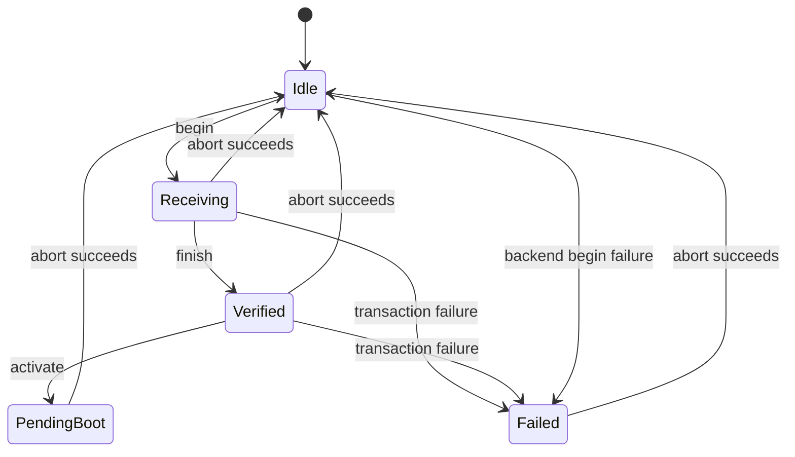

import HostReference from "@/components/HostReference.astro";
import CodeReference from "@/components/CodeReference.astro";

The Core `firmware_update` library manages a firmware update transaction through a platform backend. Its device adapter exposes the transaction through the virtual file system (VFS).

## Context

<HostReference crate="firmware_update" kind="struct" symbol="Update" /> owns a
<HostReference crate="firmware_update" kind="trait" symbol="FirmwareBackend" />.
The backend defines the image format, trust, staging geometry, and persistent
boot state. The transaction tracks the current stream in memory.

## How it works

The following diagram shows successful transaction transitions and failure recovery.

A successful begin declares the image length. Writes stream data to the backend. Finish checks the received length and obtains a verification proof. Activation consumes that proof. Abort calls the backend and clears the transaction state when it succeeds. Confirmation of the running image is a separate backend operation that is allowed in `Idle`.

The optional device adapter exposes `/devices/system/firmware`. Its control commands manage the transaction. Writes supply image bytes. See <CodeReference path="libraries/firmware_update/src/device.rs" /> for the device contract.

## Design choices and trade-offs

The backend owns verification and boot policy. The transaction keeps a proof between finish and activation. A backend failure can put the transaction in `Failed`. Closing the device does not activate an image.

## API reference

- <HostReference crate="firmware_update" />: update contracts.
- <HostReference crate="firmware_update" kind="enum" symbol="State" />:
  transaction states.
- <CodeReference path="libraries/firmware_update/src/device.rs" />: device
  adapter.

## Related

- [Virtual file system](/explanation/architecture/subsystems/virtual_file_system/)
