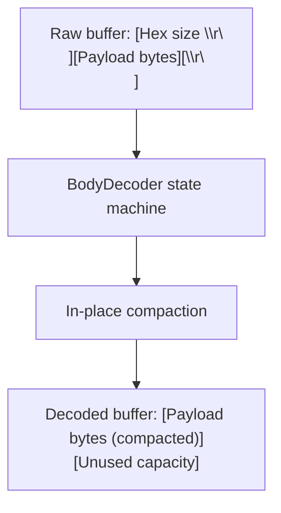

import CodeReference from "@/components/CodeReference.astro";
import HostReference from "@/components/HostReference.astro";

The `xila_http` crate provides bounded, `no_std` HTTP/1.1 response parsing, in-place chunked transfer decoding, and request framing helpers. It lives in the Core repository under `libraries/http/` and is published as the `xila_http` package.

## Context

Embedded networking stacks cannot afford arbitrary buffer growth or dynamic heap allocations when communicating with web APIs and remote servers. The `xila_http` library provides sans-I/O response framing and in-place chunk decoding that operate within caller-managed, fixed-size buffers, supporting streaming HTTP exchanges across the virtual file system (VFS).

## How it works

### Bounded response head parsing

The <HostReference crate="xila_http" kind="fn" symbol="parse_response_head" /> function parses an HTTP response head without heap allocations:

```rust
pub fn parse_response_head<const N: usize>(
    input: &[u8],
    head_request: bool,
) -> Result<Option<ResponseHead>, Error>
```

It borrows a caller-managed buffer and allocates a stack array of `[httparse::EMPTY_HEADER; N]`. The memory overhead on the stack is exactly `N * size_of::<httparse::Header>()` bytes.

- If the buffer contains an incomplete head, it returns `Ok(None)`, signaling that more data must be received from the network.
- It parses status codes and headers case-insensitively.
- Informational responses (1xx), `204 No Content`, `304 Not Modified`, and responses to `HEAD` requests are classified as <HostReference crate="xila_http" kind="enum" symbol="BodyKind" />`::Empty`.
- Protocol upgrade attempts (`101 Switching Protocols`) are rejected with `Error::UnsupportedUpgrade`.
- Inspects `Transfer-Encoding` for `chunked` framing and reads `Content-Length`.

### Body framing modes

The <HostReference crate="xila_http" kind="enum" symbol="BodyKind" /> enum distinguishes four framing modes:

- `Empty`: No response body is expected.
- `Length(u64)`: The body length is fixed and specified by a valid `Content-Length` header.
- `Chunked`: The payload uses HTTP/1.1 chunked transfer coding.
- `UntilClose`: The body continues until the transport connection closes.

### In-place chunked transfer decoding

The <HostReference crate="xila_http" kind="struct" symbol="BodyDecoder" /> struct decodes chunked bodies directly in place inside caller-provided memory:

```rust
let mut decoder = BodyDecoder::new(head.body);
let decoded_bytes = decoder.decode(&mut buffer[..read_bytes])?;
```

The decoder maintains an internal state machine (`ChunkState`) spanning chunk size parsing, extension stripping, CRLF validation, payload copying, and trailer consumption. As chunk framing metadata is parsed and discarded, payload bytes are shifted forward in the same buffer, compacting decoded data without secondary heap allocations.

- `is_complete()`: Returns whether the full response body or terminating zero-length chunk has been received.
- `finish()`: Returns `Ok(())` if the transfer finished cleanly, or `Err(Error::Truncated)` if the stream ended prematurely.

The following diagram shows how `BodyDecoder` compacts chunked HTTP transfer frames in-place within a single buffer:



Incoming data contains chunk boundaries, hexadecimal lengths, and carriage-return line-feeds. The decoder state machine strips delimiter tokens and copies payload bytes toward the start of the buffer, leaving valid decoded content ready for application consumption without separate copy buffers.

### Request and response builders

The library also supplies fixed-buffer formatting and parsing abstractions:

- <HostReference crate="xila_http" kind="struct" symbol="HttpRequestBuilder" />:
  Formats request lines, headers, and payloads into a byte slice.
- `HttpRequestParser`: Parses request method, path, and headers from an input buffer.
- <HostReference crate="xila_http" kind="struct" symbol="HttpResponseBuilder" />
  : Formats response status lines, headers, and chunked frames via `add_chunk`
  and `finish_chunks`.
- `HttpResponseParser`: Extracts response status code, headers, and body slices from a buffer.

## Design choices and trade-offs

- Sans-I/O architecture: Protocol parsing is isolated from sockets, event loops, and TLS engines. The caller retains complete control over transport scheduling and memory.
- In-place decoding: Eliminates double-buffering and secondary allocations, allowing streaming HTTP on microcontrollers with constrained RAM.
- Stack-bounded parsing: The caller configures the maximum header count `N` as a const generic, bounding stack usage deterministically.

## Limits

- HTTP/1.1 only; HTTP/2 and HTTP/3 multiplexing are not supported.
- Pipelined requests and protocol upgrades are unsupported.
- Payload compression (such as gzip or deflate) is not performed by `xila_http`.

## API reference

- <HostReference crate="xila_http" />: package documentation and root exports.
- <HostReference crate="xila_http" kind="fn" symbol="parse_response_head" />:
  non-allocating response head parser.
- <HostReference crate="xila_http" kind="struct" symbol="BodyDecoder" />:
  in-place streaming body decoder.
- <HostReference crate="xila_http" kind="enum" symbol="BodyKind" />:
  representation of expected response body framing.
- <HostReference crate="xila_http" kind="struct" symbol="HttpRequestBuilder" />:
  fixed-buffer HTTP request builder.
- <HostReference crate="xila_http" kind="struct" symbol="HttpResponseBuilder" />
  : fixed-buffer HTTP response and chunk builder.

## Related

- [Network](/explanation/architecture/subsystems/network/): Network sockets and interface management.
- [Shared](/explanation/architecture/libraries/shared/): Reusable URL parsing and utility re-exports.
