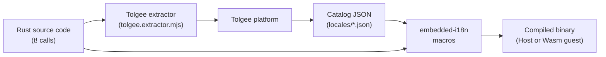

import CodeReference from "@/components/CodeReference.astro";
import DocsRsReference from "@/components/DocsRsReference.astro";

Xila uses the external <DocsRsReference crate="embedded-i18n" /> dependency for build-time localization. Core re-exports it as `xila::internationalization`. It provides compile-time string extraction, plural formatting, and catalog verification without requiring a dynamic runtime dictionary.

## Context

Embedded microcontrollers cannot afford the RAM and storage overhead of loading runtime translation files from disk. Instead, Xila compiles localized strings directly into binaries at build time. Subsystems, libraries, and applications share a single compile-time localization system that produces zero-allocation, statically verified UI strings.

## How it works

### Macro integration and crate configuration

Each translating crate configures its localization metadata in `Cargo.toml`:

```toml
[package.metadata.i18n]
load-path = "locales"
default-locale = "en"
fallback = ["en"]
strict = true
```

At the crate root, the macro declares the translation catalog path:

```rust
embedded_i18n::i18n!("locales");
```

Source files retrieve translated strings using the `t!` macro:

```rust
let label = xila::internationalization::t!("alarm.controls.delete");
let message = xila::internationalization::t!("stopwatch.laps.recorded", count = count);
```

The `locale!()` macro returns the active compiled locale identifier as a string literal. C-string literals can be created at compile time via `t!(c"...")`, returning a statically allocated `&'static CStr`.

### Build-time locale selection

The build locale is selected by the `EMBEDDED_I18N_LOCALE` environment variable:

```sh
export EMBEDDED_I18N_LOCALE="fr"
```

The default locale in `.cargo/config.toml` is `en`. Core and Applications ship catalogs for these locales:

- English (`en`)
- French (`fr`)
- Spanish (`es`)
- German (`de`)
- Brazilian Portuguese (`pt-BR`)
- Italian (`it`)
- Polish (`pl`)
- Japanese (`ja`)
- Simplified Chinese (`zh-CN`)

Because translations are compiled into each target, host binaries, guest WebAssembly modules, and seeded disk images must be built for the same locale to match.

### Catalog structure and Tolgee integration

Translation catalogs live in per-crate `locales/<locale>.json` files using nested JSON objects:

```json
{
  "alarm": {
    "controls": {
      "delete": "Delete"
    }
  }
}
```

Keys are stable dotted semantic identifiers (`feature.component.purpose`) rather than English text. For pluralized text, CLDR categories (`one`, `few`, `many`, `other`) form the leaf nodes of the hierarchy.

Tolgee configuration is defined in `tolgee.config.ts` in Core and Applications. It specifies `format: "JSON_C"` with `pull.delimiter: "."` to export structured nested JSON. The extractor in `tolgee.extractor.mjs` scans Rust source files for macro invocations.

The following diagram shows how translation catalogs are extracted, synchronized, and compiled into Xila binaries:



Rust source files containing `t!` macro invocations are processed by the Tolgee extractor to synchronize keys with the translation server. The resulting JSON catalogs are compiled alongside the Rust source by `embedded-i18n` procedural macros, producing final host binaries and guest WebAssembly executables with embedded translations.

## Design choices and trade-offs

- Zero runtime overhead: Translations are embedded at compile time, eliminating file system I/O, string parsing, and heap allocation for static text.
- Build-time selection: Language selection requires building and running an image targeting that locale; there is no dynamic language switching service at runtime.
- Strict compile-time checks: Strict checking rejects missing translation keys, mismatched format placeholders, or absent plural categories during compilation.

## Limits

- Runtime language switching is not supported without rebuilding and deploying matching artifacts.
- Simplified Chinese (`zh-CN`) is generated from a font subset covering only translated values, not full CJK character ranges.

## API reference

- <DocsRsReference crate="embedded-i18n" />: external library documentation on
  docs.rs.
- <CodeReference path="core/src/lib.rs" />: re-export of `embedded_i18n as
  internationalization`.
- <CodeReference path="tolgee.config.ts" />: Tolgee configuration file for Core.
- <CodeReference path="tools/localization/README.md" />: localization
  guidelines, conventions, and checks.

## Related

- [Development commands](/reference/development-commands/): Mise tasks for localization linting and checks.
- [Graphics](/explanation/architecture/subsystems/graphics/): Font generation and text rendering.
- [Executable](/explanation/architecture/libraries/executable/): Native program launching and capability passing.
