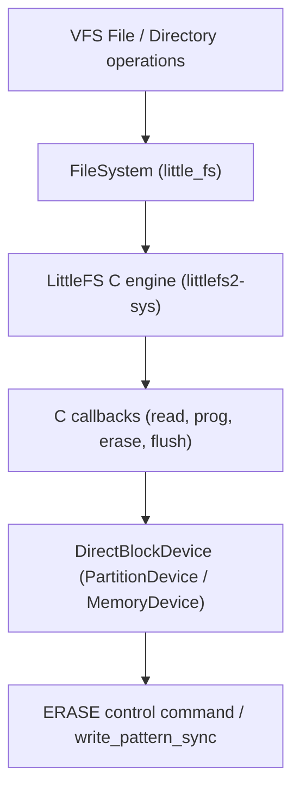

import CodeReference from "@/components/CodeReference.astro";
import DocsRsReference from "@/components/DocsRsReference.astro";
import HostReference from "@/components/HostReference.astro";

The <HostReference crate="little_fs" /> crate provides a fail-safe, power-loss-resilient file system backend for Xila. It integrates the LittleFS C library through the <DocsRsReference crate="littlefs2" /> ecosystem and adapts it to Xila's storage traits.

## Context

Embedded systems and microcontrollers require file systems resilient to sudden power interruptions and flash wear. Standard desktop file systems often fail to recover cleanly from uncommitted writes and demand excessive RAM for caching.

`little_fs` bridges the C implementation of LittleFS with Xila's <HostReference crate="file_system" kind="trait" symbol="FileSystemOperations" /> trait. It operates over any storage driver implementing <HostReference crate="file_system" kind="trait" symbol="DirectBlockDevice" />, including partition devices, flash memories, and origin-private browser storage.

## How it works

### Block geometry and configuration parameters

When initializing or formatting a filesystem, `little_fs` queries block parameters directly from the underlying `DirectBlockDevice`:

- **Block size**: queried via `GET_BLOCK_SIZE`. The configuration requires the block size to be a multiple of the cache size (`block_size % cache_size == 0`).
- **Block count**: queried via `GET_BLOCK_COUNT`.
- **Cache and lookahead sizes**: both set to the caller-supplied `cache_size` (for example, 256 bytes in native and browser runtimes). The lookahead buffer size must be a multiple of 8.
- **Read and program sizes**: set to 16 bytes by default in `Configuration::new`.
- **Block cycles**: set to `None` (`-1` in raw `littlefs::lfs_config`), disabling wear-leveling cycle limits unless explicitly configured.

```rust
use little_fs::FileSystem;

// Mount an existing formatted partition with a 256-byte cache:
let filesystem = FileSystem::new(device, 256)?;
```

### C callback bridge and erase handling

LittleFS issues synchronous C callbacks for media operations. The `callbacks` module routes these calls to the underlying device:

- `read_callback`: translates `(block, offset)` into an absolute byte position (`block * block_size + offset`) and calls `device.read_sync`.
- `programm_callback`: translates `(block, offset)` into an absolute byte position and calls `device.write_sync`.
- `erase_callback`: calculates the block start position and calls `device.erase(position, block_size)`. If the device returns `Error::UnsupportedOperation` (such as rewritable RAM or file-backed disks), the callback clears the sector by writing a zeroed pattern with `write_pattern_sync(&[0x00], block_size, position)`.
- `flush_callback`: calls `device.flush_sync` to ensure buffered writes reach hardware.

The following flowchart illustrates how LittleFS callbacks interact with device contracts:



Because C callbacks execute synchronously on the executor thread, drivers must complete immediately. If a driver returns `Poll::Pending` or a short byte count, the callback returns `LFS_ERR_IO` instead of spinning.

### Formatting and mounting behavior

`little_fs` supports three distinct mount workflows:

1. <HostReference crate="little_fs" kind="fn" symbol="mount_disk" />: the
   standard entry point used by production platforms. It reads the Master Boot
   Record, verifies
   <HostReference
     crate="file_system"
     kind="constant"
     symbol="XILA_DISK_SIGNATURE"
   />
   , checks partition boundaries against total block count, locates the Xila
   partition, and mounts it using `FileSystem::new`. If the partition table or
   filesystem is invalid, `mount_disk` aborts with an error without modifying
   the disk.
2. `FileSystem::new`: mounts an existing filesystem without formatting. If the root directory lacks internal metadata, it initializes the root attributes (`/` with directory kind) while preserving stored files.
3. `FileSystem::format`: reformats the entire storage block using `lfs_format`.

:::caution[Formatting erases all stored data]
Calling `FileSystem::format` or `FileSystem::get_or_format` wipes existing directories and files on the target partition. Production boot paths use `mount_disk` to prevent accidental data erasure on corrupted disks.
:::

## Design choices and trade-offs

- **Static device binding**: the filesystem context holds a `'static` reference to the block device. In production runtimes, devices are leaked or placed in static memory to satisfy lifetime requirements safely.
- **Fail-safe mounting**: existing disks are never reformatted on mount failure. Corrupted images return `Error::InvalidFile` to allow caller diagnosis and backup recovery.
- **MutexMountWrapper**: filesystem instances wrap the raw `littlefs::lfs_t` pointer inside a `MutexMountWrapper`, providing thread-safe concurrency across multiple tasks while guarding against use-after-unmount errors.

## Limits

- The block size must be an exact multiple of the cache size.
- File names cannot exceed 255 bytes (`LFS_NAME_MAX`).
- Extended attributes store metadata up to 1,022 bytes (`LFS_ATTR_MAX`).

## API reference

- <HostReference crate="little_fs" /> — crate root.
- <HostReference crate="little_fs" kind="struct" symbol="FileSystem" /> —
  concrete LittleFS filesystem instance.
- <HostReference crate="little_fs" kind="fn" symbol="mount_disk" /> — safe disk
  mounting without reformatting.
- <HostReference crate="file_system" kind="trait" symbol="DirectBlockDevice" />—
  underlying block device contract.
- <HostReference crate="file_system/block_device" kind="struct" symbol="ERASE">
    <code>file_system::block_device::ERASE</code>
  </HostReference>
  — sector erase command.

## Related

- [File system](/explanation/architecture/libraries/file_system/)
- [Virtual file system](/explanation/architecture/subsystems/virtual_file_system/)
- [Browser storage](/explanation/browser-storage/)
