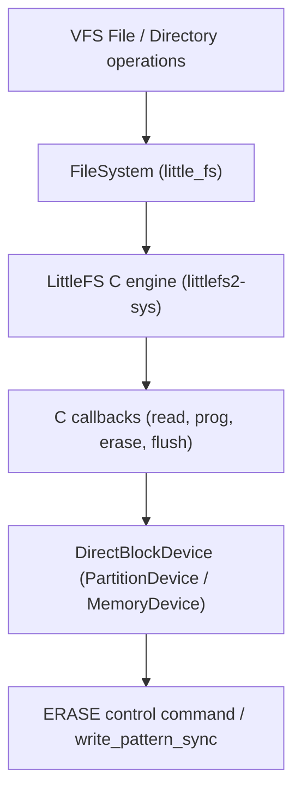

import CodeReference from "@/components/CodeReference.astro";
import DocsRsReference from "@/components/DocsRsReference.astro";
import Api from "@/components/Api.astro";

The <Api path="little_fs" /> provides a fail-safe, power-loss-resilient file system backend for Xila. It integrates the LittleFS C library through the <DocsRsReference crate="littlefs2" /> ecosystem and adapts it to Xila's storage traits.

## Context

Microcontrollers need file systems that survive sudden power interruptions and flash wear. Desktop file systems often fail to recover from uncommitted writes and demand large RAM caches.

`little_fs` bridges the C implementation of LittleFS with Xila's <Api path="file_system::FileSystemOperations" /> trait. It operates over any storage driver that implements <Api path="file_system::DirectBlockDevice" />, including partition devices, flash memories, and origin-private browser storage.

## How it works

### Block geometry and configuration parameters

When initializing or formatting a filesystem, `little_fs` queries block parameters directly from the underlying `DirectBlockDevice`:

- **Block size**: queried via `GET_BLOCK_SIZE`. The block size must be a multiple of the cache size (`block_size % cache_size == 0`).
- **Block count**: queried via `GET_BLOCK_COUNT`.
- **Cache and lookahead sizes**: both set to the caller-supplied `cache_size` (for example, 256 bytes in native and browser runtimes). The lookahead buffer size must be a multiple of 8.
- **Read and program sizes**: set to 16 bytes by default in `Configuration::new`.
- **Block cycles**: set to `None` (`-1` in raw `littlefs::lfs_config`). Wear-leveling cycle limits stay disabled unless explicitly configured.

```rust
use little_fs::FileSystem;

// Mount an existing formatted partition with a 256-byte cache:
let filesystem = FileSystem::new(device, 256)?;
```

### C callback bridge and erase handling

LittleFS issues synchronous C callbacks for media operations. The `callbacks` module routes these calls to the underlying device:

- `read_callback`: Translate `(block, offset)` into an absolute byte position (`block * block_size + offset`) and call `device.read_sync`.
- `programm_callback`: Translate `(block, offset)` into an absolute byte position and call `device.write_sync`.
- `erase_callback`: Compute the block start position and call `device.erase(position, block_size)`. If the device returns `Error::UnsupportedOperation`, for example on rewritable RAM or file-backed disks, clear the sector with `write_pattern_sync(&[0x00], block_size, position)`.
- `flush_callback`: Call `device.flush_sync` so buffered writes reach the hardware.

The following flowchart illustrates how LittleFS callbacks interact with device contracts:



Drivers must complete immediately, because C callbacks run synchronously on the executor thread. If a driver returns `Poll::Pending` or a short byte count, the callback returns `LFS_ERR_IO` instead of spinning.

### Formatting and mounting behavior

`little_fs` supports three mount workflows:

1. <Api path="little_fs::mount_disk" />: the standard entry point used by
   production platforms. It reads the Master Boot Record, verifies
   <Api path="file_system::XILA_DISK_SIGNATURE" />, checks partition boundaries
   against the total block count, locates the Xila partition, and mounts it with
   `FileSystem::new`. If the partition table or the filesystem is invalid,
   `mount_disk` returns an error and does not modify the disk.
2. `FileSystem::new`: mounts an existing filesystem without formatting. If the root directory lacks internal metadata, it initializes the root attributes (`/` with directory kind) while preserving stored files.
3. `FileSystem::format`: reformats the entire storage block using `lfs_format`.

:::caution[Formatting erases all stored data]
Calling `FileSystem::format` or `FileSystem::get_or_format` wipes existing directories and files on the target partition. Production boot paths use `mount_disk` to prevent accidental data erasure on corrupted disks.
:::

## Design choices and trade-offs

- **Static device binding**: the filesystem context holds a `'static` reference to the block device. In production runtimes, devices are leaked or placed in static memory to satisfy the lifetime requirements.
- **Fail-safe mounting**: existing disks are never reformatted on mount failure. Corrupted images return `Error::InvalidFile` to allow caller diagnosis and backup recovery.
- **MutexMountWrapper**: filesystem instances wrap the raw `littlefs::lfs_t` pointer in a `MutexMountWrapper`. This gives thread-safe access across tasks and guards against use-after-unmount errors.

## Limits

- The block size must be an exact multiple of the cache size.
- File names cannot exceed 255 bytes (`LFS_NAME_MAX`).
- Extended attributes store metadata up to 1,022 bytes (`LFS_ATTR_MAX`).

## API reference

- <Api path="little_fs" />: crate root.
- <Api path="little_fs::FileSystem" />: concrete LittleFS filesystem instance.
- <Api path="little_fs::mount_disk" />: safe disk mounting without reformatting.
- <Api path="file_system::DirectBlockDevice" />: underlying block device
  contract.
- <Api path="file_system::block_device::ERASE">
    <code>file_system::block_device::ERASE</code>
  </Api>
  : sector erase command.

## Related

- [File system](/explanation/architecture/libraries/file_system/)
- [Virtual file system](/explanation/architecture/subsystems/virtual_file_system/)
- [Browser storage](/explanation/browser-storage/)
