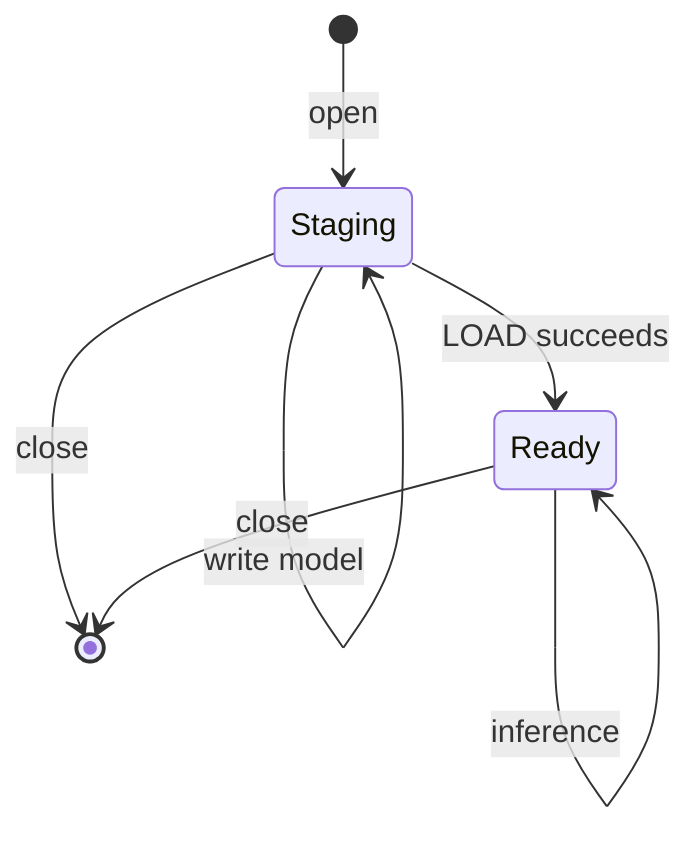

import HostReference from "@/components/HostReference.astro";
import CodeReference from "@/components/CodeReference.astro";

The Core `neural_network` library defines the contract between inference backends and device adapters. It lets a runtime expose model inference through the virtual file system (VFS).

## Context

A <HostReference crate="neural_network" kind="trait" symbol="Backend" /> represents a prepared model and creates independent execution storage. The Core neural-network driver adapts a backend to character-device operations. A <HostReference crate="neural_network" kind="trait" symbol="Loader" /> can prepare a backend from model bytes.

## How it works

The following diagram shows the loader descriptor lifecycle.

The descriptor starts in staging. The caller writes model bytes sequentially and sends <HostReference crate="device/neural_network" kind="struct" symbol="LOAD"><code>LOAD</code></HostReference> with a `LoadRequest`. After successful loading, it queries input information, selects an input, seeks to zero and writes tensor bytes. `COMPUTE` runs inference; the caller selects an output, seeks to zero and reads its bytes. Closing releases the model and execution state.

The native runtime mounts a CPU loader at `/devices/nn/cpu` when its neural-network feature is enabled. See <CodeReference repo="platforms" path="examples/native/src/main.rs" /> for its registration.

## Design choices and trade-offs

The backend supplies views directly into execution or model storage; the adapter does not stage tensors. Each loader defines its maximum model size. A fixed-model device can expose an already prepared backend without the loading stage.

## Limits

Inference commands before a successful load and a second load on a ready descriptor return `InvalidContext`. Model writes must be contiguous. The version-one tensor metadata supports a maximum rank of six.

## API reference

- <HostReference crate="neural_network" /> — inference contracts.
- <HostReference
    crate="drivers_neural_network"
    kind="struct"
    symbol="NeuralNetworkDevice"
  />
  — fixed-model adapter.
- <HostReference
    crate="drivers_neural_network"
    kind="struct"
    symbol="LoaderDevice"
  />
  — runtime loader adapter.
- <HostReference
    crate="device/neural_network"
    kind="struct"
    symbol="LoadRequest"
  >
    <code>LoadRequest</code>
  </HostReference>
  — model loading request.

## Related

- [Device](/explanation/architecture/libraries/device/)
- [Virtual file system](/explanation/architecture/subsystems/virtual_file_system/)
