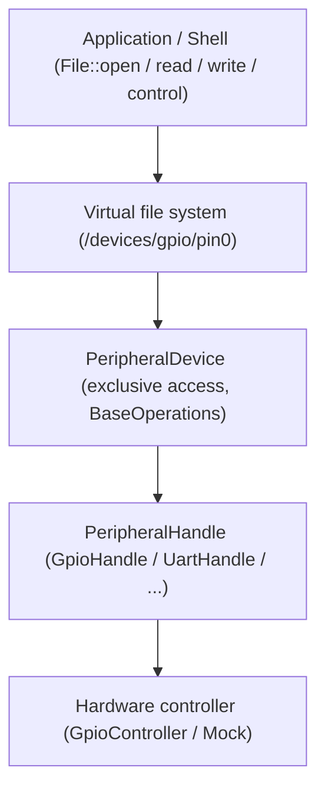

import CodeReference from "@/components/CodeReference.astro";
import Api from "@/components/Api.astro";

The <Api path="peripherals" /> library defines hardware-facing controller contracts. <Api path="drivers_peripherals" /> adapts these traits into character devices mounted in the virtual file system (VFS).

## Context

Microcontrollers provide hardware peripherals such as GPIO pins, ADCs, I2C buses, SPI buses, PWM channels, and UARTs. Direct hardware access ties application logic to specific register maps and board SDKs.

Xila decouples peripheral operations into two architectural layers:

1. **Controller traits** (<Api path="peripherals" />): pure Rust contracts based on the standard `embedded-hal` and `embedded-io` interfaces, with deterministic in-memory mocks for tests.
2. **VFS device adapters** (<Api path="drivers_peripherals" />): character-device wrappers that expose peripheral controllers under the `/devices/` path namespace for applications and command-line utilities.

## How it works

### Controller trait families

The `peripherals` crate groups hardware capabilities into modular features:

| Family | Controller trait | Ecosystem base         | Key types                                                                                    |
| ------ | ---------------- | ---------------------- | -------------------------------------------------------------------------------------------- |
| `adc`  | `AdcController`  | Xila contract          | `AdcChannelId`, `AdcChannelCapabilities`, `AdcResolution`                                    |
| `gpio` | `GpioController` | `embedded-hal` digital | `LineId`, `LineCapabilities`, `InputConfig`, `OutputConfig`, `PinState`, `Pull`, `DriveMode` |
| `i2c`  | `I2cController`  | `embedded-hal` I2C     | `I2cSpeed`, `I2cAddress`                                                                     |
| `pwm`  | `PwmController`  | `embedded-hal` PWM     | `PwmChannelId`, `PwmChannelCapabilities`                                                     |
| `spi`  | `SpiController`  | `embedded-hal` SPI     | `SpiMode`, `SpiBitOrder`                                                                     |
| `uart` | `UartController` | `embedded-io`          | `UartBaudRate`, `UartParity`, `UartStopBits`                                                 |

The `mock` feature provides deterministic, heap-free fixed-capacity mocks (`GpioMock<N>`, `AdcMock<N>`, `I2cMock<N>`, `PwmMock<N>`, `SpiMock<N>`, `UartMock<N>`) for unit tests and simulation without hardware.

### VFS peripheral adapter architecture

The `drivers_peripherals` crate adapts controller handles into VFS nodes. The following diagram illustrates how applications access peripherals through the VFS:



The adapter pipeline consists of two constructs:

1. <Api path="drivers_peripherals::PeripheralHandle" />: implemented by
   peripheral classes. Each method is a single synchronous attempt. If an
   operation would block, it returns `Error::RessourceBusy` instead of yielding
   or holding caller buffers.
2. <Api path="drivers_peripherals::PeripheralDevice" />: wraps a
   `PeripheralHandle` into a VFS character device. Opening is exclusive. While
   one file handle holds the peripheral open, other `open` calls return
   `Error::RessourceBusy` until the owning handle closes.

Mount helpers such as <Api path="drivers_peripherals::mount_peripheral" /> and `mount_gpio` mount adapters under standard paths such as `/devices/gpio/<name>`.

### GPIO device behavior and text read/write semantics

A mounted GPIO character device supports both binary I/O and typed control commands:

- **Core binary adapter** (<CodeReference path="drivers/peripherals/src/gpio.rs" />): `GpioHandle` exposes a single line handle. `read` writes one byte (`0` for low, `1` for high) to the caller buffer. It returns `Error::NotInitialized` if the pin is not configured. `write` accepts one byte (`0` or `1`). It rejects other byte values with `Error::InvalidParameter`, and it rejects writes on an input pin with `Error::UnsupportedOperation`.
- **Interactive shell text adapter** (such as `drivers_nordic` on the Arduino Nano 33 BLE): reads format the pin level as text `0\n` or `1\n` followed by an end-of-file condition, so shell utilities like `cat` terminate cleanly. Writes accept ASCII `0` or `1` with optional surrounding whitespace (`\r`, `\n`, spaces), or binary bytes `0` and `1`. Unconfigured pins auto-configure as input on read or push-pull output on write.

```text
# Read the current digital level:
cat /devices/gpio/d13
0

# Set the pin level:
echo 1 > /devices/gpio/d13
```

Typed control commands for pin reservation, direction, pull resistors, and electrical drive modes are defined by the `device` crate. For the complete command table and ABI specifications, see the [Device](/explanation/architecture/libraries/device/) documentation.

## Design choices and trade-offs

- **Exclusive device ownership**: only one task may hold an open handle to a peripheral device at a time. This prevents race conditions and pin contention without complex scheduling locks.
- **Borrowed controller handles**: controller trait methods borrow the controller and return scoped handles. Dropping a handle automatically releases the line back to the high-impedance state.
- **Immediate non-blocking execution**: peripheral methods run directly on the executor and never yield `Poll::Pending`. If a hardware bus or FIFO is unavailable, callers receive `Error::RessourceBusy` and manage retries.

## Limits

- `GpioController` reservations require explicit line release before reconfiguring a pin to a different mode.
- Advanced peripheral features such as DMA transfers, hardware interrupts, and analog triggering are managed by platform drivers outside the generic controller trait.

## API reference

- <Api path="peripherals" />: hardware controller traits and mocks.
- <Api path="drivers_peripherals" />: VFS peripheral adapters.
- <Api path="drivers_peripherals::PeripheralHandle" />: synchronous peripheral
  handle contract.
- <Api path="drivers_peripherals::PeripheralDevice" />: exclusive-access VFS
  device wrapper.
- <Api path="drivers_peripherals::mount_peripheral" />: peripheral node mounting
  helper.

## Related

- [Device](/explanation/architecture/libraries/device/)
- [File system](/explanation/architecture/libraries/file_system/)
- [Virtual file system](/explanation/architecture/subsystems/virtual_file_system/)
