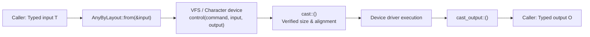

import CodeReference from "@/components/CodeReference.astro";
import HostReference from "@/components/HostReference.astro";

The `shared` crate provides cross-cutting foundational types, layout-based type erasure, bidirectional collections, unit conversion utilities, and shared HTTP types across the Xila workspace. It lives in the Core repository under `libraries/shared/`. The `xila` facade crate exposes it.

## Context

Subsystems, drivers, and libraries need shared primitives for type erasure across C-compatible boundaries, physical unit formatting, and bidirectional lookups. Instead of duplicating these utilities or creating circular dependencies, `shared` sits near the bottom of the dependency graph as a reusable, dependency-light foundation.

## How it works

### Layout-based type erasure with AnyByLayout

The <HostReference crate="shared" kind="struct" symbol="AnyByLayout" /> struct provides a borrowed, type-erased memory wrapper identified by byte size and memory alignment:

```rust
let value: u32 = 42;
let any = AnyByLayout::from(&value);
let recovered = any.cast::<u32>()?;
```

- `from(&value)` and `from_mutable(&mut value)`: Wrap live Rust references into an `AnyByLayout`.
- `cast::<T>()` and `cast_mutable::<T>()`: Verify that the layout size and pointer alignment match `T`. Return a typed reference.
- `from_raw_parts`: Construct a wrapper from a raw pointer, size, and alignment.

`AnyByLayout` underlies device control commands across the virtual file system (VFS). Drivers exchange typed command inputs and outputs through one uniform signature, without dynamic allocation or runtime type reflection.

### Bidirectional collections

The <HostReference crate="shared" kind="struct" symbol="BijectiveBTreeMap" /> struct maintains a one-to-one mapping between keys and values:

```rust
let mut map = BijectiveBTreeMap::new();
map.insert("name", 100);
assert_eq!(map.get_value(&"name"), Some(&100));
assert_eq!(map.get_key(&100), Some(&"name"));
```

Forward and reverse lookups both run in logarithmic time. They track state consistently in both directions, so no separate lookup tables are needed.

### Units, calendar, and slice utilities

The library provides several focused utility modules:

- Measurement units: The <HostReference crate="shared" kind="struct" symbol="Unit" /> struct handles quantities with metric and binary prefixes (`PREFIXES`, `BYTES_SUFFIX`, `BITS_SUFFIX`, `FREQUENCY_SUFFIX`).
- Calendar and time: Functions such as <HostReference crate="shared" kind="fn" symbol="decompose_unix_timestamp" /> convert Unix timestamps into calendar dates. They account for leap years via `is_leap_year` and month day counts via `days_in_month`.
- Slice operations: Utilities such as <HostReference crate="shared" kind="fn" symbol="align_slice_to" /> align raw memory slices to requested boundary constraints.
- UTF-8 handling: `utf8_chunks` provides safe iteration over segmented UTF-8 byte streams.
- HTTP re-exports: Re-exports request and response builders and parsers from the `xila_http` crate.

The following diagram shows how `AnyByLayout` bridges typed application control payloads and device drivers across the virtual file system:



The caller wraps a typed payload in an `AnyByLayout`. The virtual file system passes the layout reference to the driver's `control` handler. The driver verifies size and alignment via `cast`, processes the command, and writes the typed result into the output buffer.

## Design choices and trade-offs

- Layout-based type erasure: `AnyByLayout` avoids `core::any::Any`. This removes `'static` lifetime restrictions and compiler RTTI requirements, while still allowing safe borrowed memory passing.
- Dependency-light design: The crate depends only on `num`, `log`, and `xila_http`, minimizing compilation overhead.
- `no_std` with `alloc`: The crate runs on bare-metal and microcontroller targets and uses heap collections where necessary.

## Limits

- `AnyByLayout` validates only byte length and pointer alignment; it cannot check semantic type identity beyond layout compatibility.
- `BijectiveBTreeMap` requires both keys and values to implement `Ord` and `Clone`.

## API reference

- <HostReference crate="shared" />: package documentation and root exports.
- <HostReference crate="shared" kind="struct" symbol="AnyByLayout" />:
  layout-based type erasure container.
- <HostReference crate="shared" kind="struct" symbol="BijectiveBTreeMap" />:
  bidirectional one-to-one map.
- <HostReference crate="shared" kind="struct" symbol="Unit" />: unit and prefix
  conversion abstraction.
- <HostReference crate="shared" kind="fn" symbol="align_slice_to" />: byte slice
  alignment utility.
- <HostReference crate="shared" kind="fn" symbol="decompose_unix_timestamp" />:
  Unix timestamp to calendar date conversion.

## Related

- [Virtual file system](/explanation/architecture/subsystems/virtual_file_system/): Control command dispatch using layout erasure.
- [HTTP](/explanation/architecture/libraries/http/): HTTP request and response framing.
- [Device](/explanation/architecture/libraries/device/): Device control command definitions.
