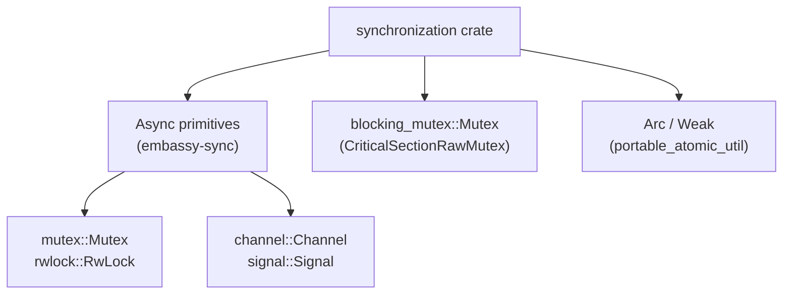

import CodeReference from "@/components/CodeReference.astro";
import Api from "@/components/Api.astro";

The `synchronization` crate standardizes synchronization primitives across Xila. It re-exports async synchronization tools from `embassy-sync` and the portable reference-counted pointers `Arc` and `Weak` from `portable_atomic_util`. It lives in the Core repository under `libraries/synchronization/`. The `xila` facade crate exposes it.

## Context

Xila runs on architectures from desktop x86_64 and 32-bit ARM Cortex-M processors with hardware atomics to microcontrollers without atomic pointer instructions. The `synchronization` crate provides a uniform `#![no_std]` interface. Subsystems and drivers use it to share state and synchronize tasks on all supported targets.

## How it works

### Cooperative async primitives

The crate re-exports concurrency tools from `embassy-sync`:

- Async mutexes: <Api path="synchronization::mutex::Mutex"><code>synchronization::mutex::Mutex</code></Api> provides a non-blocking async lock for asynchronous tasks.
- Reader-writer locks: `rwlock::RwLock` allows multiple readers or a single writer across tasks.
- Channels: `channel::Channel` supplies bounded async queues for inter-task communication.
- Signals: `signal::Signal` delivers one-shot notifications between producers and consumers.
- Synchronous critical sections: `blocking_mutex::Mutex` with `blocking_mutex::raw::CriticalSectionRawMutex` protects short synchronous sections inside interrupt handlers or driver routines.

### Portable reference counting

The <Api path="synchronization::Arc" /> and <Api path="synchronization::Weak" /> types are re-exports from `portable_atomic_util` (<CodeReference path="libraries/synchronization/src/arc/mod.rs" />). That crate provides atomic reference counting. A target without atomic compare-and-swap instructions, such as the ESP32-C2, ESP32-C3 and ESP32-S2, needs a backend from `portable-atomic`: the firmware must enable its `unsafe-assume-single-core` or `critical-section` feature. The `synchronization` crate does not select the backend.

The following diagram shows the categorization of synchronization primitives and the reference-counted pointer re-export:

The `embassy-sync` primitives coordinate cooperative tasks without blocking. The blocking mutexes protect critical sections. `Arc` and `Weak` come from `portable_atomic_util`, which adapts the reference counting to the target hardware.

## Design choices and trade-offs

- Cooperative async focus: `embassy-sync` primitives do not rely on OS thread preemption or kernel locks. They match Xila's cooperative task executor.
- Broad target compatibility: `portable_atomic_util` supplies `Arc` and `Weak` on targets with and without atomic compare-and-swap instructions. The firmware chooses the `portable-atomic` backend for the targets without them.
- Unified import path: Subsystems import all concurrency abstractions directly from `xila::synchronization`.

## Limits

- Do not hold an async mutex across CPU-intensive blocking work. This starves other tasks on the cooperative scheduler.
- On a target without atomic compare-and-swap instructions, the `portable-atomic` backend emulates the atomic operations. The backend can disable interrupts (`unsafe-assume-single-core`) or take a critical section (`critical-section`) while an `Arc` counter changes.

## API reference

- <Api path="synchronization" />: package documentation and root re-exports.
- <Api path="synchronization::Arc" />: shared reference-counted pointer.
- <Api path="synchronization::Weak" />: non-owning weak pointer to an `Arc`
  allocation.
- <Api path="synchronization::mutex::Mutex">
    <code>synchronization::mutex::Mutex</code>
  </Api>
  : cooperative async mutex.

## Related

- [Task](/explanation/architecture/subsystems/task/): Cooperative multitasking and executor execution.
- [Virtual file system](/explanation/architecture/subsystems/virtual_file_system/): Concurrent file access and device sharing.
