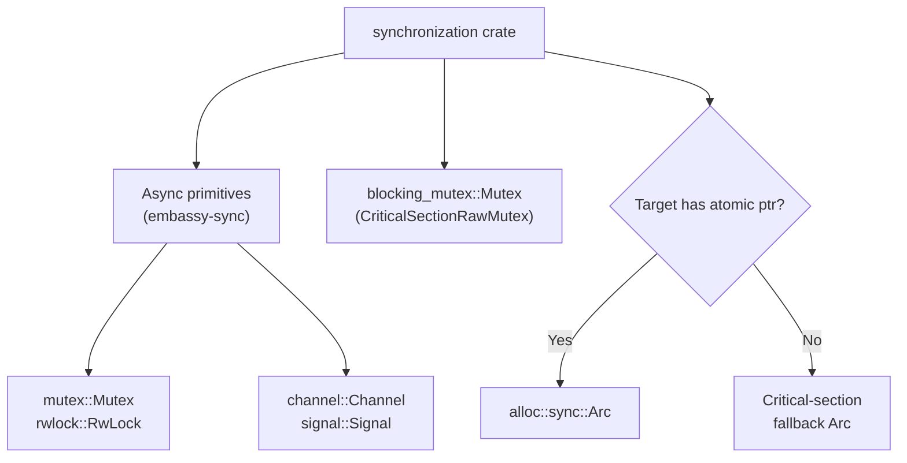

import CodeReference from "@/components/CodeReference.astro";
import HostReference from "@/components/HostReference.astro";

The `synchronization` crate standardizes synchronization primitives across Xila. It re-exports async synchronization tools from `embassy-sync` and provides portable reference-counted types (`Arc`, `Weak`) with a lock-backed fallback for targets lacking atomic pointer operations. It lives in the Core repository under `libraries/synchronization/`. The `xila` facade crate exposes it.

## Context

Xila runs on architectures from desktop x86_64 and 32-bit ARM Cortex-M processors with hardware atomics to microcontrollers without atomic pointer instructions. The `synchronization` crate provides a uniform `#![no_std]` interface. Subsystems and drivers use it to share state and synchronize tasks on all supported targets.

## How it works

### Cooperative async primitives

The crate re-exports concurrency tools from `embassy-sync`:

- Async mutexes: <HostReference crate="synchronization/mutex" kind="struct" symbol="Mutex"><code>synchronization::mutex::Mutex</code></HostReference> provides a non-blocking async lock for asynchronous tasks.
- Reader-writer locks: `rwlock::RwLock` allows multiple readers or a single writer across tasks.
- Channels: `channel::Channel` supplies bounded async queues for inter-task communication.
- Signals: `signal::Signal` delivers one-shot notifications between producers and consumers.
- Synchronous critical sections: `blocking_mutex::Mutex` with `blocking_mutex::raw::CriticalSectionRawMutex` protects short synchronous sections inside interrupt handlers or driver routines.

### Portable reference counting

The <HostReference crate="synchronization" kind="struct" symbol="Arc" /> and <HostReference crate="synchronization" kind="struct" symbol="Weak" /> types provide target-adapted reference counting:

- When `target_has_atomic = "ptr"`: The crate directly re-exports `alloc::sync::{Arc, Weak}`.
- When `not(target_has_atomic = "ptr")`: The crate provides a custom fallback implementation. The allocation is stored in an `ArcInner<T>` on the heap. A critical-section raw mutex and interior-mutable reference counters protect it.

Both variants expose the same public API: `Arc::new`, `clone`, `downgrade`, `Weak::upgrade`, `strong_count`, `weak_count`, `get_mut`, and `ptr_eq`. The fallback panics on reference count overflow.

The following diagram shows the categorization of synchronization primitives and the target-gated `Arc` implementation:

The `embassy-sync` primitives coordinate cooperative tasks without blocking. The blocking mutexes protect critical sections. `Arc` selects atomic reference counting or the critical-section fallback based on the target hardware.

## Design choices and trade-offs

- Cooperative async focus: `embassy-sync` primitives do not rely on OS thread preemption or kernel locks. They match Xila's cooperative task executor.
- Broad target compatibility: The critical-section `Arc` fallback compiles and runs safely on microcontrollers without atomic pointer instructions. No hardware emulation is required.
- Unified import path: Subsystems import all concurrency abstractions directly from `xila::synchronization`.

## Limits

- Do not hold an async mutex across CPU-intensive blocking work. This starves other tasks on the cooperative scheduler.
- On platforms without atomic pointer instructions, cloning or dropping an `Arc` briefly disables interrupts during reference counter modification.

## API reference

- <HostReference crate="synchronization" />: package documentation and root
  re-exports.
- <HostReference crate="synchronization" kind="struct" symbol="Arc" />: shared
  reference-counted pointer.
- <HostReference crate="synchronization" kind="struct" symbol="Weak" />:
  non-owning weak pointer to an `Arc` allocation.
- <HostReference crate="synchronization/mutex" kind="struct" symbol="Mutex">
    <code>synchronization::mutex::Mutex</code>
  </HostReference>
  : cooperative async mutex.

## Related

- [Task](/explanation/architecture/subsystems/task/): Cooperative multitasking and executor execution.
- [Virtual file system](/explanation/architecture/subsystems/virtual_file_system/): Concurrent file access and device sharing.
