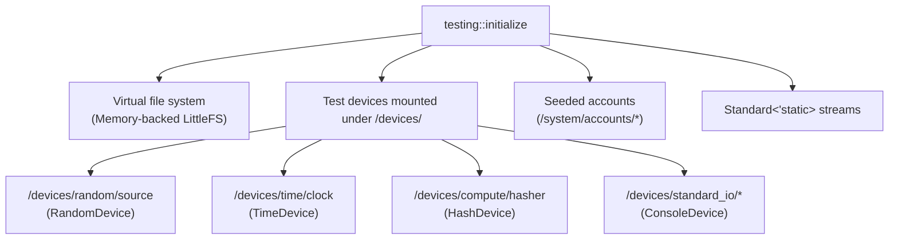

import CodeReference from "@/components/CodeReference.astro";
import HostReference from "@/components/HostReference.astro";

The `testing` crate provides minimal `std` test infrastructure for Xila unit and integration tests without requiring platform drivers or physical hardware. It lives in the Core repository under `libraries/testing/` and is published as the `xila-testing` package.

## Context

Testing operating system components such as the virtual file system, task manager, and executables on host developer machines requires real OS abstractions (time, randomness, storage, console streams, and cryptography) without binding to physical target peripherals or desktop window managers. The `testing` crate provides mock devices and a complete in-memory environment bootstrap that runs tests quickly and deterministically in CI pipelines.

## How it works

### Test harness devices

The crate provides lightweight, deterministic character devices:

- <HostReference crate="testing" kind="struct" symbol="TimeDevice" />: Mock
  clock implementing `DirectCharacterDevice`. Responds to `GET_SYSTEM_TIME`
  control commands and reads microsecond timestamps from host system time.
- <HostReference crate="testing" kind="struct" symbol="RandomDevice" />: Entropy
  source implementing `DirectCharacterDevice`. Fills byte buffers using the host
  `getrandom` crate.
- <HostReference crate="testing" kind="enum" symbol="ConsoleDevice" />:
  Implements `DirectCharacterDevice` with `Input`, `Output`, and `Error`
  variants, routing standard I/O through host standard input, output, and error
  streams.
- <HostReference crate="testing" kind="struct" symbol="HashDevice" />:
  Cryptographic hash device implementing `DirectCharacterDevice`. Handles the
  `SET_ALGORITHM` control command (supporting SHA-256 and SHA-512 via the `sha2`
  crate), streams input data into the internal hash state, and outputs the
  digest upon read.
- <HostReference crate="testing" kind="struct" symbol="Logger" />: Simple logger
  implementing the `log::Log` trait.
- <HostReference crate="testing" kind="struct" symbol="MemoryManager" />:
  In-memory heap manager backed by `std::alloc::System`.
- <HostReference crate="testing" kind="struct" symbol="HeadlessScreenDevice" />:
  800×600 pixel in-memory frame buffer (enabled by the `graphics` Cargo feature)
  implementing graphics device operations without creating host desktop windows.

### In-memory environment bootstrap

With the `environment` Cargo feature enabled, the <HostReference crate="testing" kind="fn" symbol="initialize" /> function sets up a complete in-memory Xila instance:

```rust
pub async fn initialize(
    graphics_enabled: bool,
    network_enabled: bool,
) -> Standard<'static>
```

The bootstrap procedure executes sequentially:

1. Initializes logging with `Logger`.
2. Creates task manager, users manager, and time manager instances.
3. If `graphics_enabled` is true, constructs a `HeadlessScreenDevice` (800×600) and spawns the background graphics loop task.
4. Formats an in-memory LittleFS file system on a `MemoryDevice::<512>::new_static(1024 * 512)` (512 KiB block device with 256-byte blocks) and initializes the virtual file system.
5. Populates the default directory hierarchy via `create_default_hierarchy`.
6. Mounts mock character devices into the VFS:
   - `/devices/random/source` (`RandomDevice`)
   - `/devices/standard_io/input` (`ConsoleDevice::Input`)
   - `/devices/standard_io/output` (`ConsoleDevice::Output`)
   - `/devices/standard_io/error` (`ConsoleDevice::Error`)
   - `/devices/time/clock` (`TimeDevice`)
   - `/devices/standard_io/null` (`drivers_core::NullDevice`)
   - `/devices/compute/hasher` (`HashDevice`)
7. If `network_enabled` is true, initializes the network manager without physical network interfaces or active HTTP clients.
8. Seeds the default `administrator` group and user (identifier 1000) with an empty password.
9. Sets default environment variables `Paths` = `/` and `Host` = `xila`.
10. Opens and returns `Standard<'static>` streams bound to `/devices/standard_io/*`.

### Host file injection

The <HostReference crate="testing" kind="fn" symbol="load_file" /> helper copies a file from the host filesystem into the virtual file system, truncating any existing file at the destination path.

The following diagram shows the in-memory test environment initialized by `initialize`:



The initializer formats an in-memory LittleFS instance, constructs standard directory structures, mounts mock hardware devices under `/devices/`, provisions the initial administrator account under `/system/accounts/`, and opens standard streams for caller execution.

## Design choices and trade-offs

- Pure in-memory execution: LittleFS runs in memory and the display buffer is an offscreen bitmap, ensuring tests execute quickly and without modifying host files or opening host windows.
- Deterministic CI tests: Decouples core testing from platform audio hardware, Wi-Fi adapters, or display servers.
- Fast-fail assertions: `initialize` uses explicit assertions and unwraps to report misconfigurations immediately during test bootstrap.

## Limits

- Requires `std` and is intended exclusively for host tests, not embedded deployment targets.
- `network_enabled` initializes a network manager without physical network interfaces or active HTTP socket clients; network driver tests belong to platform integration tests.

## API reference

- <HostReference crate="testing" />: package documentation and root exports.
- <HostReference crate="testing" kind="fn" symbol="initialize" />: bootstraps
  the complete in-memory test environment.
- <HostReference crate="testing" kind="fn" symbol="load_file" />: copies a host
  file into the in-memory virtual file system.
- <HostReference crate="testing" kind="struct" symbol="TimeDevice" />: mock
  clock character device.
- <HostReference crate="testing" kind="struct" symbol="RandomDevice" />: mock
  entropy character device.
- <HostReference crate="testing" kind="struct" symbol="HashDevice" />: mock
  cryptographic hash character device.
- <HostReference crate="testing" kind="struct" symbol="HeadlessScreenDevice" />:
  off-screen 800×600 framebuffer screen device.

## Related

- [Executable](/explanation/architecture/libraries/executable/): Program execution and standard stream handling.
- [Virtual file system](/explanation/architecture/subsystems/virtual_file_system/): File system and device hierarchy.
- [Authentication](/explanation/architecture/libraries/authentication/): User account seeding and persistence.
