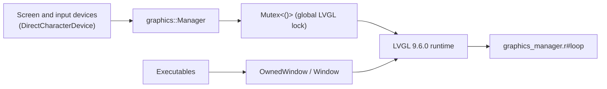

import CodeReference from "@/components/CodeReference.astro";
import DocsRsReference from "@/components/DocsRsReference.astro";
import Api from "@/components/Api.astro";

The graphics subsystem coordinates display rendering, input handling, and window management. It hosts LVGL 9.6.0. It exposes thread-safe abstractions that bridge platform-specific character devices to graphical interface windows.

## Context

Embedded graphical user interfaces need efficient drawing primitives without coupling applications to concrete display hardware. The <Api path="graphics" /> encapsulates <DocsRsReference crate="lvgl" /> version 9.6.0. It coordinates platform display drivers that implement direct character device traits, physical and synthetic input devices, and user-space application windows.

## How it works

### Runtime architecture and LVGL integration

The following diagram shows how the graphics manager coordinates platform devices, the LVGL engine, and application windows.

The <Api path="graphics::Manager" /> struct keeps display descriptors and registered input devices in an internal read-write lock. LVGL is written in C and keeps process-global state. A central mutex (`global_lock`) therefore guards every interaction with LVGL.

The runtime initializes graphics by calling <Api path="graphics::initialize_with_input_devices" /> with a time manager reference, a display device, and input devices. It registers a static pointer through `graphics::set_ffi_manager` so that C callbacks can reach the manager instance without carrying Rust references.

### Display and input loop

Rendering and event processing run inside a dedicated asynchronous task via `Manager::r#loop`:

1. The loop acquires the global LVGL lock.
2. It executes `lvgl::lv_timer_handler()` to process animations, layouts, and dirty display regions.
3. Every 30 iterations, the manager calls `check_for_resizing()` on active displays to handle window resizes.
4. The loop releases the lock and pauses execution for the duration returned by LVGL using the provided sleep function.

Physical inputs such as touchscreens, mice, and keyboards implement `DirectCharacterDevice` and are registered as either pointer or keypad devices. The manager also installs internal queues for synthetic input injection during automated testing.

### Window management

Executables create visual interfaces by calling `create_window()`, which returns an <Api path="graphics::OwnedWindow" />:

- The window wraps an underlying LVGL object (`lv_obj_t`).
- It captures LVGL events and transforms them into typed Xila events.
- Dropping an `OwnedWindow` automatically destroys its corresponding LVGL object and clears associated event queues.

### Typography and font variants

Fonts are compiled into C archive members through the `selected_fonts!` macro using the `XILA_FONT_VARIANT` compile-time environment variable. The subsystem provides two primary font families:

- **Montserrat**: proportional typeface provided in sizes 10, 14, 18, and 28 points (`get_font_small()`, `get_font_medium()`, `get_font_large()`, and `get_font_extra_large()`).
- **Unscii**: bitmap monospace typeface provided in sizes 8 and 16 points (`get_font_monospace_small()` and `get_font_monospace_medium()`).

## Design choices and trade-offs

- **Centralized global lock**: LVGL is not re-entrant. Serializing all calls through `global_lock` protects against data races across asynchronous tasks.
- **Configurable color depth**: Cargo features `rendering_rgb565` and `rendering_xrgb8888` select between 16-bit color for microcontrollers and 32-bit color for desktop and browser runtimes.
- **Direct character devices**: screens and input devices are treated as character devices, keeping the graphics engine decoupled from platform bus protocols.

## Limits

- Screen snapshots are capped at `SCREEN_SNAPSHOT_MAX_PIXELS` (64,000,000 pixels). This avoids unbounded memory allocations.
- Font variants must be selected at compile time. Loading dynamic TrueType or OpenType fonts at runtime is not supported.

## API reference

- <Api path="graphics" /> - crate root and common type aliases.
- <Api path="graphics::Manager" /> - main graphics manager.
- <Api path="graphics::OwnedWindow" /> - owned window handle.
- <Api path="graphics::initialize_with_input_devices" />- primary initialization
  entry point.

## Related

- [Virtual file system](/explanation/architecture/subsystems/virtual_file_system/) - device mounting under `/devices/`.
- [Task](/explanation/architecture/subsystems/task/) - task execution and timer scheduling.
- [Time](/explanation/architecture/subsystems/time/) - tick sources and animation timing.
