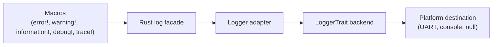

import CodeReference from "@/components/CodeReference.astro";
import HostReference from "@/components/HostReference.astro";

The log subsystem provides a unified logging facade across Xila. It routes messages from standard logging macros through severity-filtering logic to an installed platform backend.

## Context

Kernel subsystems, libraries, and executables need structured log output without hard-coded output channels such as UART, a serial console, or standard error. The <HostReference crate="log" /> crate adapts the standard Rust `log` crate to Xila's <HostReference crate="log" kind="trait" symbol="LoggerTrait" /> contract.

## How it works

### Architecture and message flow

The following diagram shows the path of a log record from emission to the platform backend.

A log record passes through four stages:

1. Subsystems and executables invoke standard logging macros: `error!`, `warning!`, `information!`, `debug!`, or `trace!`.
2. The macros invoke the external Rust `log` crate, which checks the current maximum severity filter.
3. If enabled, the record passes to Xila's internal `Logger` adapter stored in `LOGGER_INSTANCE`.
4. The adapter converts the record into a Xila <HostReference crate="log" kind="struct" symbol="Record" /> and forwards it to the active `LoggerTrait` implementation.

### Severity levels and formatting

The subsystem sorts log messages into five levels in <HostReference crate="log" kind="enum" symbol="Level" />:

- `Level::Error` (tag `E`): critical failures and unrecoverable errors.
- `Level::Warn` (tag `W`): abnormal conditions that do not immediately halt execution.
- `Level::Info` (tag `I`): informational status updates during boot and operation.
- `Level::Debug` (tag `D`): detailed diagnostic information for debugging.
- `Level::Trace` (tag `T`): low-level tracing events.

The default `LoggerTrait::log` implementation formats records with ANSI color codes, severity tags, target module names, and formatted argument text before invoking `write`.

### Initialization and lifetime

During boot, the target platform registers its backend by calling <HostReference crate="log" kind="fn" symbol="initialize" /> with a static reference to its logger implementation (for example, `drivers_std::log::Logger` on native platforms). After registration, the maximum filter level is trace. The backend controls runtime filtering.

## Design choices and trade-offs

- **Zero-allocation records**: the `Record` structure references borrowed string slices and `core::fmt::Arguments`, avoiding heap allocations in `no_std` environments.
- **Static backend dispatch**: using `OnceLock` and a static trait reference keeps logging accessible from any execution context without passing manager instances.
- **Compatibility with standard macros**: re-exporting standard logging macros maintains familiar Rust idioms throughout all repositories.

## Limits

- The logging backend can be initialized only once. Later calls to `log::initialize` fail.
- The default handler formats log messages with ANSI escape sequences. Strip them when redirecting output to raw binary storage.

## API reference

- <HostReference crate="log" /> - crate root and re-exported macros.
- <HostReference crate="log" kind="trait" symbol="LoggerTrait" /> - interface
  required for platform logger implementations.
- <HostReference crate="log" kind="enum" symbol="Level" /> - severity level
  enumeration.
- <HostReference crate="log" kind="struct" symbol="Record" /> - structured log
  message container.
- <HostReference crate="log" kind="fn" symbol="initialize" /> - registers the
  platform logger backend.

## Related

- [Task](/explanation/architecture/subsystems/task/) - task execution and logging integration.
- [Time](/explanation/architecture/subsystems/time/) - timestamping and monotonic uptime.
- [Virtual file system](/explanation/architecture/subsystems/virtual_file_system/) - standard I/O device nodes.
