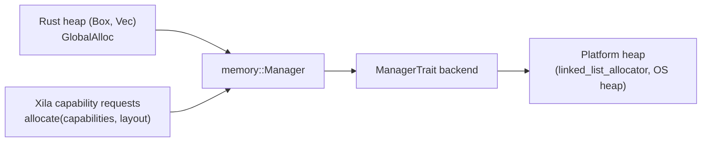

import CodeReference from "@/components/CodeReference.astro";
import Api from "@/components/Api.astro";

The memory subsystem provides a portable allocation abstraction for embedded targets, native operating systems, and WebAssembly environments. It decouples memory requests from target-specific heap algorithms and adapts them to Rust's global allocator interface.

## Context

Different hardware platforms have diverse physical memory layouts. Microcontrollers often separate internal high-speed SRAM from external PSRAM. Only specific memory ranges support Direct Memory Access (DMA) or instruction execution. Desktop operating systems use virtual memory paging instead.

The <Api path="memory" /> abstracts these constraints. It defines what an allocation request requires, not how the heap is managed. Target platforms provide concrete allocators that fulfill the <Api path="memory::ManagerTrait" /> contract. Xila exposes the contract to standard Rust data structures and to specialized subsystem allocators.

## How it works

### Memory manager and capability flags

The following diagram shows how general and capability-specific allocation requests flow to the platform memory backend.

Allocation requests reach the subsystem through two channels:

1. **Standard Rust allocations**: collections such as `Box`, `Vec`, and `String` allocate via Rust's `GlobalAlloc` trait. The <Api path="memory::Manager" /> translates these calls into `ManagerTrait::allocate` with empty capability requirements.
2. **Capability-specific requests**: subsystems that need specialized memory call `Manager::allocate` directly. They pass a `core::alloc::Layout` and <Api path="memory::CapabilityFlags" />.

The subsystem defines two capability flags:

- `CapabilityFlags::Executable`: memory configured with execute permissions, required for dynamic code generation or machine code loaders.
- `CapabilityFlags::DirectMemoryAccess`: memory accessible by hardware peripheral DMA controllers, avoiding cache-coherency hazards.

### Allocator instantiation

Platform crates implement `ManagerTrait` and instantiate the global allocator using platform macros:

- In native desktop targets, `drivers_std::memory::instantiate_global_allocator!()` hooks into the host operating system allocator.
- In microcontroller targets, `drivers_espressif` or bare-metal drivers initialize a `linked_list_allocator` or heap partition table before runtime startup.

## Design choices and trade-offs

- **Trait-based abstraction**: separating the allocator contract from Core lets you switch memory managers without modifying operating system logic.
- **Unsafe trait contract**: all methods in `ManagerTrait` (`allocate`, `deallocate`, `reallocate`) are marked `unsafe` because incorrect pointers or layouts can cause undefined behavior.
- **Null-safe zero-size allocations**: requests with a layout size of zero return a null pointer immediately without querying the backend allocator.

## Limits

- The memory manager does not compact memory or collect garbage. The underlying platform allocator must manage fragmented heaps.
- Microcontroller targets with bounded physical RAM return null when heap capacity is exhausted.

## API reference

- <Api path="memory" /> - crate root and Layout type alias.
- <Api path="memory::Manager" /> - memory manager adapting `ManagerTrait` to
  `GlobalAlloc`.
- <Api path="memory::ManagerTrait" /> - interface implemented by platform heap
  managers.
- <Api path="memory::CapabilityFlags" /> - flags defining allocation constraints
  such as DMA or execution.

## Related

- [Task](/explanation/architecture/subsystems/task/) - task execution and heap usage.
- [Virtual file system](/explanation/architecture/subsystems/virtual_file_system/) - buffer allocation for file operations.
- [Drivers std](/explanation/architecture/drivers/std/) - host memory allocator implementation.
