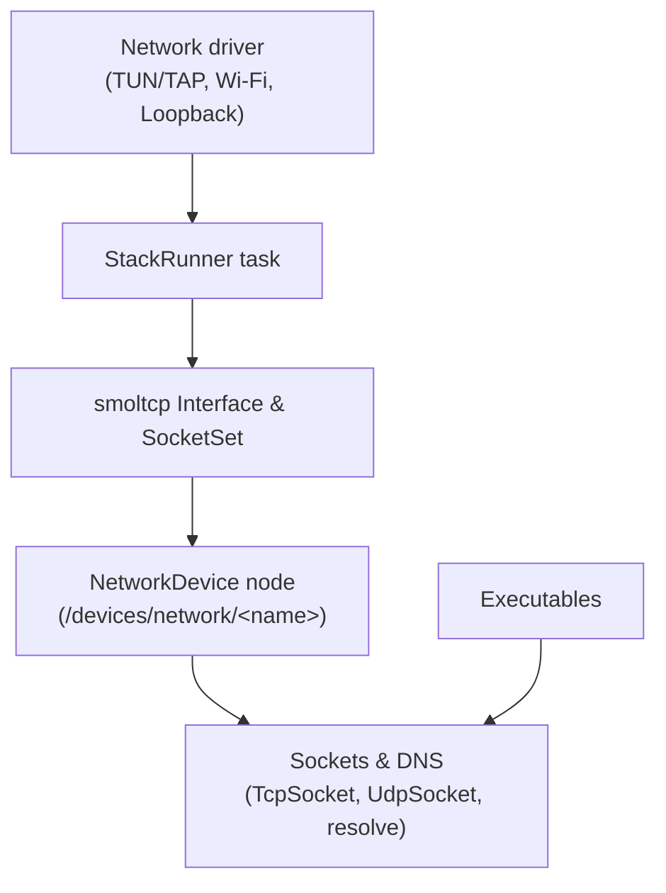

import CodeReference from "@/components/CodeReference.astro";
import DocsRsReference from "@/components/DocsRsReference.astro";
import HostReference from "@/components/HostReference.astro";

The network subsystem coordinates TCP/IP networking across physical and virtual interfaces using smoltcp. It exposes socket endpoints, asynchronous DNS resolution, and interface management through virtual file system device nodes.

## Context

Embedded systems need an efficient, deterministic networking stack that operates without standard library socket primitives. The <HostReference crate="network" /> crate integrates <DocsRsReference crate="smoltcp" /> to provide IPv4/IPv6 networking, DHCP, TCP, UDP, and ICMP support in `no_std` environments.

Network interfaces appear as device files in the virtual file system, allowing applications to configure addresses and routes through typed control commands while socket abstractions provide asynchronous network I/O.

## How it works

### smoltcp integration and interface runners

The following diagram shows the relationship between hardware drivers, smoltcp stacks, interface runners, and application sockets.



Networking is managed through the <HostReference crate="network" kind="struct" symbol="Manager" /> struct. Calling `mount_interface` registers a network driver fulfilling smoltcp's `Device` trait:

1. The manager constructs an internal `Stack` wrapping a smoltcp `Interface` and `SocketSet`.
2. It spawns a background `StackRunner` task that polls the network device, handles incoming packets, and services timers.
3. It mounts a `NetworkDevice` at `/devices/network/<name>` in the virtual file system.
4. A shared `WakeSignal` wakes the runner whenever sockets request packet transmission.

### Sockets and DNS resolution

Applications interact with network connections through high-level socket structures:

- <HostReference crate="network" kind="struct" symbol="TcpSocket" />: provides
  asynchronous TCP streams with connect, listen, read, and write operations.
- <HostReference crate="network" kind="struct" symbol="UdpSocket" />: provides
  datagram-oriented communication with bind, send, and receive methods.
- `IcmpSocket`: sends and receives ICMP echo packets for connectivity checks and ping utilities.
- **DNS resolution**: calling `Manager::resolve` performs asynchronous domain name lookups against configured DNS servers using smoltcp's DNS client socket.

### Interface configuration via control commands

Network interfaces are configured by sending typed control commands to their `/devices/network/<name>` device nodes in the virtual file system:

- `ADD_IP_ADDRESS` and `REMOVE_IP_ADDRESS`: configure IPv4 and IPv6 Classless Inter-Domain Routing (CIDR) addresses.
- `ADD_ROUTE` and `REMOVE_ROUTE`: manage gateway routing entries.
- `ADD_DNS_SERVER` and `REMOVE_DNS_SERVER`: configure resolver IP addresses.

### Feature configuration and platform enablement

In the `xila` façade crate, networking is gated behind the `network` Cargo feature:

```toml
[features]
default = ["abi_definitions", "network"]
network = ["dep:network", "executable/network"]
```

The feature is enabled by default in the root `xila` crate. Platforms choose whether to activate it:

- Microcontroller targets with constrained flash can disable default features to omit the entire networking subsystem and smoltcp dependency.
- On desktop platforms, runtime networking is activated using command-line flags (such as `--networking` in `examples/native`). When enabled, the platform creates a host TUN/TAP interface, mounts it as `tunnel0`, and configures standard IP addresses, routes, and DNS servers.

## Design choices and trade-offs

- **smoltcp in no_std**: smoltcp operates without heap allocations for packet buffers if desired, making it safe for microcontrollers without virtual memory.
- **Virtual file system interface**: managing network interfaces as files maintains architectural consistency with standard devices.
- **Asynchronous runner**: packet polling runs as an independent cooperative task, preventing network I/O from blocking user interface threads.

## Limits

- Socket sets use fixed capacities per interface stack to bound memory consumption.
- Domain name resolution requires at least one configured and reachable DNS server; local hosts file resolution is not supported.

## API reference

- <HostReference crate="network" /> - crate root and type re-exports.
- <HostReference crate="network" kind="struct" symbol="Manager" /> - network
  subsystem manager.
- <HostReference crate="network" kind="struct" symbol="TcpSocket" /> -
  asynchronous TCP stream handle.
- <HostReference crate="network" kind="struct" symbol="UdpSocket" /> -
  asynchronous UDP datagram handle.
- <HostReference crate="network" kind="fn" symbol="initialize" /> - constructs
  the network manager instance.

## Related

- [Virtual file system](/explanation/architecture/subsystems/virtual_file_system/) - device mounting and control command dispatch.
- [Task](/explanation/architecture/subsystems/task/) - background runner task scheduling.
- [Time](/explanation/architecture/subsystems/time/) - network timeout and retransmission timebase.
