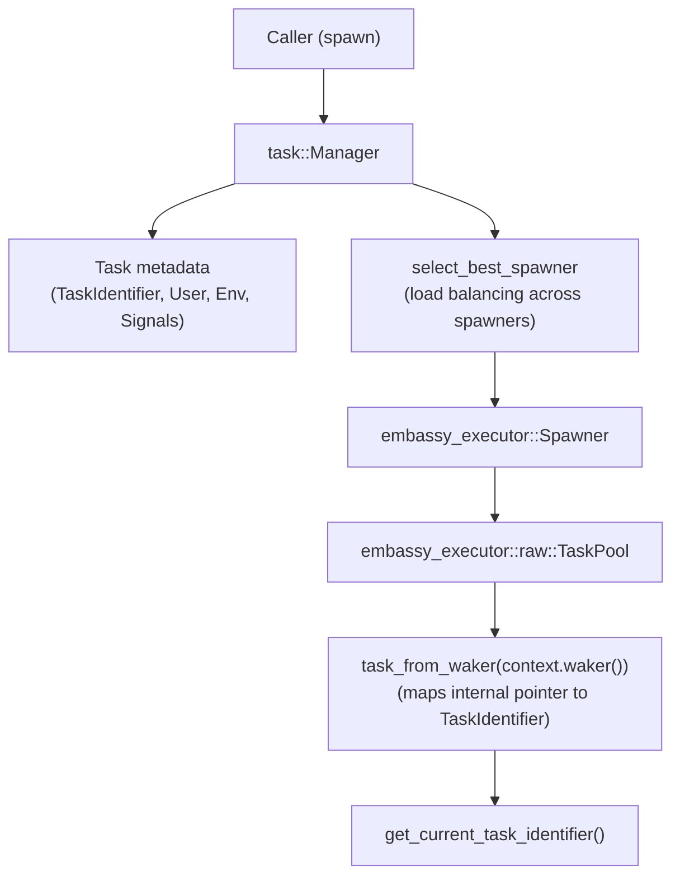

import CodeReference from "@/components/CodeReference.astro";
import DocsRsReference from "@/components/DocsRsReference.astro";
import HostReference from "@/components/HostReference.astro";

The task subsystem manages asynchronous execution, task identity, and lifecycle tracking. It pairs Embassy's cooperative task pools with system-level metadata such as user credentials, environment variables, and parent-child relationships.

## Context

An embedded operating system needs more than a raw future executor: it must track which task initiated an I/O operation, enforce user access controls, pass environment variables, and deliver inter-task signals. The <HostReference crate="task" /> crate bridges logical task abstractions with <DocsRsReference crate="embassy-executor" /> spawners.

## How it works

### Task and executor model

The following diagram shows how the task manager coordinates Embassy executors and logical task metadata.

The <HostReference crate="task" kind="struct" symbol="Manager" /> maintains registered tasks and active spawners inside an internal read-write lock:

1. **Task registration**: calling `Manager::spawn` creates a logical task entry and assigns a unique <HostReference crate="task" kind="struct" symbol="TaskIdentifier" />.
2. **Spawner selection**: if no specific spawner identifier is supplied, `select_best_spawner` counts active tasks assigned to each registered Embassy spawner and selects the spawner with the lowest task count.
3. **Task allocation**: the manager allocates an Embassy `TaskPool` dynamically and issues a spawn token to the chosen spawner.
4. **Waker-based identity recovery**: once executing, `get_current_internal_identifier()` inspects the current future's waker using `task_from_waker(context.waker())`. The manager maps this memory address back to the logical `TaskIdentifier`.

This waker-based lookup allows file system and permissions logic to determine the calling task without requiring thread-local storage or explicit handle arguments in every function call.

### Task lifecycle and join handles

Calling `spawn` returns both a `TaskIdentifier` and a typed <HostReference crate="task" kind="struct" symbol="JoinHandle" />:

- When a task completes its asynchronous closure, it signals the join handle with its return value.
- The manager automatically unregisters the completed task, freeing its metadata.
- If the terminating task spawned child tasks, the manager reparents those orphaned children to `TaskIdentifier::ROOT_TASK_IDENTIFIER`.

### Cooperative execution and yielding

Tasks execute cooperatively on single-threaded or multi-threaded Embassy executors:

- Calling <HostReference crate="task" kind="fn" symbol="yield_now" /> yields execution to other pending tasks in the executor queue.
- Calling <HostReference crate="task" kind="fn" symbol="sleep" /> suspends the task for a specified duration using `embassy_time::Timer`.

## Design choices and trade-offs

- **Waker-based context**: resolving identity through waker pointers makes logical task contexts available in `no_std` environments without runtime operating system threads.
- **Multiple spawner support**: registering multiple spawners allows dual-core microcontrollers and multi-threaded desktop targets to distribute asynchronous tasks across execution threads.
- **Cooperative scheduling**: cooperative multitasking removes the need for complex kernel preemptive locking. A task that performs heavy synchronous computation without yielding can starve other futures.

## Limits

- Futures must yield periodically. Tight synchronous loops block other tasks on the same Embassy executor.
- Task identifiers cannot exceed the bounds of `TaskIdentifierInner` (`u64`).

## API reference

- <HostReference crate="task" /> - crate root and common type aliases.
- <HostReference crate="task" kind="struct" symbol="Manager" /> - task subsystem
  manager.
- <HostReference crate="task" kind="struct" symbol="TaskIdentifier" /> - stable
  unique task identifier.
- <HostReference crate="task" kind="struct" symbol="JoinHandle" /> -
  asynchronous completion handle.
- <HostReference crate="task" kind="fn" symbol="yield_now" /> - cooperatively
  yields execution.
- <HostReference crate="task" kind="fn" symbol="sleep" /> - sleeps for a given
  duration.

## Related

- [Virtual file system](/explanation/architecture/subsystems/virtual_file_system/) - caller task authorization.
- [Users](/explanation/architecture/subsystems/users/) - task user and group ownership.
- [Time](/explanation/architecture/subsystems/time/) - Embassy time driver integration.
